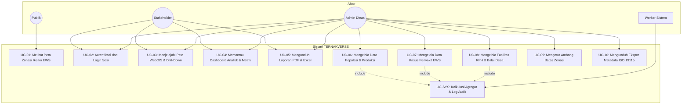
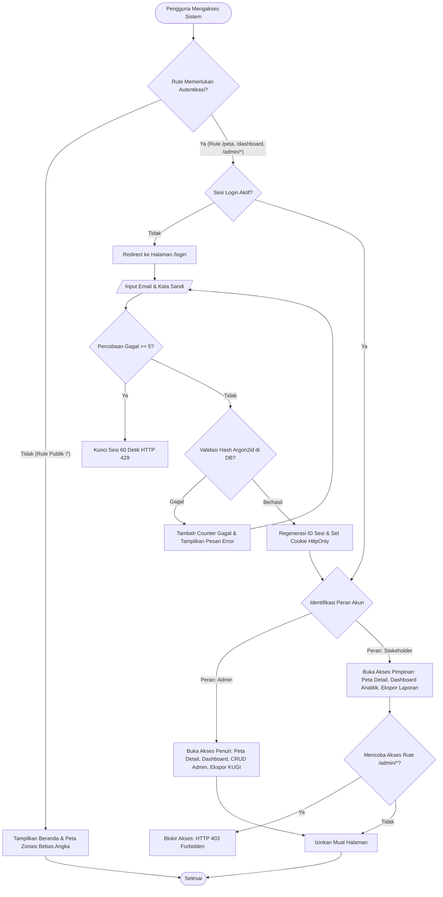
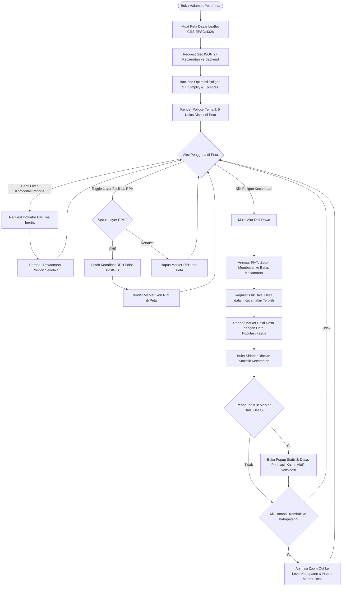
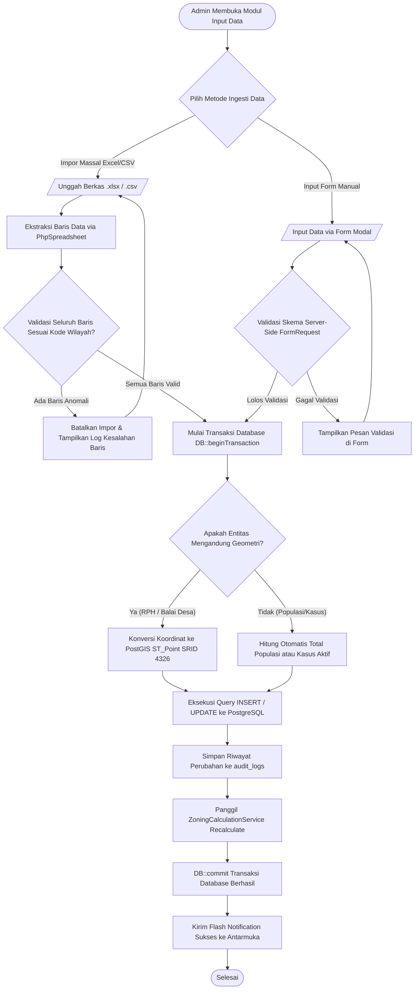
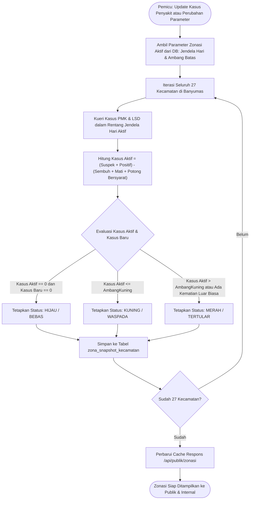
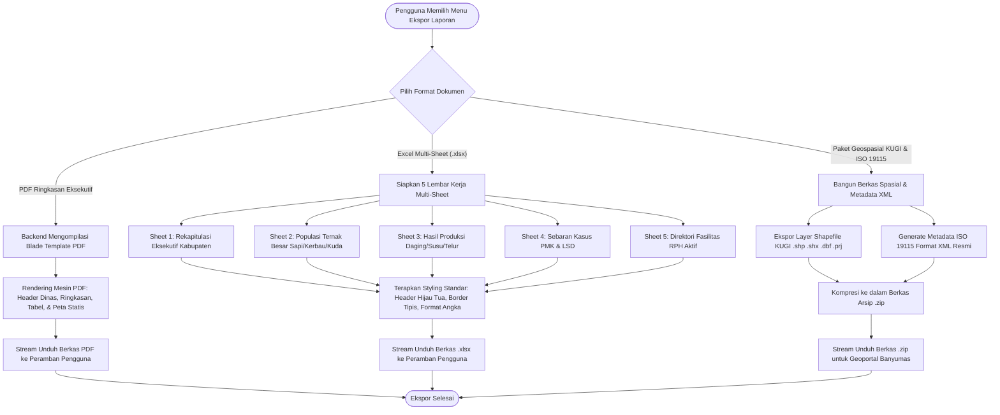

# Product Requirements Document (PRD) & Software Requirements Specification (SRS)
# TERNAKVERSE — WebGIS Peternakan Kabupaten Banyumas

**Fase 1: Sistem Pemetaan Peternakan Interaktif, Visualisasi Spasial, Dashboard Analitik Pendukung Keputusan, dan Monitoring Penyakit Hewan**

---

## Kendali Dokumen

| Atribut | Keterangan |
|---|---|
| **Nama Produk / Sistem** | **TERNAKVERSE** (*Sistem Pemetaan Peternakan Interaktif Berbasis WebGIS*) |
| **Jenis Dokumen** | Product Requirements Document (PRD) & Software Requirements Specification (SRS) |
| **Versi Dokumen** | **2.0 (Comprehensive Engineering & Development Specification)** |
| **Tanggal Pembaruan** | 13 Oktober 2026 |
| **Fase Pengembangan** | Fase 1 (Visualisasi Spasial, Dashboard Analitik, EWS Terbatas, dan Pelaporan Terstandarisasi) |
| **Program Kerja** | Computing Project (ComPro) & Pengabdian kepada Masyarakat (Informatika untuk Masyarakat / IUM) |
| **Institusi Akademik** | Program Studi S-1 Teknik Informatika, Direktorat Kampus Purwokerto, Universitas Telkom |
| **Instansi Mitra** | Dinas Pertanian dan Ketahanan Pangan Kabupaten Banyumas — Bidang Peternakan, Kesehatan Hewan, dan Kesmavet |
| **Alamat Mitra** | Jl. Prof. Dr. Soeharso (Komplek GOR Satria) No. 45 Purwokerto 53114 |
| **Pimpinan Mitra** | Kusbiono Jumadi Rahman, S.Pt., M.Pt. (Kepala Bidang Peternakan, Keswan, dan Kesmavet) |
| **Dosen Pembimbing** | Dosen Pembimbing Akademik IUM & Supervisor ComPro (Bu Annisaa dkk.) |
| **Status Dokumen** | Diselaraskan dengan KAK Geospasial Peternakan 2026 & Draf Proposal IUM Kelompok 1 |
| **Standar Acuan Rekayasa** | ISO/IEC/IEEE 29148:2018 (Requirements Engineering), ISO/IEC 25010 (Product Quality), KUGI (Katalog Unsur Geografi Indonesia), ISO 19115 (Metadata Geospasial) |

---

## Riwayat Revisi Dokumen

| Versi | Tanggal | Ringkasan Perubahan | Penulis / Penyusun |
|---|---|---|---|
| 0.1 | 08 Oktober 2026 | Pengumpulan kebutuhan awal, inventarisasi data lembar kerja dinas, dan wawancara mitra. | Tim Pengembang Kelompok 1 |
| 1.0 | 13 Oktober 2026 (Pagi) | Penyusunan draf awal PRD Fase 1 berbasis ringkasan cakupan. | Product Manager |
| 2.0 | 13 Oktober 2026 (Sore) | **Penyelarasan penuh dengan Kerangka Acuan Kerja (KAK) Geospasial Banyumas 2026 dan Proposal IUM**: penyusunan lengkap Database Schema DDL PostGIS, ERD relasional-spasial, 5 Flowchart alur sistem, 10 Use Case Specification, Standar KUGI (Unsur `ADMINISTRASI_AR_PETERNAKAN` & `ADMINISTRASI_AR_PENYAKITHEWAN`), integrasi data Sebaran RPH (Rumah Potong Hewan), Seeding riil 27 Kecamatan, Standar Metadata ISO 19115 XML, dan arsitektur pengamanan Zero Data Leakage. | Tim Rekayasa Perangkat Lunak & Sistem Basis Data |

---

## Daftar Isi

1. [Product Overview & Alignment](#1-product-overview--alignment)
   - 1.1 Ringkasan Eksekutif & Latar Belakang
   - 1.2 Landasan Hukum & Regulasi Acuan
   - 1.3 Visi dan Misi Produk
   - 1.4 Ruang Lingkup Sistem (In-Scope & Out-of-Scope)
   - 1.5 Asumsi dan Dependensi
2. [Software Requirements Specification (SRS)](#2-software-requirements-specification-srs)
   - 2.1 Deskripsi Umum Sistem (*Overall Description*)
   - 2.2 Karakteristik dan Kelas Pengguna (*User Classes & RBAC*)
   - 2.3 Lingkungan Operasi & Batasan Desain
   - 2.4 Kebutuhan Fungsional (*Functional Requirements - FR*)
   - 2.5 Kebutuhan Non-Fungsional (*Non-Functional Requirements - NFR*)
   - 2.6 Kebutuhan Antarmuka Eksternal (*External Interface Requirements*)
3. [Use Case Analysis & Specifications](#3-use-case-analysis--specifications)
   - 3.1 Diagram Use Case Sistem
   - 3.2 Matriks Relasi Use Case dan Aktor
   - 3.3 Spesifikasi Detail Use Case (UC-01 s/d UC-10)
4. [System Flowcharts](#4-system-flowcharts)
   - 4.1 Flowchart 1: Alur Autentikasi Pengguna & Guard RBAC
   - 4.2 Flowchart 2: Alur Eksplorasi Peta WebGIS & Drill-Down Wilayah
   - 4.3 Flowchart 3: Alur Ingesti, Validasi Spasial, dan CRUD Data Admin
   - 4.4 Flowchart 4: Alur Mesin Perhitungan Zonasi EWS Otomatis
   - 4.5 Flowchart 5: Alur Ekspor Laporan Periodik Terstandarisasi
5. [Entity Relationship Diagram (ERD)](#5-entity-relationship-diagram-erd)
   - 5.1 Diagram ERD Konseptual & Logikal (Mermaid)
   - 5.2 Kamus Entitas dan Relasi
6. [Database Schema Specification (PostgreSQL + PostGIS DDL)](#6-database-schema-specification-postgresql--postgis-ddl)
   - 6.1 DDL Ekstensi dan Konfigurasi Spasial
   - 6.2 DDL Tabel Wilayah Administratif & Spasial
   - 6.3 DDL Tabel Master Komoditas, Produksi, dan Penyakit
   - 6.4 DDL Tabel Fasilitas Geospasial (Rumah Potong Hewan - RPH)
   - 6.5 DDL Tabel Transaksional Peternakan & Kesehatan Hewan
   - 6.6 DDL Tabel Zonasi EWS & Kepatuhan Standar KUGI
   - 6.7 DDL Tabel Manajemen Akun & Audit Trail Logging
   - 6.8 Stored Functions, Triggers, dan PostGIS Spatial Views
7. [Pondasi Pengembangan Sistem (Development Foundations)](#7-pondasi-pengembangan-sistem-development-foundations)
   - 7.1 Blueprint Arsitektur Aplikasi VILT Stack
   - 7.2 Spesifikasi Kontrak API & Endpoints
   - 7.3 Mekanisme Anti-Kebocoran Data Publik (*Zero Data Leakage*)
   - 7.4 Data Seeding Awal Berdasarkan KAK Banyumas 2026 (27 Kecamatan)
   - 7.5 Modul Generator Metadata ISO 19115 (Format XML)
   - 7.6 Konfigurasi Spasial Proyeksi Leaflet (SRGI2013 / WGS84)
   - 7.7 Panduan Desain Antarmuka Sesuai DESIGN_RULE.md

---

## 1. Product Overview & Alignment

### 1.1 Ringkasan Eksekutif & Latar Belakang

Berdasarkan hasil analisis pada draf **Proposal Informatika untuk Masyarakat Kelompok 1 (2026)** dan **Kerangka Acuan Kerja (KAK) Penyusunan dan Pemutakhiran Data Geospasial Bidang Peternakan, Kesehatan Hewan dan Kesmavet Dinas Pertanian Kabupaten Banyumas (2026)**, sektor peternakan memegang peranan krusial terhadap ketahanan pangan dan ekonomi regional Banyumas. Meskipun demikian, tata kelola data peternakan saat ini menghadapi kendala struktural yang signifikan:

1. **Fragmentasi Data Tabular**: Data populasi ternak besar (sapi potong, sapi perah, kerbau, kuda), ternak kecil/unggas, hasil produksi (daging, susu, telur), serta sebaran wabah penyakit menular hewan (Penyakit Mulut dan Kuku / PMK dan *Lumpy Skin Disease* / LSD) masih tersebar dalam lembar kerja spreadsheet terpisah tanpa integrasi spasial.
2. **Ketiadaan Visualisasi Keruangan**: Pemangku kebijakan di Dinas Pertanian dan Ketahanan Pangan kesulitan melihat disparitas populasi antarkecamatan, mengidentifikasi konsentrasi kantong ternak, serta memitigasi rantai penularan wabah penyakit secara cepat.
3. **Keterbatasan Infrastruktur Server Internal**: Instansi mitra belum memiliki peladen *on-premise* mandiri yang siap melayani kebutuhan publik 24/7, sehingga perangkat lunak harus dirancang fleksibel untuk beroperasi pada lingkungan *Cloud VPS* maupun server lokal.
4. **Kebutuhan Standarisasi Data Geospasial Nasional**: KAK Dinas secara tegas mengamanatkan bahwa pengolahan data spasial harus mengacu pada sistem proyeksi **SRGI2013-WGS84**, atribut berbasis standar **Katalog Unsur Geografi Indonesia (KUGI)**, metadata berstandar **ISO 19115 (XML)**, serta memiliki interoperabilitas dengan **Geoportal Kabupaten Banyumas** (`https://geoportal.banyumaskab.go.id/main/`).

**TERNAKVERSE** hadir sebagai solusi sistem informasi geografis berbasis web (*Web-based GIS*) interaktif yang memadukan data statistik atribut dengan representasi poligon dan titik spasial, dilengkapi modul *Decision Support System* (DSS) untuk pimpinan dinas, panel kendali data terproteksi untuk staf teknis, serta kanal transparansi zonasi risiko bagi masyarakat umum tanpa membocorkan data privat peternak.

### 1.2 Landasan Hukum & Regulasi Acuan

Pengembangan sistem TERNAKVERSE secara formal berpegang pada regulasi perundang-undangan berikut:
1. **Undang-Undang Nomor 23 Tahun 2014** tentang Pemerintahan Daerah.
2. **Undang-Undang Nomor 41 Tahun 2014** jo. **Undang-Undang Nomor 18 Tahun 2009** tentang Peternakan dan Kesehatan Hewan.
3. **Undang-Undang Nomor 27 Tahun 2022** tentang Pelindungan Data Pribadi (UU PDP).
4. **Peraturan Presiden Nomor 39 Tahun 2019** tentang Satu Data Indonesia.
5. **Peraturan Menteri Pertanian Nomor 25/Permentan/OT.140/2/2012** tentang Pedoman Pengelolaan Data Statistik Pertanian.
6. **Peraturan Bupati Banyumas Nomor 24 Tahun 2024** tentang Satu Data Daerah Kabupaten Banyumas.
7. **Standar KUGI (Katalog Unsur Geografi Indonesia)** Badan Informasi Geospasial (BIG).
8. **ISO 19115:2003 / ISO 19115-1:2014** (*Geographic information — Metadata*).

### 1.3 Visi dan Misi Produk

- **Visi**: Menjadi pusat rujukan geospasial peternakan dan kewaspadaan kesehatan hewan yang terintegrasi, mutakhir, andal, dan ramah pengguna di Kabupaten Banyumas guna mendukung kebijakan berbasis bukti (*evidence-based policy*).
- **Misi**:
  1. Mentransformasikan data tabular peternakan menjadi lapisan peta tematik interaktif berstandar KUGI.
  2. Menyediakan sarana peringatan dini (*Early Warning System*) berbasis zonasi warna untuk pencegahan wabah PMK dan LSD.
  3. Memangkas waktu rekapitulasi pelaporan periodik triwulan dan tahunan dari hari menjadi hitungan detik.
  4. Menjaga kerahasiaan data privat peternak rakyat melalui prinsip mitigasi risiko penempatan titik koordinat Balai Desa.

### 1.4 Ruang Lingkup Sistem (In-Scope & Out-of-Scope)

#### Ruang Lingkup Masuk (In-Scope Fase 1)
- **Cakupan Wilayah**: 27 Kecamatan administratif di Kabupaten Banyumas dengan 331 Desa/Kelurahan.
- **Komoditas Ternak**:
  - *Ternak Besar (Mandat Utama KAK)*: Sapi Potong (Jantan, Betina, Total), Sapi Perah (Jantan, Betina, Total), Kerbau, dan Kuda.
  - *Komoditas Pelengkap (Proposal IUM)*: Kambing, Ayam Ras Pedaging, dan Ayam Ras Petelur.
- **Produksi Peternakan**: Daging (kg), Susu (liter), dan Telur (kg).
- **Fasilitas Peternakan Spasial (Mandat KAK)**: Sebaran titik koordinat Rumah Potong Hewan (RPH) pemerintah dan swasta di Kabupaten Banyumas.
- **Pemantauan Penyakit Menular Hewan (EWS Terbatas)**: Penyakit Mulut dan Kuku (PMK) dan *Lumpy Skin Disease* (LSD) dengan rincian kasus suspek, positif, sembuh, mati, potong bersyarat, dan kasus aktif.
- **Mekanisme Peta Interaktif**: *Drill-Down* hierarkis (Level Kabupaten $\rightarrow$ Level Kecamatan Poligon $\rightarrow$ Level Desa Titik Balai Desa & Titik RPH).
- **Pelaporan Otomatis**: Generator berkas PDF Ringkasan Eksekutif dan lembar kerja Excel multi-sheet terstandarisasi untuk Triwulan (I–IV) dan Tahunan.
- **Kepatuhan Geospasial**: Format ekspor Shapefile (.shp), GeoJSON, dan Metadata ISO 19115 format XML untuk interoperabilitas Geoportal Banyumas.
- **Kendali Akses Pengguna**: *Role-Based Access Control* (RBAC) membagi hak akses ke dalam Publik, Stakeholder (Pimpinan Dinas), dan Admin (Staf Teknis).

#### Ruang Lingkup di Luar Sistem (Out-of-Scope Fase 1)
- Sensor otomatisasi kandang berbasis IoT dan transmisi data telemetri *real-time*.
- Pelacakan koordinat GPS kandang individual milik peternak rakyat (dibatasi pada titik Balai Desa administratif demi perlindungan privasi dan keamanan peternak).
- Otomasi kecerdasan buatan (Machine Learning / Deep Learning) untuk peramalan wabah (masuk rencana Fase 2).
- Penyakit hewan zoonosis selain PMK dan LSD (misalnya Antraks, Flu Burung, dan Rabies dijadwalkan pada Fase 2).
- Aplikasi *mobile native* Android/iOS (antarmuka Web responsive berbasis Tailwind CSS sudah dioptimasi untuk peramban ponsel pintar).

### 1.5 Asumsi dan Dependensi

1. **Ketersediaan Data Dasar Geospasial**: Peta batas administrasi 27 kecamatan Kabupaten Banyumas berskala 1:250.000 dengan CRS EPSG:4326 tersedia dan valid.
2. **Koordinat Balai Desa**: Koordinat bujur dan lintang dari 331 Balai Desa/Kelurahan disediakan oleh Bagian Pemerintahan / Dinas Kominfo Banyumas atau disintesis dari pangkalan data resmi BPS.
3. **Integritas Input Data**: Data primer diinput oleh operator/admin dinas yang telah melalui sesi pelatihan bimbingan teknis (*transfer of knowledge*).
4. **Konektivitas Internet**: Pengguna memiliki koneksi internet aktif untuk memuat peta ubin (*base map tiles*) dari OpenStreetMap / CartoDB. Mode luring lokal intranet didukung dengan ubin raster statis lokal jika diperlukan.

---

## 2. Software Requirements Specification (SRS)

### 2.1 Deskripsi Umum Sistem (*Overall Description*)

TERNAKVERSE dirancang dengan pola arsitektur *Monolith Modern Berpasak* (*Modern Decoupled Monolith*) memanfaatkan **VILT Stack (Vue 3, Inertia.js, Laravel 11/12, Tailwind CSS)**. Sistem berinteraksi langsung dengan pangkalan data relasional dan keruangan **PostgreSQL 16 + PostGIS 3.4**. Peta interaktif di sisi klien dirender menggunakan pustaka **Leaflet.js** melalui pembungkus reaktif Vue-Leaflet.

```
+-----------------------------------------------------------------------------------+
|                                  KLIEN PERAMBAN                                   |
|   +-----------------------+  +-----------------------+  +----------------------+  |
|   | Antarmuka Publik      |  | Portal Stakeholder    |  | Panel Kendali Admin  |  |
|   | (Peta Zonasi Bebas)   |  | (Dashboard & Ekspor)  |  | (CRUD Data & GIS)    |  |
|   +-----------------------+  +-----------------------+  +----------------------+  |
|                                         |                                         |
|                   Vue 3 (Composition API) + Tailwind CSS                          |
+-----------------------------------------+-----------------------------------------+
                                          | Inertia.js Protocol (JSON over HTTPS)
+-----------------------------------------v-----------------------------------------+
|                                 SERVER APLIKASI                                   |
|                        Nginx Reverse Proxy + PHP 8.2+ FPM                         |
|                                         |                                         |
|   +---------------------------------------------------------------------------+   |
|   |                           FRAMEWORK LARAVEL                               |   |
|   |  - Middleware: Auth, RBAC (Spatie), Anti-Data-Leakage                     |   |
|   |  - Controller: MapController, AnalyticsController, AdminDataController     |   |
|   |  - Service Layer: ZoningCalculationService, GeoJsonExportService,         |   |
|   |                   ReportGeneratorService, Iso19115MetadataService        |   |
|   |  - Queue Worker: Job Ekspor PDF/Excel Asinkron                            |   |
|   +---------------------------------------------------------------------------+   |
+-----------------------------------------+-----------------------------------------+
                                          | PDO / SQL Binding (SRID 4326)
+-----------------------------------------v-----------------------------------------+
|                             PANGKALAN DATA RELASIONAL & SPASIAL                   |
|                        PostgreSQL 16 dengan Ekstensi PostGIS                      |
|                                                                                   |
|  - Tabel Spasial Poligon (Kecamatan) & Titik (Desa, RPH)                          |
|  - Indeks Spasial GiST (Geographic Information System Tree)                       |
|  - Tabel Atribut KUGI, Statistik Peternakan, EWS Kasus Penyakit, dan Audit Trail  |
+-----------------------------------------------------------------------------------+
```

### 2.2 Karakteristik dan Kelas Pengguna (*User Classes & RBAC*)

Sistem menetapkan 3 kelompok pengguna utama dengan matriks kontrol akses berbasis peran (*Role-Based Access Control* - RBAC) yang ketat:

| Peran Pengguna | Deskripsi & Identitas Aktor | Hak Akses Utama | Batasan & Privasi Data |
|---|---|---|---|
| **Publik (Masyarakat / Peternak)** | Warga umum, peternak, akademisi, dan media massa tanpa akun login. | - Melihat peta choropleth zonasi kewaspadaan penyakit tingkat kecamatan.<br>- Membaca panduan biosafety dan kontak dinas.<br>- Memfilter tampilan berdasarkan jenis penyakit (PMK / LSD). | **Ketentuan Tanpa Kebocoran Data (*Zero Data Leakage*)**: Sama sekali **tidak boleh** melihat angka absolut populasi, jumlah produksi, maupun angka pasti kasus penyakit. Hanya disajikan status zonasi (Hijau / Kuning / Merah). |
| **Stakeholder (Pimpinan Dinas)** | Kepala Dinas, Kepala Bidang Peternakan & Keswan, Kepala Bappeda, dan Pejabat Struktural. | - Mengakses Dashboard Analitik Eksekutif terpadu.<br>- Menjelajahi Peta Drill-Down lengkap dengan tooltip angka absolut.<br>- Melakukan komparasi performa antarkecamatan dan antarperiode.<br>- Mengunduh laporan ringkasan eksekutif (PDF) dan rekapitulasi data (Excel). | Memiliki hak baca penuh terhadap seluruh statistik peternakan dan kesehatan hewan di tingkat kabupaten, kecamatan, dan desa. Tidak memiliki hak manipulasi data (CRUD). |
| **Admin (Staf Teknis Dinas)** | Operator Data, Petugas Medik Veteriner, dan Staf Pengelola Geospasial Bidang Peternakan. | - Melakukan operasi CRUD pada seluruh entitas (populasi, produksi, penyakit, master wilayah, RPH).<br>- Mengimpor berkas Excel/CSV massal.<br>- Mengonfigurasi parameter ambang batas zonasi EWS.<br>- Mengunduh berkas Shapefile dan metadata ISO 19115 XML.<br>- Mengelola akun pengguna dan meninjau audit trail log. | Memiliki hak baca dan tulis penuh. Seluruh aksi manipulasi data dicatat secara permanen di dalam tabel audit log. |

### 2.3 Lingkungan Operasi & Batasan Desain

- **Peramban Klien**: Google Chrome (v110+), Mozilla Firefox (v110+), Microsoft Edge (v110+), Safari (v16+).
- **Resolusi Layar**: Desktop (1366x768 ke atas), Tablet (768x1024), Ponsel Pintar (360x640 ke atas).
- **Sistem Operasi Server**: Ubuntu Linux 22.04 / 24.04 LTS atau Rocky Linux 9.
- **Topologi Penyebaran Terpisah (Decoupled Dual-Portal Deployment)**:
  - **Portal Publik (`ternak.banyumaskab.go.id` / `apps/public-web`)**: Aplikasi WebGIS mandiri untuk masyarakat umum. Bebas autentikasi, tanpa kode login/admin di dalam bundle JavaScript klien, dan dilindungi Nginx Rule yang memblokir akses rute `/(admin|dinas|login)` dengan respons `404 Not Found`.
  - **Portal Internal (`internal-ternak.banyumaskab.go.id` / `apps/internal-portal`)**: Subdomain terisolasi untuk staf dinas dan super admin. Pintu masuk tunggal menggunakan form login terenkripsi dengan proteksi brute force (Throttle, CAPTCHA, dan opsional IP Whitelist jaringan Pemkab).
- **Bahasa & Kerangka Kerja**: PHP 8.2 / 8.3, Laravel 11/12 (Core Backend API), Node.js 20 LTS, Vue 3, Inertia.js 1.x / Vite, Tailwind CSS 3.4+.
- **Sistem Basis Data**: PostgreSQL 16.x dengan PostGIS 3.4.x (SRID 4326).
- **Aturan Desain UI**: Mengikuti dokumen `DESIGN_RULE.md` dengan gaya *buku stiker di atas peta gelap* (Dark Surface `#0A0D0E`, Panel `#10171A`, Aksen Neon `#39FF14`, Cyan `#19F5D4`, border 2px solid, dan hard shadow 3px 3px 0 cyan). Pada portal publik, tombol switcher peran `[ Publik | Dinas | Admin ]` dihilangkan total; pada portal internal hanya berupa badge status peran tunggal statis.

---

### 2.4 Kebutuhan Fungsional (*Functional Requirements - FR*)

#### Modul 1: Autentikasi dan Manajemen Akses (FR-AUTH)

| ID Kebutuhan | Deskripsi Kebutuhan | Prioritas | Kriteria Keberterimaan (*Acceptance Criteria*) |
|---|---|---|---|
| **FR-AUTH-01** | Sistem harus menyediakan form autentikasi kredensial (email & kata sandi) terproteksi CSRF untuk Stakeholder dan Admin. | Tinggi | Pengguna dapat masuk dan menerima token sesi HTTPS aman (HttpOnly, SameSite). |
| **FR-AUTH-02** | Sistem harus menerapkan mekanisme hashing kata sandi modern menggunakan algoritma Argon2id atau Bcrypt. | Tinggi | Kata sandi tidak pernah disimpan dalam format teks polos (*plain text*). |
| **FR-AUTH-03** | Sistem harus menegakkan otorisasi RBAC berbasis middleware di tingkat rute server. | Tinggi | Percobaan akses rute Admin oleh Publik/Stakeholder langsung menghasilkan respons HTTP 403 Forbidden. |
| **FR-AUTH-04** | Sistem harus menerapkan pembatasan laju login (*rate limiting*) maksimum 5 kali percobaan gagal per menit per alamat IP. | Sedang | Akun/IP terkunci sementara selama 60 detik setelah 5 kali kegagalan beruntun (HTTP 429). |
| **FR-AUTH-05** | Sistem harus memfasilitasi terminasi sesi aman (*logout*) dan regenerasi token sesi saat otentikasi berubah. | Tinggi | Sesi klien dihapus dari basis data/Redis dan pengalihan kembali ke halaman utama publik. |

#### Modul 2: Peta WebGIS Interaktif & Drill-Down (FR-MAP)

| ID Kebutuhan | Deskripsi Kebutuhan | Prioritas | Kriteria Keberterimaan (*Acceptance Criteria*) |
|---|---|---|---|
| **FR-MAP-01** | Sistem harus menampilkan peta dasar (*base map*) Kabupaten Banyumas dengan batas administrasi 27 kecamatan berbasis poligon GeoJSON. | Tinggi | Poligon 27 kecamatan tampil utuh pada skala awal 1:250.000 dengan CRS SRGI2013-WGS84 (EPSG:4326). |
| **FR-MAP-02** | Sistem harus menyediakan pewarnaan tematik choropleth 5 kelas diskrit berdasarkan rentang populasi atau tingkat produksi. | Tinggi | Poligon terwarnai otomatis sesuai palet token warna: Kelas 1 (`#14535E`) hingga Kelas 5 (`#39FF14`). |
| **FR-MAP-03** | Sistem harus mendukung mekanisme interaksi *drill-down* saat poligon kecamatan diklik oleh Stakeholder/Admin. | Tinggi | Tampilan peta bergeser dan memperbesar (*flyTo zoom*) ke poligon kecamatan, memuat titik Balai Desa dan titik RPH dalam kecamatan tersebut. |
| **FR-MAP-04** | Sistem harus merepresentasikan marker desa tepat pada koordinat Balai Desa administratif demi menjaga kerahasiaan kandang warga. | Tinggi | Tidak ada titik koordinat kandang privat yang dimunculkan pada peta; label penanda bertuliskan "Balai Desa [Nama Desa]". |
| **FR-MAP-05** | Sistem harus menyediakan lapisan geospasial khusus sebaran Rumah Potong Hewan (RPH) sesuai mandat KAK. | Tinggi | Titik RPH dapat diaktifkan/dinonaktifkan melalui kontrol layer; popup menampilkan nama RPH, kapasitas potong, dan status kepemilikan. |
| **FR-MAP-06** | Sistem harus menyediakan *layer switcher* untuk beralih antara peta gelap (Dark CartoDB), peta terang (OSM), dan peta satelit. | Sedang | Pengguna dapat mengganti latar peta dasar tanpa kehilangan lapisan data tematik di atasnya. |

#### Modul 3: Zonasi Risiko Kesehatan Hewan / EWS (FR-ZON)

| ID Kebutuhan | Deskripsi Kebutuhan | Prioritas | Kriteria Keberterimaan (*Acceptance Criteria*) |
|---|---|---|---|
| **FR-ZON-01** | Sistem harus mengklasifikasikan wilayah kecamatan ke dalam 3 status zonasi kewaspadaan: **Hijau (Bebas / Aman)**, **Kuning (Waspada)**, dan **Merah (Tertular / Bahaya)** untuk PMK dan LSD. | Tinggi | Status zona terkalkulasi otomatis berdasarkan parameter ambang batas kasus aktif dan kemunculan kasus baru dalam 14/30 hari terakhir. |
| **FR-ZON-02** | Sistem harus menyajikan tampilan peta zonasi kewaspadaan pada halaman beranda publik tanpa login. | Tinggi | Publik dapat melihat warna status risiko seluruh kecamatan untuk mitigasi lalu lintas ternak. |
| **FR-ZON-03** | Sistem wajib menegakkan protokol *Zero Data Leakage* pada rute dan respons API publik. | Kritis | Inspeksi jaringan (*Network tab*) pada peramban publik tidak boleh menemukan angka kuantitatif populasi, produksi, atau jumlah kasus. |
| **FR-ZON-04** | Sistem harus menerapkan prinsip agregasi *worst-case* dari tingkat desa ke tingkat kecamatan. | Tinggi | Jika salah satu desa berstatus Merah, maka status kecamatan otomatis menjadi Merah untuk meningkatkan kehati-hatian dinas. |

#### Modul 4: Dashboard Analitik Terpadu (FR-DASH)

| ID Kebutuhan | Deskripsi Kebutuhan | Prioritas | Kriteria Keberterimaan (*Acceptance Criteria*) |
|---|---|---|---|
| **FR-DASH-01** | Sistem harus menyediakan kartu metrik ringkasan (KPI Cards) mencakup: Total Populasi Ternak Besar, Total Produksi Daging/Susu/Telur, Total Kasus Aktif PMK & LSD, dan Jumlah RPH Aktif. | Tinggi | Angka metrik teragregasi secara akurat dari basis data sesuai filter periode aktif (Triwulan / Tahunan). |
| **FR-DASH-02** | Sistem harus menyajikan grafik komparasi populasi dan produksi antar-kecamatan (Bar Chart horizontal/vertikal). | Tinggi | Pimpinan dapat melihat peringkat 5 kecamatan tertinggi dan terendah untuk setiap komoditas hewan. |
| **FR-DASH-03** | Sistem harus menyajikan grafik tren historis kejadian kasus penyakit hewan dan angka kesembuhan per triwulan. | Tinggi | Visualisasi garis tren multi-garis (*multi-line sparkline*) menampilkan dinamika kasus suspek, positif, dan sembuh. |
| **FR-DASH-04** | Sistem harus menyediakan filter interaktif multi-dimensi: Tahun (2024–2026), Triwulan (TW I, II, III, IV, atau Semua), Komoditas, dan Jenis Penyakit. | Tinggi | Seluruh elemen grafik dan kartu metrik pada dashboard diperbarui secara reaktif tanpa memuat ulang halaman (*Inertia visit*). |

#### Modul 5: Ekspor Laporan Terstandarisasi (FR-RPT)

| ID Kebutuhan | Deskripsi Kebutuhan | Prioritas | Kriteria Keberterimaan (*Acceptance Criteria*) |
|---|---|---|---|
| **FR-RPT-01** | Sistem harus mampu menghasilkan dokumen laporan format PDF resmi berorientasi lanskap/potret berstempel dinas. | Tinggi | Berkas PDF memuat ringkasan eksekutif, tabel data 27 kecamatan, peta statis, dan lembar pengesahan pimpinan. |
| **FR-RPT-02** | Sistem harus mampu mengekspor buku kerja Excel (.xlsx) dengan struktur *multi-sheet* terstandarisasi. | Tinggi | Berkas Excel memuat sheet terpisah: `Ringkasan`, `Populasi Ternak`, `Produksi Peternakan`, `Kasus Penyakit Hewan`, dan `Sebaran RPH`. |
| **FR-RPT-03** | Sistem harus mengalihkan proses ekspor data besar ke pekerja antrean (*Queue Worker*) jika waktu pembuatan diperkirakan > 5 detik. | Sedang | Pengguna menerima notifikasi pengunduhan saat berkas selesai digenerate tanpa mengalami *connection timeout*. |

#### Modul 6: Manajemen Data Admin & Kepatuhan KUGI (FR-DATA)

| ID Kebutuhan | Deskripsi Kebutuhan | Prioritas | Kriteria Keberterimaan (*Acceptance Criteria*) |
|---|---|---|---|
| **FR-DATA-01** | Sistem harus menyediakan antarmuka CRUD data populasi ternak dengan pemilahan jenis kelamin (Jantan, Betina, Total) sesuai format KAK Hal 5. | Tinggi | Admin dapat menambah, mengubah, dan menghapus rekaman populasi per desa/kecamatan per triwulan. |
| **FR-DATA-02** | Sistem harus menyediakan antarmuka CRUD data kasus penyakit hewan (suspek, positif, sembuh, mati, potong bersyarat) per tanggal laporan. | Tinggi | Sistem otomatis menghitung total kasus kumulatif dan kasus aktif sesuai formula validasi dinas. |
| **FR-DATA-03** | Sistem harus menyediakan antarmuka CRUD data fasilitas Rumah Potong Hewan (nama, titik koordinat lintang/bujur, jenis hewan potong, kapasitas harian). | Tinggi | Koordinat disimpan langsung sebagai tipe geometri Point PostGIS (SRID 4326). |
| **FR-DATA-04** | Sistem harus menyediakan modul impor massal data tabular via berkas Excel/CSV dengan validasi skema ketat. | Sedang | Sistem memvalidasi kesesuaian kode kecamatan/desa dan menolak baris data yang mengandung anomali dengan laporan error terperinci. |
| **FR-DATA-05** | Sistem harus menyediakan fungsi ekspor data atribut berbasis skema standar KUGI (Unsur `ADMINISTRASI_AR_PETERNAKAN` dan `ADMINISTRASI_AR_PENYAKITHEWAN`) ke dalam format Shapefile (.shp) dan GeoJSON. | Tinggi | Berkas hasil ekspor kompatibel langsung saat dibuka pada perangkat lunak GIS (QGIS / ArcGIS). |

#### Modul 7: Modul Interoperabilitas Metadata ISO 19115 (FR-META)

| ID Kebutuhan | Deskripsi Kebutuhan | Prioritas | Kriteria Keberterimaan (*Acceptance Criteria*) |
|---|---|---|---|
| **FR-META-01** | Sistem harus mampu menghasilkan dokumen metadata geospasial berstandar ISO 19115 dalam format XML sesuai mandat KAK Bagian 4.d. | Tinggi | Berkas XML tervalidasi terhadap skema XSD ISO 19139/19115, memuat elemen: informasi dasar dataset, batas bounding box, sistem proyeksi SRGI2013, informasi pemeliharaan, dan pihak penanggung jawab (Dinas Pertanian Banyumas). |
| **FR-META-02** | Sistem harus menyediakan tautan publikasi dan unduh metadata untuk integrasi Geoportal Kabupaten Banyumas. | Sedang | Pengelola Geoportal daerah dapat memanen (*harvest*) metadata XML secara langsung melalui endpoint URL katalog terstandarisasi. |

#### Modul 8: Tata Kelola Sistem dan Pengawasan (FR-SYS)

| ID Kebutuhan | Deskripsi Kebutuhan | Prioritas | Kriteria Keberterimaan (*Acceptance Criteria*) |
|---|---|---|---|
| **FR-SYS-01** | Sistem harus mencatat seluruh aktivitas manipulasi data (Create, Update, Delete) ke dalam tabel `audit_logs`. | Tinggi | Log mencatat `user_id`, aksi, nama tabel/entitas, nilai lama (*old values*), nilai baru (*new values*), alamat IP, dan waktu kejadian (*timestamp*). |
| **FR-SYS-02** | Sistem harus menyediakan antarmuka konfigurasi ambang batas zonasi kewaspadaan EWS (*Zoning Parameters Management*). | Sedang | Admin dapat mengatur batas jumlah kasus aktif untuk memicu transisi warna Hijau $\rightarrow$ Kuning $\rightarrow$ Merah secara dinamis. |
| **FR-SYS-03** | Sistem harus mendukung mekanisme *soft delete* untuk mencegah kehilangan data akibat ketidaksengajaan operator. | Tinggi | Baris data diberi tanda waktu `deleted_at` dan dapat dipulihkan (*restore*) oleh pimpinan admin. |

---

### 2.5 Kebutuhan Non-Fungsional (*Non-Functional Requirements - NFR*)

Klasifikasi kebutuhan non-fungsional disusun mengacu pada standar mutu perangkat lunak **ISO/IEC 25010**:

| ID NFR | Kategori ISO 25010 | Parameter & Deskripsi Kebutuhan | Metrik / Target Kinerja Terukur |
|---|---|---|---|
| **NFR-PERF-01** | *Performance Efficiency* | Waktu pemuatan halaman awal peta (*Largest Contentful Paint* - LCP) pada jaringan 4G standar. | $\le 2.5\text{ detik}$ |
| **NFR-PERF-02** | *Performance Efficiency* | Latensi kueri spasial dan respons API endpoint peta/dashboard pada persentil ke-95 ($P_{95}$). | $\le 500\text{ ms}$ |
| **NFR-PERF-03** | *Performance Efficiency* | Ukuran berkas payload GeoJSON batas 27 kecamatan setelah penyederhanaan topologi (`ST_SimplifyPreserveTopology`) dan kompresi Gzip/Brotli. | $\le 450\text{ KB}$ |
| **NFR-PERF-04** | *Performance Efficiency* | Kapasitas penanganan pengguna simultan (*concurrent users*) tanpa degradasi performa. | $\ge 250\text{ pengguna publik simultan}$ dan $\ge 30\text{ staf admin aktif}$ |
| **NFR-SEC-01** | *Security* | Enkripsi saluran transmisi data seluruh sistem. | Wajib HTTPS dengan protokol TLS 1.3 dan header *HTTP Strict Transport Security* (HSTS). |
| **NFR-SEC-02** | *Security* | Ketahanan terhadap serangan injeksi SQL dan pemalsuan data spasial. | 100% kueri basis data memanfaatkan *Eloquent ORM* / *PDO Parameterized Binding* berparameter kuat. |
| **NFR-SEC-03** | *Security* | Pengamanan sesi dan autentikasi terhadap serangan XSS dan CSRF. | Token CSRF otomatis pada setiap mutasi Inertia; atribut *SameSite=Strict* dan *HttpOnly* pada *session cookies*. |
| **NFR-SEC-04** | *Security* | Penerapan *Security Headers* peramban. | Penerapan `Content-Security-Policy`, `X-Frame-Options: SAMEORIGIN`, `X-Content-Type-Options: nosniff`, dan `Referrer-Policy`. |
| **NFR-SEC-05** | *Security* | Isolasi Fisik Berkas Bundle Klien (*Physical Bundle Decoupling*). | Bundle JavaScript portal publik (`apps/public-web`) wajib dibangun terpisah dan dilarang memuat rute, komponen dashboard internal, skema API admin, atau form login untuk mencegah eksfiltrasi informasi (*zero code leakage*). |
| **NFR-SEC-06** | *Security* | Penolakan Akses Rute Admin di Domain Publik (*Public Domain Route Hard-Drop*). | Web Server (Nginx) pada domain publik wajib memblokir permintaan ke rute `/(admin|dinas|login)` dengan status `404 Not Found` langsung dari reverse proxy tanpa meneruskannya ke aplikasi. |
| **NFR-PRV-01** | *Privacy & Compliance* | Perlindungan data pribadi peternak rakyat sesuai UU No. 27/2022 (UU PDP). | Sistem **dilarang** menyimpan dan menyajikan nama peternak serta koordinat presisi kandang individual ke ruang publik. |
| **NFR-REL-01** | *Reliability* | Ketersediaan sistem operasional (*System Availability*). | SLA Ketersediaan $\ge 99.5\%$ selama jam kerja dinas (07.00 – 17.00 WIB). |
| **NFR-REL-02** | *Reliability* | Ketahanan data (*Data Resilience*) dan pencadangan. | Skrip pencadangan otomatis pangkalan data harian (*daily automated pg_dump backup*) tersimpan di direktori terisolasi. |
| **NFR-USE-01** | *Usability* | Tingkat kemudahan penggunaan sistem dievaluasi melalui *System Usability Scale* (SUS). | Skor rata-rata SUS $\ge 70.0$ (kategori *Good* / *Acceptable*) pada pengujian pengguna mitra. |
| **NFR-USE-02** | *Usability* | Kepatuhan desain antarmuka terhadap aturan `DESIGN_RULE.md`. | 100% antarmuka mematuhi Dark Theme, palet token neon/cyan, border 2px solid, dan hard shadow 3px 3px 0 cyan. |
| **NFR-POR-01** | *Portability* | Fleksibilitas infrastruktur penyebaran (*Deployment*). | Sistem dapat beroperasi tanpa perubahan kode sumber baik di Cloud VPS Publik maupun Server Lokal *On-Premise* Linux. |
| **NFR-MAI-01** | *Maintainability* | Keterbacaan dan pemeliharaan kode sumber. | Arsitektur Modular berbasis Service Layer & Form Request; cakupan pengujian unit (*Unit Test Coverage*) $\ge 70\%$. |

---

### 2.6 Kebutuhan Antarmuka Eksternal (*External Interface Requirements*)

1. **Antarmuka Pengguna (User Interface)**:
   - Antarmuka berbasis web responsif desktop, tablet, dan smartphone mengadopsi prinsip desain dari `DESIGN_RULE.md`.
   - Menggunakan komponen panel melayang (*floating toolbars*), kontrol filter multi-pilihan terkelompok, dan kartu indikator taktil.
2. **Antarmuka Perangkat Lunak (Software Interface)**:
   - **PostgreSQL 16 / PostGIS 3.4**: Interaksi data spasial via dialek SQL PostGIS (`ST_AsGeoJSON`, `ST_Contains`, `ST_Intersects`, `ST_Simplify`).
   - **Geoportal Kabupaten Banyumas**: Endpoint pembacaan metadata ISO 19115 XML terstandarisasi.
   - **OpenStreetMap / CartoDB Dark Matter**: Pustaka tile layer pihak ketiga melalui protokol HTTPS aman.
3. **Antarmuka Komunikasi (Communication Interface)**:
   - Seluruh komunikasi klien-server menggunakan protokol HTTPS port 443.
   - Format data pertukaran internal menggunakan JSON dan Inertia Protocol (`X-Inertia: true`).

---

## 3. Use Case Analysis & Specifications

### 3.1 Diagram Use Case Sistem



### 3.2 Matriks Relasi Use Case dan Aktor

| Kode Use Case | Nama Use Case | Publik | Stakeholder | Admin | Sistem Worker |
|---|---|:---:|:---:|:---:|:---:|
| **UC-01** | Melihat Peta Zonasi Risiko EWS (Tanpa Angka Absolut) | V | V | V | - |
| **UC-02** | Autentikasi dan Login Sesi Terproteksi | - | V | V | - |
| **UC-03** | Menjelajahi Peta WebGIS & Drill-Down Kecamatan/Desa | - | V | V | - |
| **UC-04** | Memantau Dashboard Analitik & Komparasi Statistik | - | V | V | - |
| **UC-05** | Mengunduh Laporan Resmi (PDF Ringkasan & Excel Multi-sheet) | - | V | V | V |
| **UC-06** | Mengelola Data Populasi & Produksi Peternakan (CRUD & Impor) | - | - | V | - |
| **UC-07** | Mengelola Data Kasus Penyakit Hewan Menular (PMK & LSD) | - | - | V | - |
| **UC-08** | Mengelola Data Titik Spasial RPH dan Balai Desa | - | - | V | - |
| **UC-09** | Mengonfigurasi Parameter Ambang Batas Zonasi Risiko | - | - | V | - |
| **UC-10** | Mengunduh Ekspor Metadata Geospasial ISO 19115 XML & KUGI | - | - | V | - |

---

### 3.3 Spesifikasi Detail Use Case (UC-01 s/d UC-10)

#### UC-01: Melihat Peta Zonasi Risiko EWS
- **Aktor Utama**: Publik (Masyarakat, Peternak, Pedagang Ternak).
- **Prasyarat**: Peramban terhubung ke internet dan mengakses alamat domain root `/`.
- **Kondisi Akhir**: Peta zonasi 27 kecamatan tampil dengan gradasi warna peringatan (Hijau/Kuning/Merah). Tidak ada data kuantitatif rahasia yang bocor.
- **Skenario Normal**:
  1. Pengguna membuka halaman utama sistem.
  2. Sistem memuat komponen peta Leaflet dan meminta data zonasi dari `/api/publik/zonasi`.
  3. Server merespons dengan GeoJSON batas kecamatan disertai properti status warna zonasi (tanpa kolom populasi, produksi, atau angka kasus).
  4. Pengguna memilih filter jenis penyakit: "PMK" atau "LSD".
  5. Peta memperbarui warna poligon kecamatan sesuai status risiko terkini.
  6. Pengguna mengklik poligon suatu kecamatan; popup menampilkan nama kecamatan, status kewaspadaan, himbauan biosekuriti, dan kontak dinas.
- **Skenario Alternatif**: Jaringan terputus; sistem menampilkan pesan kesalahan ramah (*toast notification*) dan mempertahankan peta ubin yang telah tercache.

#### UC-02: Autentikasi dan Login Sesi
- **Aktor Utama**: Stakeholder, Admin.
- **Prasyarat**: Pengguna telah memiliki akun aktif di pangkalan data sistem.
- **Kondisi Akhir**: Pengguna berhasil masuk ke sesi terproteksi dan diarahkan ke halaman yang sesuai perannya.
- **Skenario Normal**:
  1. Pengguna mengakses halaman login `/login`.
  2. Pengguna menginputkan email dan kata sandi, lalu menekan tombol "Masuk".
  3. Sistem memverifikasi kecocokan kredensial melalui hashing Argon2id/Bcrypt dan memeriksa status `aktif = true`.
  4. Sistem meregenerasi ID sesi untuk mencegah *session fixation* dan menetapkan cookie terenkripsi.
  5. Pengguna diarahkan ke Dashboard Analitik (untuk Stakeholder) atau Panel Admin (untuk Admin).
- **Skenario Alternatif**:
  - Kredensial tidak cocok: Sistem menambah penghitung gagal login, menampilkan pesan peringatan merah, dan mempertahankan input email.
  - Percobaan gagal $\ge 5$ kali dalam 1 menit: Sistem mengunci form login selama 60 detik (HTTP 429).

#### UC-03: Menjelajahi Peta WebGIS & Drill-Down Wilayah
- **Aktor Utama**: Stakeholder, Admin.
- **Prasyarat**: Pengguna telah terautentikasi (UC-02).
- **Kondisi Akhir**: Pengguna dapat melihat data spasial tematik hingga tingkat desa dan titik fasilitas RPH.
- **Skenario Normal**:
  1. Pengguna membuka modul peta `/peta`.
  2. Sistem merender 27 kecamatan dengan pewarnaan choropleth 5 kelas berdasarkan indikator default (Populasi Sapi Potong).
  3. Pengguna mengubah layer indikator ke "Kasus PMK" atau "Produksi Susu". Poligon berubah warna seketika.
  4. Pengguna mengklik salah satu poligon kecamatan (contoh: Kecamatan Sumbang).
  5. Peta melakukan transisi animasi *zoom-in* ke batas kecamatan terpilih.
  6. Sistem mengambil data titik Balai Desa dan titik RPH dalam kecamatan tersebut dari endpoint `/api/peta/kecamatan/{id}/detail`.
  7. Marker titik Balai Desa dan marker ikon RPH muncul.
  8. Pengguna mengklik marker Balai Desa; sistem memunculkan popup ringkasan populasi dan penyakit di desa tersebut.
  9. Pengguna mengklik tombol "Reset Zoom" untuk kembali ke tampilan kabupaten menyeluruh.

#### UC-04: Memantau Dashboard Analitik & Metrik
- **Aktor Utama**: Stakeholder, Admin.
- **Prasyarat**: Terautentikasi (UC-02).
- **Kondisi Akhir**: Informasi statistik deskriptif dan komparatif tersaji secara komprehensif.
- **Skenario Normal**:
  1. Pengguna membuka menu `/dashboard`.
  2. Sistem menampilkan 4 kartu KPI utama (Total Populasi Ternak Besar, Total Produksi Daging/Susu/Telur, Total Kasus Aktif PMK/LSD, dan Sebaran RPH).
  3. Sistem merender diagram batang komparasi antar-kecamatan dan diagram garis tren triwulanan.
  4. Pengguna memilih filter "Tahun: 2026", "Triwulan: TW II".
  5. Komponen Vue mengirim request Inertia dan merender ulang seluruh komponen grafik secara instan.
  6. Pengguna menyorot kursor (*hover*) pada diagram batang untuk melihat rincian angka absolut per komoditas.

#### UC-05: Mengunduh Laporan Resmi (PDF & Excel)
- **Aktor Utama**: Stakeholder, Admin.
- **Prasyarat**: Terautentikasi (UC-02).
- **Kondisi Akhir**: Dokumen laporan resmi terunduh ke komputer lokal pengguna.
- **Skenario Normal**:
  1. Pengguna membuka menu `/laporan`.
  2. Pengguna menentukan parameter: Jenis Laporan (Triwulan atau Tahunan), Tahun, Triwulan, dan Format Berkas (PDF / Excel).
  3. Pengguna menekan tombol "Generate & Unduh Laporan".
  4. Jika berkas siap langsung (sinkron): Peramban langsung mengunduh berkas dengan nama terstandarisasi, misalnya: `Laporan_Peternakan_Banyumas_2026_TW2.xlsx`.
  5. Jika berkas membutuhkan waktu rendering berat: Sistem memasukkan tugas ke *queue* latar belakang dan menampilkan pesan "Laporan sedang diproses di latar belakang". Pengguna menerima link unduh setelah tugas selesai.

#### UC-06: Mengelola Data Populasi & Produksi (CRUD)
- **Aktor Utama**: Admin Dinas.
- **Prasyarat**: Terautentikasi dengan peran Admin (UC-02).
- **Kondisi Akhir**: Pangkalan data populasi/produksi terbarui dan tercatat pada audit log.
- **Skenario Normal**:
  1. Admin membuka menu `/admin/populasi`.
  2. Admin memilih tombol "Tambah Rekaman Populasi".
  3. Form modal terbuka: Admin memilih Kecamatan, Desa, Komoditas (contoh: Sapi Potong), Tahun, Triwulan, Jumlah Jantan, dan Jumlah Betina.
  4. Admin menekan tombol "Simpan Data".
  5. Server memvalidasi keunikan kombinasi `(desa_id, komoditas_id, tahun, triwulan)` dan menghitung otomatis `jumlah_total = jantan + betina`.
  6. Sistem menyimpan rekaman ke tabel `populasi_ternak` dan memicu trigger pencatatan ke tabel `audit_logs`.
  7. Antarmuka menampilkan notifikasi sukses hijau dan baris baru muncul di tabel data.
- **Skenario Alternatif**: Kombinasi data untuk periode tersebut sudah ada; sistem menampilkan pesan error validasi "Data populasi untuk desa dan periode ini sudah terdaftar. Silakan gunakan fitur Edit".

#### UC-07: Mengelola Data Kasus Penyakit Hewan (CRUD)
- **Aktor Utama**: Admin Dinas.
- **Prasyarat**: Terautentikasi sebagai Admin (UC-02).
- **Kondisi Akhir**: Riwayat kasus penyakit hewan terbarui, memicu rekalkulasi zonasi risiko.
- **Skenario Normal**:
  1. Admin mengakses menu `/admin/penyakit`.
  2. Admin memilih tombol "Catat Kasus Penyakit Baru".
  3. Admin mengisi form: Desa, Jenis Penyakit (PMK / LSD), Komoditas, Tanggal Laporan, Kasus Suspek, Positif, Sembuh, Mati, dan Potong Bersyarat.
  4. Admin menekan tombol "Simpan Laporan".
  5. Server memvalidasi input, menyimpan rekaman ke tabel `kasus_penyakit`, dan memanggil `ZoningCalculationService`.
  6. Status zonasi desa dan kecamatan diperbarui seketika.
  7. Aktivitas tercatat di `audit_logs`.

#### UC-08: Mengelola Fasilitas RPH & Titik Balai Desa
- **Aktor Utama**: Admin Dinas.
- **Prasyarat**: Terautentikasi sebagai Admin (UC-02).
- **Kondisi Akhir**: Titik spasial RPH dan koordinat Balai Desa diperbarui di tabel PostGIS.
- **Skenario Normal**:
  1. Admin membuka menu `/admin/geospasial/rph`.
  2. Admin memilih "Tambah RPH" dan mengisi nama fasilitas (contoh: "RPH Kertanegara"), alamat, kecamatan, jenis hewan potong, kapasitas potong harian, status kelayakan, serta koordinat lintang & bujur.
  3. Admin dapat mengklik langsung pada peta mini interaktif di dalam modal untuk menentukan titik koordinat secara presisi.
  4. Server mengonversi koordinat menjadi objek PostGIS `ST_SetSRID(ST_Point(bujur, lintang), 4326)`.
  5. Data tersimpan di tabel `fasilitas_rph` dan titik langsung tampil pada layer peta.

#### UC-09: Mengonfigurasi Parameter Ambang Batas Zonasi
- **Aktor Utama**: Admin Dinas.
- **Prasyarat**: Terautentikasi sebagai Admin (UC-02).
- **Kondisi Akhir**: Nilai ambang batas EWS berubah dan memicu pembaruan zonasi seluruh kecamatan.
- **Skenario Normal**:
  1. Admin membuka menu `/admin/pengaturan/zonasi`.
  2. Sistem menyajikan tabel parameter untuk PMK dan LSD: Jendela Hari Aktif (default: 14 hari), Ambang Batas Kuning/Waspada (contoh: 1–5 kasus aktif), dan Ambang Batas Merah/Tertular (contoh: > 5 kasus aktif).
  3. Admin mengubah ambang batas Merah PMK dari 5 menjadi 3 kasus aktif atas instruksi Kepala Bidang Keswan.
  4. Admin menekan tombol "Simpan & Terapkan Zonasi".
  5. Sistem menjalankan rekalkulasi batch untuk seluruh 27 kecamatan dan memperbarui snapshot zonasi.
  6. Perubahan nilai konfigurasi dicatat dalam `audit_logs`.

#### UC-10: Mengunduh Ekspor Metadata ISO 19115 XML & KUGI
- **Aktor Utama**: Admin Dinas.
- **Prasyarat**: Terautentikasi sebagai Admin (UC-02).
- **Kondisi Akhir**: Berkas metadata XML standar ISO 19115 dan paket Shapefile KUGI terunduh.
- **Skenario Normal**:
  1. Admin membuka menu `/admin/geospasial/ekspor-katalog`.
  2. Admin memilih unsur data: `ADMINISTRASI_AR_PETERNAKAN` atau `ADMINISTRASI_AR_PENYAKITHEWAN`.
  3. Admin menekan tombol "Unduh Metadata ISO 19115 (XML)".
  4. Sistem mengeksekusi `Iso19115MetadataService` dan mengirimkan stream berkas XML terstruktur yang siap diunggah ke Geoportal Banyumas.
  5. Admin menekan tombol "Unduh Shapefile KUGI (ZIP)"; sistem mengompresi kumpulan berkas `.shp`, `.shx`, `.dbf`, `.prj` berproyeksi SRGI2013-WGS84.

---

## 4. System Flowcharts

### 4.1 Flowchart 1: Alur Autentikasi Pengguna & Guard RBAC



---

### 4.2 Flowchart 2: Alur Eksplorasi Peta WebGIS & Drill-Down Wilayah



---

### 4.3 Flowchart 3: Alur Ingesti, Validasi Spasial, dan CRUD Data Admin



---

### 4.4 Flowchart 4: Alur Mesin Perhitungan Zonasi EWS Otomatis



---

### 4.5 Flowchart 5: Alur Ekspor Laporan Periodik Terstandarisasi



---

## 5. Entity Relationship Diagram (ERD)

### 5.1 Diagram ERD Konseptual & Logikal (Mermaid)

```mermaid
erDiagram
    KECAMATAN ||--o{ DESA : "membawahi (1:N)"
    KECAMATAN ||--o{ FASILITAS_RPH : "lokasi (1:N)"
    KECAMATAN ||--o{ ZONA_SNAPSHOT_KECAMATAN : "memiliki (1:N)"
    
    DESA ||--o{ POPULASI_TERNAK : "memiliki data (1:N)"
    DESA ||--o{ PRODUKSI_TERNAK : "memiliki data (1:N)"
    DESA ||--o{ KASUS_PENYAKIT : "lokasi kejadian (1:N)"
    DESA ||--o{ ZONA_SNAPSHOT_DESA : "memiliki (1:N)"
    
    KOMODITAS ||--o{ POPULASI_TERNAK : "kategori hewan (1:N)"
    KOMODITAS ||--o{ PRODUKSI_TERNAK : "penghasil (1:N)"
    KOMODITAS ||--o{ KASUS_PENYAKIT : "hewan terdampak (1:N)"
    
    KATEGORI_PRODUKSI ||--o{ PRODUKSI_TERNAK : "jenis produk (1:N)"
    
    PENYAKIT ||--o{ KASUS_PENYAKIT : "klasifikasi wabah (1:N)"
    PENYAKIT ||--o{ PARAMETER_ZONASI : "parameter aturan (1:N)"
    PENYAKIT ||--o{ ZONA_SNAPSHOT_DESA : "jenis penyakit (1:N)"
    PENYAKIT ||--o{ ZONA_SNAPSHOT_KECAMATAN : "jenis penyakit (1:N)"
    
    USERS ||--o{ AUDIT_LOGS : "melakukan aksi (1:N)"
    USERS ||--o{ MODEL_HAS_ROLES : "memiliki peran (1:N)"
    ROLES ||--o{ MODEL_HAS_ROLES : "ditetapkan ke (1:N)"

    KECAMATAN {
        bigint id PK
        string kode_kecamatan "UK, 8 char (KDCPUM)"
        string nama_kecamatan "100 char (WADMKC)"
        geometry geom "MultiPolygon, SRID 4326"
        decimal luas_wilayah_km2
        string fcode "KUGI Feature Code"
        string metadata_id "Ref ISO 19115"
        timestamp created_at
        timestamp updated_at
    }

    DESA {
        bigint id PK
        bigint kecamatan_id FK
        string kode_desa "UK, 10 char"
        string nama_desa "100 char"
        string jenis "Desa atau Kelurahan"
        geometry titik_balai_desa "Point, SRID 4326"
        timestamp created_at
        timestamp updated_at
    }

    FASILITAS_RPH {
        bigint id PK
        bigint kecamatan_id FK
        string nama_rph "100 char"
        string alamat_lengkap
        string jenis_pengelola "Pemerintah atau Swasta"
        string jenis_hewan_potong "Sapi, Kambing, Babi"
        integer kapasitas_potong_ekor_hari
        string status_operasional "Aktif, Tidak Aktif"
        geometry geom_titik "Point, SRID 4326"
        timestamp created_at
        timestamp updated_at
    }

    KOMODITAS {
        smallint id PK
        string kode "UK, 20 char"
        string nama "Sapi Potong, Sapi Perah, dll"
        string kelompok "Ternak Besar, Ternak Kecil, Unggas"
        boolean aktif
    }

    KATEGORI_PRODUKSI {
        smallint id PK
        string nama "Daging, Susu, Telur"
        string satuan "kg, liter, butir"
    }

    PENYAKIT {
        smallint id PK
        string kode "UK: PMK, LSD"
        string nama "Penyakit Mulut dan Kuku, dll"
        string nama_latin
        string tingkat_bahaya "Tinggi, Sedang"
    }

    POPULASI_TERNAK {
        bigint id PK
        bigint desa_id FK
        smallint komoditas_id FK
        smallint tahun "2024-2030"
        smallint triwulan "1-4"
        integer jumlah_jantan
        integer jumlah_betina
        integer jumlah_total "Auto Computed"
        timestamp created_at
        timestamp updated_at
    }

    PRODUKSI_TERNAK {
        bigint id PK
        bigint desa_id FK
        smallint komoditas_id FK
        smallint kategori_produksi_id FK
        smallint tahun "2024-2030"
        smallint triwulan "1-4"
        decimal jumlah_produksi "Precision 12, Scale 2"
        timestamp created_at
        timestamp updated_at
    }

    KASUS_PENYAKIT {
        bigint id PK
        bigint desa_id FK
        smallint penyakit_id FK
        smallint komoditas_id FK
        date tanggal_laporan
        smallint tahun
        smallint triwulan
        integer kasus_suspek
        integer kasus_positif
        integer kasus_sembuh
        integer kasus_mati
        integer potong_bersyarat
        integer kasus_aktif "Auto Computed"
        text catatan_lapangan
        timestamp created_at
        timestamp updated_at
    }

    PARAMETER_ZONASI {
        bigint id PK
        smallint penyakit_id FK
        smallint jendela_hari_aktif "Default 14 atau 30"
        integer ambang_kuning_maks "Contoh 5"
        timestamp created_at
        timestamp updated_at
    }

    ZONA_SNAPSHOT_KECAMATAN {
        bigint id PK
        bigint kecamatan_id FK
        smallint penyakit_id FK
        smallint tahun
        smallint triwulan
        string status_zona "HIJAU, KUNING, MERAH"
        integer total_kasus_aktif
        timestamp waktu_kalkulasi
    }

    ZONA_SNAPSHOT_DESA {
        bigint id PK
        bigint desa_id FK
        smallint penyakit_id FK
        smallint tahun
        smallint triwulan
        string status_zona "HIJAU, KUNING, MERAH"
        integer total_kasus_aktif
        timestamp waktu_kalkulasi
    }

    USERS {
        bigint id PK
        string nama "100 char"
        string email "UK, 100 char"
        string password "Hashed Argon2id"
        string nip_pegawai "Nullable, 18 char"
        string nomor_telepon
        boolean aktif "Default true"
        timestamp email_verified_at
        timestamp created_at
        timestamp updated_at
    }

    ROLES {
        bigint id PK
        string name "admin, stakeholder"
        string guard_name "web"
        timestamp created_at
        timestamp updated_at
    }

    MODEL_HAS_ROLES {
        bigint role_id FK
        string model_type
        bigint model_id FK
    }

    AUDIT_LOGS {
        bigint id PK
        bigint user_id FK
        string action "CREATE, UPDATE, DELETE, IMPORT"
        string table_name "50 char"
        bigint record_id
        jsonb old_values
        jsonb new_values
        string ip_address "45 char"
        string user_agent
        timestamp created_at
    }
```



### 5.2 Kamus Entitas dan Relasi

1. **`kecamatan` $\rightarrow$ `desa` (1:N)**: Satu kecamatan membawahi banyak desa/kelurahan di Kabupaten Banyumas.
2. **`kecamatan` $\rightarrow$ `fasilitas_rph` (1:N)**: Satu kecamatan dapat memiliki nol atau lebih fasilitas Rumah Potong Hewan (RPH).
3. **`desa` $\rightarrow$ `populasi_ternak` (1:N)**: Satu desa memiliki rekaman populasi berkala per komoditas, tahun, dan triwulan dengan batasan unik (*unique constraint*).
4. **`desa` $\rightarrow$ `produksi_ternak` (1:N)**: Satu desa mencatat hasil produksi peternakan (daging, susu, telur) per periode.
5. **`desa` $\rightarrow$ `kasus_penyakit` (1:N)**: Kejadian wabah PMK dan LSD dilaporkan dengan basis lokasi desa administratif.
6. **`penyakit` $\rightarrow$ `parameter_zonasi` (1:N)**: Parameter ambang batas peringatan dini dikonfigurasi spesifik per jenis penyakit menular.
7. **`users` $\rightarrow$ `audit_logs` (1:N)**: Setiap perubahan data yang dilakukan pengguna terekam lengkap demi akuntabilitas birokrasi daerah.

---

## 6. Database Schema Specification (PostgreSQL + PostGIS DDL)

Berikut adalah spesifikasi skrip DDL SQL komprehensif siap eksekusi (*production-grade*) untuk diimplementasikan pada database PostgreSQL 16 dengan ekstensi PostGIS:

### 6.1 DDL Ekstensi dan Konfigurasi Spasial

```sql
-- Inisialisasi Ekstensi Spasial dan Enkripsi
CREATE EXTENSION IF NOT EXISTS postgis;
CREATE EXTENSION IF NOT EXISTS "uuid-ossp";

-- Pengaturan Zona Waktu Standar Indonesia Bagian Barat (WIB)
SET timezone = 'Asia/Jakarta';
```

### 6.2 DDL Tabel Wilayah Administratif & Spasial

```sql
-- Tabel Master Kecamatan (Sesuai KUGI Unsur ADMINISTRASI_AR_PETERNAKAN)
CREATE TABLE IF NOT EXISTS kecamatan (
    id BIGSERIAL PRIMARY KEY,
    kode_kecamatan VARCHAR(8) NOT NULL UNIQUE, -- KDCPUM Standar Kemendagri / BPS
    nama_kecamatan VARCHAR(100) NOT NULL,      -- WADMKC
    geom GEOMETRY(MultiPolygon, 4326) NOT NULL, -- Proyeksi SRGI2013-WGS84
    luas_wilayah_km2 NUMERIC(10, 2),
    fcode VARCHAR(10) DEFAULT 'BA0010',        -- Kode Unsur Geografi Indonesia
    metadata_id VARCHAR(100) DEFAULT 'ISO-19115-DINPERTAN-BMS-KEC',
    srs_id VARCHAR(10) DEFAULT 'EPSG:4326',
    remark TEXT,
    created_at TIMESTAMP WITH TIME ZONE DEFAULT CURRENT_TIMESTAMP,
    updated_at TIMESTAMP WITH TIME ZONE DEFAULT CURRENT_TIMESTAMP
);

-- Indeks Spasial GiST untuk Query Keruangan Cepat
CREATE INDEX IF NOT EXISTS idx_kecamatan_geom ON kecamatan USING GIST (geom);
CREATE INDEX IF NOT EXISTS idx_kecamatan_kode ON kecamatan (kode_kecamatan);

-- Tabel Master Desa / Kelurahan
CREATE TABLE IF NOT EXISTS desa (
    id BIGSERIAL PRIMARY KEY,
    kecamatan_id BIGINT NOT NULL REFERENCES kecamatan(id) ON DELETE RESTRICT ON UPDATE CASCADE,
    kode_desa VARCHAR(10) NOT NULL UNIQUE,
    nama_desa VARCHAR(100) NOT NULL,
    jenis VARCHAR(20) DEFAULT 'Desa' CHECK (jenis IN ('Desa', 'Kelurahan')),
    titik_balai_desa GEOMETRY(Point, 4326) NOT NULL, -- Titik Privasi Pengganti Kandang Warga
    fcode VARCHAR(10) DEFAULT 'BA0020',
    remark TEXT,
    created_at TIMESTAMP WITH TIME ZONE DEFAULT CURRENT_TIMESTAMP,
    updated_at TIMESTAMP WITH TIME ZONE DEFAULT CURRENT_TIMESTAMP
);

CREATE INDEX IF NOT EXISTS idx_desa_geom ON desa USING GIST (titik_balai_desa);
CREATE INDEX IF NOT EXISTS idx_desa_kecamatan ON desa (kecamatan_id);
```

### 6.3 DDL Tabel Master Komoditas, Produksi, dan Penyakit

```sql
-- Tabel Master Komoditas Ternak
CREATE TABLE IF NOT EXISTS komoditas (
    id SMALLSERIAL PRIMARY KEY,
    kode VARCHAR(20) NOT NULL UNIQUE,
    nama VARCHAR(100) NOT NULL,
    kelompok VARCHAR(30) NOT NULL CHECK (kelompok IN ('Ternak Besar', 'Ternak Kecil', 'Unggas')),
    aktif BOOLEAN DEFAULT TRUE,
    created_at TIMESTAMP WITH TIME ZONE DEFAULT CURRENT_TIMESTAMP
);

-- Tabel Master Kategori Hasil Produksi
CREATE TABLE IF NOT EXISTS kategori_produksi (
    id SMALLSERIAL PRIMARY KEY,
    nama VARCHAR(50) NOT NULL UNIQUE, -- Daging, Susu, Telur
    satuan VARCHAR(20) NOT NULL,      -- kg, liter, butir
    created_at TIMESTAMP WITH TIME ZONE DEFAULT CURRENT_TIMESTAMP
);

-- Tabel Master Penyakit Menular Hewan (EWS)
CREATE TABLE IF NOT EXISTS penyakit (
    id SMALLSERIAL PRIMARY KEY,
    kode VARCHAR(20) NOT NULL UNIQUE, -- PMK, LSD
    nama VARCHAR(150) NOT NULL,
    nama_latin VARCHAR(150),
    tingkat_bahaya VARCHAR(20) DEFAULT 'Tinggi' CHECK (tingkat_bahaya IN ('Sangat Tinggi', 'Tinggi', 'Sedang', 'Rendah')),
    fcode VARCHAR(10) DEFAULT 'CA0010', -- Unsur Penyakit KUGI
    created_at TIMESTAMP WITH TIME ZONE DEFAULT CURRENT_TIMESTAMP
);
```

### 6.4 DDL Tabel Fasilitas Geospasial (Rumah Potong Hewan - RPH)

```sql
-- Mandat KAK: Sebaran Rumah Potong Hewan (RPH) di Kabupaten Banyumas
CREATE TABLE IF NOT EXISTS fasilitas_rph (
    id BIGSERIAL PRIMARY KEY,
    kecamatan_id BIGINT NOT NULL REFERENCES kecamatan(id) ON DELETE RESTRICT ON UPDATE CASCADE,
    nama_rph VARCHAR(150) NOT NULL,
    alamat_lengkap TEXT NOT NULL,
    jenis_pengelola VARCHAR(50) DEFAULT 'Pemerintah' CHECK (jenis_pengelola IN ('Pemerintah', 'Swasta', 'Kelompok Tani')),
    jenis_hewan_potong VARCHAR(100) NOT NULL, -- Sapi, Kerbau, Kambing, Babi
    kapasitas_potong_ekor_hari INTEGER NOT NULL DEFAULT 0,
    status_operasional VARCHAR(20) DEFAULT 'Aktif' CHECK (status_operasional IN ('Aktif', 'Tidak Aktif', 'Renovasi')),
    geom_titik GEOMETRY(Point, 4326) NOT NULL,
    nomor_kontak VARCHAR(30),
    created_at TIMESTAMP WITH TIME ZONE DEFAULT CURRENT_TIMESTAMP,
    updated_at TIMESTAMP WITH TIME ZONE DEFAULT CURRENT_TIMESTAMP
);

CREATE INDEX IF NOT EXISTS idx_rph_geom ON fasilitas_rph USING GIST (geom_titik);
CREATE INDEX IF NOT EXISTS idx_rph_kecamatan ON fasilitas_rph (kecamatan_id);
```

### 6.5 DDL Tabel Transaksional Peternakan & Kesehatan Hewan

```sql
-- Tabel Transaksional Populasi Ternak (Format KAK Hal 5: Jantan, Betina, Total)
CREATE TABLE IF NOT EXISTS populasi_ternak (
    id BIGSERIAL PRIMARY KEY,
    desa_id BIGINT NOT NULL REFERENCES desa(id) ON DELETE RESTRICT ON UPDATE CASCADE,
    komoditas_id SMALLINT NOT NULL REFERENCES komoditas(id) ON DELETE RESTRICT ON UPDATE CASCADE,
    tahun SMALLINT NOT NULL CHECK (tahun >= 2020 AND tahun <= 2035),
    triwulan SMALLINT NOT NULL CHECK (triwulan BETWEEN 1 AND 4),
    jumlah_jantan INTEGER NOT NULL DEFAULT 0 CHECK (jumlah_jantan >= 0),
    jumlah_betina INTEGER NOT NULL DEFAULT 0 CHECK (jumlah_betina >= 0),
    jumlah_total INTEGER GENERATED ALWAYS AS (jumlah_jantan + jumlah_betina) STORED,
    created_at TIMESTAMP WITH TIME ZONE DEFAULT CURRENT_TIMESTAMP,
    updated_at TIMESTAMP WITH TIME ZONE DEFAULT CURRENT_TIMESTAMP,
    CONSTRAINT uq_populasi_desa_komoditas_periode UNIQUE (desa_id, komoditas_id, tahun, triwulan)
);

CREATE INDEX IF NOT EXISTS idx_populasi_periode ON populasi_ternak (tahun, triwulan);
CREATE INDEX IF NOT EXISTS idx_populasi_komoditas ON populasi_ternak (komoditas_id);

-- Tabel Transaksional Hasil Produksi Peternakan
CREATE TABLE IF NOT EXISTS produksi_ternak (
    id BIGSERIAL PRIMARY KEY,
    desa_id BIGINT NOT NULL REFERENCES desa(id) ON DELETE RESTRICT ON UPDATE CASCADE,
    komoditas_id SMALLINT NOT NULL REFERENCES komoditas(id) ON DELETE RESTRICT ON UPDATE CASCADE,
    kategori_produksi_id SMALLINT NOT NULL REFERENCES kategori_produksi(id) ON DELETE RESTRICT ON UPDATE CASCADE,
    tahun SMALLINT NOT NULL CHECK (tahun >= 2020 AND tahun <= 2035),
    triwulan SMALLINT NOT NULL CHECK (triwulan BETWEEN 1 AND 4),
    jumlah_produksi NUMERIC(14, 2) NOT NULL DEFAULT 0.00 CHECK (jumlah_produksi >= 0),
    created_at TIMESTAMP WITH TIME ZONE DEFAULT CURRENT_TIMESTAMP,
    updated_at TIMESTAMP WITH TIME ZONE DEFAULT CURRENT_TIMESTAMP,
    CONSTRAINT uq_produksi_desa_komoditas_kategori_periode UNIQUE (desa_id, komoditas_id, kategori_produksi_id, tahun, triwulan)
);

CREATE INDEX IF NOT EXISTS idx_produksi_periode ON produksi_ternak (tahun, triwulan);

-- Tabel Transaksional Kejadian Kasus Penyakit Hewan Menular (EWS PMK & LSD)
CREATE TABLE IF NOT EXISTS kasus_penyakit (
    id BIGSERIAL PRIMARY KEY,
    desa_id BIGINT NOT NULL REFERENCES desa(id) ON DELETE RESTRICT ON UPDATE CASCADE,
    penyakit_id SMALLINT NOT NULL REFERENCES penyakit(id) ON DELETE RESTRICT ON UPDATE CASCADE,
    komoditas_id SMALLINT NOT NULL REFERENCES komoditas(id) ON DELETE RESTRICT ON UPDATE CASCADE,
    tanggal_laporan DATE NOT NULL,
    tahun SMALLINT NOT NULL CHECK (tahun >= 2020 AND tahun <= 2035),
    triwulan SMALLINT NOT NULL CHECK (triwulan BETWEEN 1 AND 4),
    kasus_suspek INTEGER NOT NULL DEFAULT 0 CHECK (kasus_suspek >= 0),
    kasus_positif INTEGER NOT NULL DEFAULT 0 CHECK (kasus_positif >= 0),
    kasus_sembuh INTEGER NOT NULL DEFAULT 0 CHECK (kasus_sembuh >= 0),
    kasus_mati INTEGER NOT NULL DEFAULT 0 CHECK (kasus_mati >= 0),
    potong_bersyarat INTEGER NOT NULL DEFAULT 0 CHECK (potong_bersyarat >= 0),
    kasus_aktif INTEGER GENERATED ALWAYS AS (
        GREATEST(0, (kasus_suspek + kasus_positif) - (kasus_sembuh + kasus_mati + potong_bersyarat))
    ) STORED,
    catatan_lapangan TEXT,
    created_at TIMESTAMP WITH TIME ZONE DEFAULT CURRENT_TIMESTAMP,
    updated_at TIMESTAMP WITH TIME ZONE DEFAULT CURRENT_TIMESTAMP
);

CREATE INDEX IF NOT EXISTS idx_kasus_tgl ON kasus_penyakit (tanggal_laporan);
CREATE INDEX IF NOT EXISTS idx_kasus_penyakit ON kasus_penyakit (penyakit_id);
CREATE INDEX IF NOT EXISTS idx_kasus_periode ON kasus_penyakit (tahun, triwulan);
```

### 6.6 DDL Tabel Zonasi EWS & Kepatuhan Standar KUGI

```sql
-- Tabel Parameter Ambang Batas Zonasi EWS
CREATE TABLE IF NOT EXISTS parameter_zonasi (
    id BIGSERIAL PRIMARY KEY,
    penyakit_id SMALLINT NOT NULL REFERENCES penyakit(id) ON DELETE CASCADE,
    jendela_hari_aktif SMALLINT NOT NULL DEFAULT 14, -- Jumlah hari analisis kasus aktif
    ambang_kuning_maks INTEGER NOT NULL DEFAULT 5,   -- 1-5 = Kuning, >5 = Merah
    created_at TIMESTAMP WITH TIME ZONE DEFAULT CURRENT_TIMESTAMP,
    updated_at TIMESTAMP WITH TIME ZONE DEFAULT CURRENT_TIMESTAMP
);

-- Tabel Snapshot Status Zonasi Tingkat Kecamatan (Untuk Akses Cepat Publik & Admin)
CREATE TABLE IF NOT EXISTS zona_snapshot_kecamatan (
    id BIGSERIAL PRIMARY KEY,
    kecamatan_id BIGINT NOT NULL REFERENCES kecamatan(id) ON DELETE CASCADE,
    penyakit_id SMALLINT NOT NULL REFERENCES penyakit(id) ON DELETE CASCADE,
    tahun SMALLINT NOT NULL,
    triwulan SMALLINT NOT NULL,
    status_zona VARCHAR(10) NOT NULL CHECK (status_zona IN ('HIJAU', 'KUNING', 'MERAH')),
    total_kasus_aktif INTEGER NOT NULL DEFAULT 0,
    waktu_kalkulasi TIMESTAMP WITH TIME ZONE DEFAULT CURRENT_TIMESTAMP,
    CONSTRAINT uq_zona_kecamatan_periode UNIQUE (kecamatan_id, penyakit_id, tahun, triwulan)
);

CREATE INDEX IF NOT EXISTS idx_zona_kecamatan_lookup ON zona_snapshot_kecamatan (kecamatan_id, penyakit_id, tahun, triwulan);
```

### 6.7 DDL Tabel Manajemen Akun & Audit Trail Logging

```sql
-- Tabel Manajemen Pengguna
CREATE TABLE IF NOT EXISTS users (
    id BIGSERIAL PRIMARY KEY,
    nama VARCHAR(150) NOT NULL,
    email VARCHAR(150) NOT NULL UNIQUE,
    password VARCHAR(255) NOT NULL,
    nip_pegawai VARCHAR(25),
    nomor_telepon VARCHAR(25),
    aktif BOOLEAN DEFAULT TRUE,
    email_verified_at TIMESTAMP WITH TIME ZONE,
    remember_token VARCHAR(100),
    created_at TIMESTAMP WITH TIME ZONE DEFAULT CURRENT_TIMESTAMP,
    updated_at TIMESTAMP WITH TIME ZONE DEFAULT CURRENT_TIMESTAMP
);

-- Tabel Audit Trail Log
CREATE TABLE IF NOT EXISTS audit_logs (
    id BIGSERIAL PRIMARY KEY,
    user_id BIGINT REFERENCES users(id) ON DELETE SET NULL,
    action VARCHAR(50) NOT NULL, -- CREATE, UPDATE, DELETE, IMPORT, LOGIN
    table_name VARCHAR(50) NOT NULL,
    record_id BIGINT,
    old_values JSONB,
    new_values JSONB,
    ip_address VARCHAR(45),
    user_agent TEXT,
    created_at TIMESTAMP WITH TIME ZONE DEFAULT CURRENT_TIMESTAMP
);

CREATE INDEX IF NOT EXISTS idx_audit_created ON audit_logs (created_at DESC);
CREATE INDEX IF NOT EXISTS idx_audit_user ON audit_logs (user_id);
```

### 6.8 Stored Functions, Triggers, dan PostGIS Spatial Views

```sql
-- Trigger untuk Otomasi Pembaruan Kolom updated_at
CREATE OR REPLACE FUNCTION update_timestamp_column()
RETURNS TRIGGER AS $$
BEGIN
    NEW.updated_at = CURRENT_TIMESTAMP;
    RETURN NEW;
END;
$$ LANGUAGE plpgsql;

CREATE TRIGGER trg_kecamatan_updated BEFORE UPDATE ON kecamatan FOR EACH ROW EXECUTE FUNCTION update_timestamp_column();
CREATE TRIGGER trg_desa_updated BEFORE UPDATE ON desa FOR EACH ROW EXECUTE FUNCTION update_timestamp_column();
CREATE TRIGGER trg_populasi_updated BEFORE UPDATE ON populasi_ternak FOR EACH ROW EXECUTE FUNCTION update_timestamp_column();
CREATE TRIGGER trg_produksi_updated BEFORE UPDATE ON produksi_ternak FOR EACH ROW EXECUTE FUNCTION update_timestamp_column();
CREATE TRIGGER trg_kasus_updated BEFORE UPDATE ON kasus_penyakit FOR EACH ROW EXECUTE FUNCTION update_timestamp_column();

-- PostGIS View Sesuai Standar KUGI Unsur ADMINISTRASI_AR_PETERNAKAN
CREATE OR REPLACE VIEW v_kugi_administrasi_ar_peternakan AS
SELECT 
    k.id AS objectid,
    k.nama_kecamatan AS wadmkc,
    k.kode_kecamatan::INTEGER AS kdcpum,
    k.nama_kecamatan AS namobj,
    COALESCE(SUM(p.jumlah_total) FILTER (WHERE kom.kode = 'SAPI_POTONG'), 0) AS pop_sapipotong,
    COALESCE(SUM(p.jumlah_total) FILTER (WHERE kom.kode = 'SAPI_PERAH'), 0) AS pop_sapiperah,
    COALESCE(SUM(p.jumlah_total) FILTER (WHERE kom.kelompok = 'Ternak Besar'), 0) AS pop_total,
    k.fcode AS fcode,
    k.metadata_id AS metadata,
    'Polygon' AS shape,
    k.srs_id AS srs_id,
    k.remark AS remark,
    k.geom AS geom
FROM kecamatan k
LEFT JOIN desa d ON d.kecamatan_id = k.id
LEFT JOIN populasi_ternak p ON p.desa_id = d.id AND p.tahun = EXTRACT(YEAR FROM CURRENT_DATE)::SMALLINT
LEFT JOIN komoditas kom ON kom.id = p.komoditas_id
GROUP BY k.id, k.nama_kecamatan, k.kode_kecamatan, k.fcode, k.metadata_id, k.srs_id, k.remark, k.geom;

-- PostGIS View Sesuai Standar KUGI Unsur ADMINISTRASI_AR_PENYAKITHEWAN
CREATE OR REPLACE VIEW v_kugi_administrasi_ar_penyakithewan AS
SELECT 
    k.id AS objectid,
    k.nama_kecamatan AS wadmkc,
    k.kode_kecamatan::INTEGER AS kdcpum,
    k.nama_kecamatan AS namobj,
    COALESCE(SUM(kp.kasus_positif) FILTER (WHERE pyk.kode = 'PMK'), 0) AS kasus_pmk,
    COALESCE(SUM(kp.kasus_positif) FILTER (WHERE pyk.kode = 'LSD'), 0) AS kasus_lsd,
    COALESCE(SUM(kp.kasus_positif), 0) AS kasus_total,
    k.fcode AS fcode,
    k.metadata_id AS metadata,
    'Polygon' AS shape,
    k.srs_id AS srs_id,
    k.remark AS remark,
    k.geom AS geom
FROM kecamatan k
LEFT JOIN desa d ON d.kecamatan_id = k.id
LEFT JOIN kasus_penyakit kp ON kp.desa_id = d.id AND kp.tahun = EXTRACT(YEAR FROM CURRENT_DATE)::SMALLINT
LEFT JOIN penyakit pyk ON pyk.id = kp.penyakit_id
GROUP BY k.id, k.nama_kecamatan, k.kode_kecamatan, k.fcode, k.metadata_id, k.srs_id, k.remark, k.geom;
```

---

## 7. Pondasi Pengembangan Sistem (Development Foundations)

### 7.1 Blueprint Arsitektur Aplikasi Terpisah (Decoupled Multi-App Monorepo)

Untuk mencegah kebocoran kode administrasi dan menjamin isolasi domain, repositori diatur dengan arsitektur **Monorepo Dua Aplikasi Frontend + Satu Core API Backend**:

```
ternakverse/
├── apps/
│   ├── public-web/                       # APLIKASI 1: Portal Publik (ternak.banyumaskab.go.id)
│   │   ├── src/
│   │   │   ├── components/               # Komponen Peta Publik, Legenda Kualitatif, Info Biosekuriti
│   │   │   └── pages/PublicWebGis.vue    # Halaman Peta Utama Bebas Login & Bebas Kode Admin
│   │   ├── package.json
│   │   └── vite.config.js                # Build mandiri -> dist/public (Ukuran payload < 250 KB)
│   │
│   └── internal-portal/                  # APLIKASI 2: Portal Petugas (internal-ternak.banyumaskab.go.id)
│       ├── src/
│       │   ├── components/               # Role Badge Statis, Modal Form CRUD, Tooltip Kuantitatif
│       │   └── pages/
│       │       ├── Login.vue             # Pintu Masuk Khusus Petugas
│       │       ├── DinasDashboard.vue    # Peta Drill-Down & Analitik Pimpinan
│       │       └── AdminPanel.vue        # Pengelolaan Data Spasial & KUGI
│       ├── package.json
│       └── vite.config.js                # Build mandiri -> dist/internal (Auth Gated)
│
├── backend/                              # CORE BACKEND SERVICE (Laravel 11/12 REST API)
│   ├── app/
│   │   ├── Actions/                      # CalculateZoningStatusAction, GenerateIso19115XmlAction
│   │   ├── Http/
│   │   │   ├── Controllers/
│   │   │   │   ├── Public/               # PublicMapController (Read-Only, Cached, Rate-Limited)
│   │   │   │   └── Internal/             # AuthController, DashboardController, AdminDataController
│   │   │   ├── Middleware/               # EnforceDomainRouting, EnsureRole, PreventPublicDataLeakage
│   │   │   └── Resources/                # PublicZoningResource vs DetailedSpatialResource
│   │   └── Services/                     # SpatialDataService, ReportBuilderService, ZoningEngineService
│   └── routes/
│       ├── public.php                    # Terhubung ke domain ternak.banyumaskab.go.id
│       └── internal.php                  # Terhubung ke domain internal-ternak.banyumaskab.go.id
└── packages/
    └── shared/                           # GeoJSON Banyumas teroptimasi, token desain, kontrak tipe TypeScript
```

### 7.2 Spesifikasi Kontrak API & Routing Berbasis Domain

Rute dipisahkan secara fisik di tingkat Web Server (Nginx Reverse Proxy) dan Backend Service:

#### A. Domain Publik (`ternak.banyumaskab.go.id` / `apps/public-web`)
| Rute Endpoint | Metode HTTP | Hak Akses | Deskripsi & Proteksi Keamanan |
|---|:---:|---|---|
| `/` | `GET` | Publik Bebas | Memuat antarmuka WebGIS Publik Vue 3 (Statik/Cached, tanpa tombol login/switcher). |
| `/api/v1/public/zonasi` | `GET` | Publik Bebas | **Anti-Leakage**: GeoJSON 27 kecamatan `{ kode, nama, status_zona, pesan_biosekuriti }`. Tanpa angka! |
| `/api/v1/public/panduan-pmk-lsd` | `GET` | Publik Bebas | Konten edukasi pencegahan wabah penyakit ternak. |
| `/(admin|dinas|login)` | `ALL` | Ditolak | **Nginx Rule Drop**: Langsung mengembalikan `404 Not Found` (Mencegah probing URL slash admin). |

#### B. Domain Internal Petugas (`internal-ternak.banyumaskab.go.id` / `apps/internal-portal`)
| Rute Endpoint | Metode HTTP | Hak Akses | Deskripsi & Proteksi Keamanan |
|---|:---:|---|---|
| `/login` | `GET/POST` | Tamu | Form autentikasi kredensial petugas dengan proteksi brute-force (*Throttle 5 att/min*). |
| `/logout` | `POST` | Terautentikasi | Invalidation token sesi dan redirect ke form login. |
| `/api/v1/internal/peta/kabupaten` | `GET` | Dinas, Admin | GeoJSON 27 kecamatan dengan agregat total populasi, produksi, dan kasus aktif per kecamatan. |
| `/api/v1/internal/peta/kecamatan/{id}` | `GET` | Dinas, Admin | GeoJSON rincian: Poligon kecamatan + Titik Balai Desa + Titik Fasilitas RPH di dalamnya. |
| `/api/v1/internal/analitik/metrik` | `GET` | Dinas, Admin | Data agregat untuk grafik komparasi, tren triwulan, dan persentase komoditas. |
| `/api/v1/internal/laporan/unduh` | `POST` | Dinas, Admin | Trigger pembuatan dan pengunduhan berkas PDF resmi atau lembar kerja Excel multi-sheet. |
| `/api/v1/internal/admin/populasi` | `RESOURCE`| Super Admin | Endpoint CRUD lengkap rekaman populasi ternak (Index, Store, Update, Destroy). |
| `/api/v1/internal/admin/penyakit` | `RESOURCE`| Super Admin | Endpoint CRUD pencatatan kejadian kasus PMK & LSD. |
| `/api/v1/internal/admin/rph` | `RESOURCE`| Super Admin | Endpoint CRUD data geospasial fasilitas Rumah Potong Hewan. |
| `/api/v1/internal/admin/geospasial/ekspor-kugi` | `GET` | Super Admin | Unduh arsip Shapefile (.zip) berstandar KUGI (`ADMINISTRASI_AR_PETERNAKAN`). |
| `/api/v1/internal/admin/geospasial/metadata-iso` | `GET` | Super Admin | Unduh berkas metadata resmi ISO 19115 format XML untuk Geoportal Banyumas. |
| `/api/v1/internal/admin/audit-logs` | `GET` | Super Admin | Penelusuran riwayat aktivitas manipulasi data oleh operator. |

### 7.3 Mekanisme Anti-Kebocoran Data Publik (*Zero Data Leakage*)

Untuk menjamin kepatuhan terhadap regulasi privasi data peternak dan instruksi dinas bahwa masyarakat umum hanya boleh melihat zonasi risiko, sistem menerapkan arsitektur *Zero Data Leakage* pada tingkat backend melalui **`PublicZoningResource.php`**:

```php
namespace App\Http\Resources;

use Illuminate\Http\Request;
use Illuminate\Http\Resources\Json\JsonResource;

class PublicZoningResource extends JsonResource
{
    /**
     * Transform the resource into an array.
     * PERINGATAN KERAS: Kolom populasi, produksi, dan angka kasus 
     * DILARANG KERAS dimasukkan ke dalam resource ini!
     */
    public function toArray(Request $request): array
    {
        return [
            'type' => 'Feature',
            'properties' => [
                'kode_kecamatan'  => $this->kode_kecamatan,
                'nama_kecamatan'  => $this->nama_kecamatan,
                'status_zonasi'   => $this->status_zona, // 'HIJAU', 'KUNING', 'MERAH'
                'label_kewaspadaan' => match($this->status_zona) {
                    'HIJAU'  => 'Daerah Bebas / Aman',
                    'KUNING' => 'Daerah Waspada Penyebaran',
                    'MERAH'  => 'Daerah Tertular / Bahaya',
                    default  => 'Tidak Terdefinisi'
                },
                'anjuran_peternak' => match($this->status_zona) {
                    'HIJAU'  => 'Pertahankan sanitasi kandang dan laporkan jika ada hewan bergejala sakit.',
                    'KUNING' => 'Batasi lalu lintas ternak masuk dari luar kecamatan dan lakukan desinfeksi berkala.',
                    'MERAH'  => 'Karantina ketat! Larangan pengeluaran dan pemasukan ternak rentan.',
                    default  => 'Hubungi petugas penyuluh peternakan setempat.'
                },
            ],
            'geometry' => json_decode($this->geojson_geometry),
        ];
    }
}
```

### 7.4 Data Seeding Awal Berdasarkan KAK Banyumas 2026 (27 Kecamatan)

Pangkalan data diinisialisasi (*seeding*) dengan data tabular aktual yang tercantum pada **Kerangka Acuan Kerja (KAK) Geospasial Peternakan Kabupaten Banyumas (September 2026, Halaman 5 & 6)**:

| No | Nama Kecamatan | Sapi Potong (Jantan) | Sapi Potong (Betina) | Sapi Potong (Total) | Sapi Perah (Jantan) | Sapi Perah (Betina) | Sapi Perah (Total) | Kasus PMK | Kasus LSD | Total Kasus Penyakit | Status Awal EWS |
|:--:|---|:---:|:---:|:---:|:---:|:---:|:---:|:---:|:---:|:---:|:---:|
| 1 | Lumbir | 133 | 267 | 400 | 0 | 0 | 0 | 5 | 1 | 6 | **MERAH** |
| 2 | Wangon | 173 | 297 | 470 | 1 | 10 | 11 | 19 | 14 | 33 | **MERAH** |
| 3 | Jatilawang | 189 | 228 | 417 | 0 | 0 | 0 | 0 | 1 | 1 | **KUNING** |
| 4 | Rawalo | 67 | 107 | 174 | 0 | 0 | 0 | 0 | 0 | 0 | **HIJAU** |
| 5 | Kebasen | 80 | 177 | 257 | 0 | 0 | 0 | 0 | 0 | 0 | **HIJAU** |
| 6 | Kemranjen | 123 | 92 | 215 | 0 | 0 | 0 | 5 | 7 | 12 | **MERAH** |
| 7 | Sumpiuh | 61 | 75 | 136 | 0 | 0 | 0 | 2 | 12 | 14 | **MERAH** |
| 8 | Tambak | 78 | 116 | 194 | 0 | 0 | 0 | 3 | 9 | 12 | **MERAH** |
| 9 | Somagede | 366 | 360 | 726 | 0 | 0 | 0 | 8 | 34 | 42 | **MERAH** |
| 10 | Kalibagor | 790 | 1.107 | 1.897 | 0 | 0 | 0 | 5 | 11 | 16 | **MERAH** |
| 11 | Banyumas | 157 | 216 | 373 | 0 | 0 | 0 | 7 | 2 | 9 | **MERAH** |
| 12 | Patikraja | 156 | 125 | 281 | 0 | 0 | 0 | 3 | 2 | 5 | **KUNING** |
| 13 | Purwojati | 67 | 165 | 232 | 0 | 0 | 0 | 1 | 4 | 5 | **KUNING** |
| 14 | Ajibarang | 161 | 264 | 425 | 0 | 0 | 0 | 4 | 17 | 21 | **MERAH** |
| 15 | Gumelar | 111 | 107 | 218 | 0 | 0 | 0 | 0 | 0 | 0 | **HIJAU** |
| 16 | Pekuncen | 125 | 80 | 205 | 18 | 485 | 503 | 0 | 4 | 4 | **KUNING** |
| 17 | Cilongok | 240 | 214 | 454 | 15 | 334 | 349 | 2 | 2 | 4 | **KUNING** |
| 18 | Karanglewas | 144 | 74 | 218 | 8 | 98 | 106 | 3 | 3 | 6 | **MERAH** |
| 19 | Kedungbanteng | 188 | 310 | 498 | 3 | 60 | 63 | 0 | 1 | 1 | **KUNING** |
| 20 | Baturraden | 270 | 319 | 589 | 111 | 1.342 | 1.453 | 11 | 0 | 11 | **MERAH** |
| 21 | Sumbang | 697 | 1.671 | 2.368 | 13 | 145 | 158 | 70 | 12 | 82 | **MERAH** |
| 22 | Kembaran | 465 | 1.287 | 1.752 | 0 | 0 | 0 | 3 | 1 | 4 | **KUNING** |
| 23 | Sokaraja | 412 | 264 | 676 | 0 | 0 | 0 | 9 | 3 | 12 | **MERAH** |
| 24 | Purwokerto Selatan | 0 | 6 | 6 | 0 | 0 | 0 | 0 | 0 | 0 | **HIJAU** |
| 25 | Purwokerto Barat | 0 | 6 | 6 | 0 | 0 | 0 | 0 | 0 | 0 | **HIJAU** |
| 26 | Purwokerto Timur | 9 | 7 | 16 | 0 | 0 | 0 | 0 | 0 | 0 | **HIJAU** |
| 27 | Purwokerto Utara | 9 | 6 | 15 | 3 | 11 | 14 | 0 | 0 | 0 | **HIJAU** |
| **TOTAL** | **KAB. BANYUMAS** | **5.271** | **7.947** | **13.218** | **172** | **2.485** | **2.657** | **160** | **140** | **300** | **TERKONTROL** |

*Catatan Validasi KAK*: Total Populasi Ternak Besar Sapi Potong mencapai **13.218 ekor**, Sapi Perah mencapai **2.657 ekor**, dan total wabah tercatat **300 kasus** (160 kasus PMK dan 140 kasus LSD) dengan konsentrasi populasi dan kasus tertinggi berada di Kecamatan Sumbang, Kalibagor, Baturraden, dan Kembaran.

### 7.5 Modul Generator Metadata ISO 19115 (Format XML)

Mengacu pada instruksi teknis **KAK Halaman 6 Bagian 4.d**, berkas metadata geospasial diekspor ke dalam skema XML standar ISO 19139/19115:

```xml
<?xml version="1.0" encoding="UTF-8"?>
<gmd:MD_Metadata xmlns:gmd="http://www.isotc211.org/2005/gmd" 
                 xmlns:gco="http://www.isotc211.org/2005/gco"
                 xmlns:gml="http://www.opengis.net/gml">
    <gmd:fileIdentifier>
        <gco:CharacterString>ID-DINPERTAN-BMS-TERNAKVERSE-2026</gco:CharacterString>
    </gmd:fileIdentifier>
    <gmd:language>
        <gco:CharacterString>ind</gco:CharacterString>
    </gmd:language>
    <gmd:characterSet>
        <gmd:MD_CharacterSetCode codeList="http://standards.iso.org/ittf/PubliclyAvailableStandards/ISO_19139_Schemas/resources/codelist/gmxCodelists.xml#MD_CharacterSetCode" codeListValue="utf8">utf8</gmd:MD_CharacterSetCode>
    </gmd:characterSet>
    <gmd:contact>
        <gmd:CI_ResponsibleParty>
            <gmd:organisationName>
                <gco:CharacterString>Dinas Pertanian dan Ketahanan Pangan Kabupaten Banyumas</gco:CharacterString>
            </gmd:organisationName>
            <gmd:positionName>
                <gco:CharacterString>Bidang Peternakan, Kesehatan Hewan dan Kesmavet</gco:CharacterString>
            </gmd:positionName>
            <gmd:contactInfo>
                <gmd:CI_Contact>
                    <gmd:address>
                        <gmd:CI_Address>
                            <gmd:deliveryPoint>
                                <gco:CharacterString>Jl. Prof. Dr. Soeharso No. 45 Purwokerto</gco:CharacterString>
                            </gmd:deliveryPoint>
                            <gmd:electronicMailAddress>
                                <gco:CharacterString>dinpertankp@banyumaskab.go.id</gco:CharacterString>
                            </gmd:electronicMailAddress>
                        </gmd:CI_Address>
                    </gmd:address>
                </gmd:CI_Contact>
            </gmd:contactInfo>
            <gmd:role>
                <gmd:CI_RoleCode codeList="http://standards.iso.org/ittf/PubliclyAvailableStandards/ISO_19139_Schemas/resources/codelist/gmxCodelists.xml#CI_RoleCode" codeListValue="pointOfContact">pointOfContact</gmd:CI_RoleCode>
            </gmd:role>
        </gmd:CI_ResponsibleParty>
    </gmd:contact>
    <gmd:dateStamp>
        <gco:Date>2026-09-30</gco:Date>
    </gmd:dateStamp>
    <gmd:metadataStandardName>
        <gco:CharacterString>ISO 19115:2003/Cor.1:2006 Geographic Information - Metadata</gco:CharacterString>
    </gmd:metadataStandardName>
    <gmd:identificationInfo>
        <gmd:MD_DataIdentification>
            <gmd:citation>
                <gmd:CI_Citation>
                    <gmd:title>
                        <gco:CharacterString>Data Geospasial Populasi dan Sebaran Kasus Penyakit Hewan Kabupaten Banyumas</gco:CharacterString>
                    </gmd:title>
                    <gmd:date>
                        <gmd:CI_Date>
                            <gmd:date>
                                <gco:Date>2026-09-01</gco:Date>
                            </gmd:date>
                            <gmd:dateType>
                                <gmd:CI_DateTypeCode codeList="http://standards.iso.org/ittf/PubliclyAvailableStandards/ISO_19139_Schemas/resources/codelist/gmxCodelists.xml#CI_DateTypeCode" codeListValue="publication">publication</gmd:CI_DateTypeCode>
                            </gmd:dateType>
                        </gmd:CI_Date>
                    </gmd:date>
                </gmd:CI_Citation>
            </gmd:citation>
            <gmd:abstract>
                <gco:CharacterString>Dataset geospasial tematik komoditas peternakan besar, sebaran rumah potong hewan, dan kasus penyakit hewan menular (PMK dan LSD) di 27 kecamatan Kabupaten Banyumas berstandar KUGI.</gco:CharacterString>
            </gmd:abstract>
            <gmd:extent>
                <gmd:EX_Extent>
                    <gmd:geographicElement>
                        <gmd:EX_GeographicBoundingBox>
                            <gmd:westBoundLongitude><gco:Decimal>108.98</gco:Decimal></gmd:westBoundLongitude>
                            <gmd:eastBoundLongitude><gco:Decimal>109.38</gco:Decimal></gmd:eastBoundLongitude>
                            <gmd:southBoundLatitude><gco:Decimal>-7.60</gco:Decimal></gmd:southBoundLatitude>
                            <gmd:northBoundLatitude><gco:Decimal>-7.25</gco:Decimal></gmd:northBoundLatitude>
                        </gmd:EX_GeographicBoundingBox>
                    </gmd:geographicElement>
                </gmd:EX_Extent>
            </gmd:extent>
        </gmd:MD_DataIdentification>
    </gmd:identificationInfo>
    <gmd:referenceSystemInfo>
        <gmd:MD_ReferenceSystem>
            <gmd:referenceSystemIdentifier>
                <gmd:RS_Identifier>
                    <gmd:code>
                        <gco:CharacterString>SRGI2013 / EPSG:4326 (WGS 84)</gco:CharacterString>
                    </gmd:code>
                </gmd:RS_Identifier>
            </gmd:referenceSystemIdentifier>
        </gmd:MD_ReferenceSystem>
    </gmd:referenceSystemInfo>
</gmd:MD_Metadata>
```

### 7.6 Konfigurasi Spasial Proyeksi Leaflet (SRGI2013 / WGS84)

Untuk memastikan layer GeoJSON berproyeksi resmi sesuai KAK, konfigurasi peta Vue-Leaflet diatur dengan parameter presisi keruangan Kabupaten Banyumas:

```javascript
// resources/js/Components/Map/MapConfig.js
export const BANYUMAS_MAP_CONFIG = {
    // Pusat Koordinat Alun-Alun Purwokerto / Pusat Banyumas
    center: [-7.4243, 109.2302],
    zoom: 11,
    minZoom: 10,
    maxZoom: 17,
    // Batas Wilayah Maksimal (Max Bounds) Kabupaten Banyumas
    maxBounds: [
        [-7.6800, 108.9200], // Southwest
        [-7.1800, 109.4500]  // Northeast
    ],
    // Sistem Referensi Spasial EPSG:4326 (SRGI2013-WGS84)
    crs: L.CRS.EPSG4326,
    preferCanvas: true, // Optimasi performa render poligon berat
    zoomControl: false  // Menggunakan kustom kontrol sesuai DESIGN_RULE.md
};
```

### 7.7 Panduan Desain Antarmuka Sesuai DESIGN_RULE.md

Pengembangan seluruh komponen Vue 3 wajib mereferensikan token gaya pada `DESIGN_RULE.md`:
1. **Latar Gelap & Kontras Tegas**: Background menggunakan `--bg: #0A0D0E` dan panel menggunakan `--panel: #10171A`.
2. **Aksen Interaktif Neon & Cyan**:
   - Aksi primer dan kelas choropleth puncak: `--neon: #39FF14`.
   - Tombol fokus dan bayangan keras: `--cyan: #19F5D4`.
3. **Bayangan Keras (*Hard Shadow*)**:
   - Tombol utama dan modal: `box-shadow: 3px 3px 0px var(--cyan);`.
   - Tombol sekunder: `box-shadow: 3px 3px 0px var(--garis);`.
   - **Dilarang keras**: Menggunakan `blur` radius pada bayangan (harus *flat sharp shadow*).
4. **Hierarki Radius & Border**:
   - Seluruh elemen berbingkai: `border: 2px solid var(--garis)` atau `border: 2px solid var(--cyan)`.
   - Tombol & form input: `border-radius: 12px;`.
   - Kartu panel & grafik: `border-radius: 20px;`.
   - Pil stiker status: `border-radius: 999px;`.

---

## 8. Persetujuan & Tanda Tangan Pengesahan

Dokumen PRD & SRS Versi 2.0 ini telah diselaraskan secara menyeluruh dengan kebutuhan Kerangka Acuan Kerja (KAK) Dinas Pertanian Kabupaten Banyumas serta draf Proposal Pengabdian Masyarakat IUM Kelompok 1 (2026). Dokumen ini menjadi acuan tunggal yang mengikat secara teknis bagi tim pengembang perangkat lunak, perancang basis data, penguji sistem (QA), dan pemangku kepentingan mitra.

| Pihak Pengesah | Nama & Jabatan | Tanda Tangan | Tanggal Pengesahan |
|---|---|:---:|:---:|
| **Pihak Mitra (Pemerintah Daerah)** | **Kusbiono Jumadi Rahman, S.Pt., M.Pt.**<br>Kepala Bidang Peternakan, Keswan, dan Kesmavet<br>NIP. 19780505 201001 1 021 | __________________ | 13 Oktober 2026 |
| **Dosen Pembimbing Akademik** | **Annisaa dkk.**<br>Dosen Pembimbing IUM / ComPro<br>Universitas Telkom Kampus Purwokerto | __________________ | 13 Oktober 2026 |
| **Ketua Tim Pengembang (Project Manager)** | **Satrio Wibowo**<br>Program Studi S-1 Teknik Informatika<br>Universitas Telkom Kampus Purwokerto | __________________ | 13 Oktober 2026 |
| **Lead Software Engineer & DB Architect** | **Tim Pengembang TERNAKVERSE**<br>Kelompok 1 - ComPro & IUM | __________________ | 13 Oktober 2026 |
