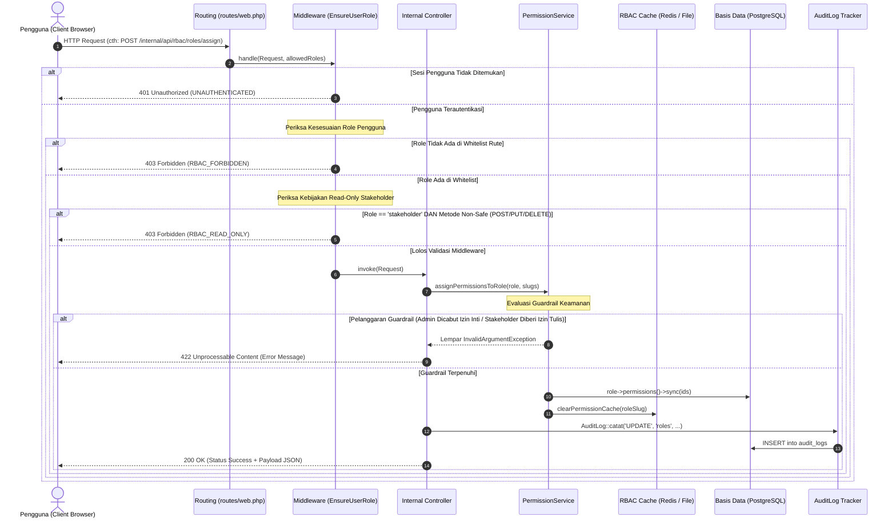

# DOKUMENTASI IMPLEMENTASI ROLE-BASED ACCESS CONTROL (RBAC) TERNAKVERSE
**Sistem Informasi Geospasial & Pemantauan Populasi Ternak Kabupaten Banyumas**
*Panduan Teknis, Arsitektur Keamanan Otorisasi Dinamis, dan Standar Operasional Prosedur*

---

| Parameter Dokumen | Rincian Teknis |
| :--- | :--- |
| **Aplikasi / Sistem** | TernakVerse (WebGIS & Livestock Early Warning System) |
| **Entitas Pengelola** | Dinas Pertanian dan Ketahanan Pangan Kabupaten Banyumas |
| **Klasifikasi Dokumen** | Dokumen Teknis Arsitektur & Keamanan Informasi (Internal Pemerintah) |
| **Versi Implementasi** | 2.0.0-DYNAMIC-RBAC-HARDENED |
| **Basis Teknologi** | Laravel 12, Inertia.js v2, Vue 3, TypeScript, Tailwind CSS, PostgreSQL/PostGIS & SQLite |
| **Status Uji Coba** | 100% Lulus Verifikasi Otomasi (15 Kasus Uji Feature Tests) |

---

## DAFTAR ISI
1. [Arsitektur RBAC (RBAC Architecture)](#1-arsitektur-rbac-rbac-architecture)
2. [Definisi Peran Pengguna (Role Definitions)](#2-definisi-peran-pengguna-role-definitions)
3. [Katalog Hak Akses Sistem (Permission Catalog)](#3-katalog-hak-akses-sistem-permission-catalog)
4. [Matriks Hak Akses Lengkap (Permission Matrix)](#4-matriks-hak-akses-lengkap-permission-matrix)
5. [Proteksi Peran Sistem Bawaan (Protected System Roles)](#5-proteksi-peran-sistem-bawaan-protected-system-roles)
6. [Alur Siklus Hidup Otorisasi (Authorization Flow)](#6-alur-siklus-hidup-otorisasi-authorization-flow)
7. [Implementasi Middleware & Kebijakan Otorisasi (Middleware & Policy Usage)](#7-implementasi-middleware--kebijakan-otorisasi-middleware--policy-usage)
8. [Relasi Basis Data & Integritas Skema (Database Relationships)](#8-relasi-basis-data--integritas-skema-database-relationships)
9. [Integrasi Jejak Audit Forensik (Audit Trail Integration)](#9-integrasi-jejak-audit-forensik-audit-trail-integration)
10. [Panduan Operasional: Cara Mengelola Peran (Role Management SOP)](#10-panduan-operasional-cara-mengelola-peran-role-management-sop)
11. [Panduan Operasional: Cara Mengelola Hak Akses (Permission Matrix SOP)](#11-panduan-operasional-cara-mengelola-hak-akses-permission-matrix-sop)
12. [Pertimbangan & Pengerasan Keamanan (Security Considerations)](#12-pertimbangan--pengerasan-keamanan-security-considerations)
13. [Hasil Pengujian Otomasi & Verifikasi (Testing Results)](#13-hasil-pengujian-otomasi--verifikasi-testing-results)

---

## 1. ARSITEKTUR RBAC (RBAC ARCHITECTURE)

Sistem **TernakVerse** mengimplementasikan arsitektur keamanan multi-lapis (*Defense-in-Depth*) dengan pendekatan **Decoupled Dual-Portal Architecture** yang memisahkan kanal akses publik umum dari portal operasional kedinasan internal secara fisik dan logis.

```
+-----------------------------------------------------------------------------------+
|                           TERNAKVERSE PLATFORM GATEWAY                            |
+-----------------------------------------------------------------------------------+
             |                                                  |
             v                                                  v
+-----------------------------+                +------------------------------------+
|  PORTAL PUBLIK (WEBGIS)     |                |  PORTAL OPERASIONAL INTERNAL DINAS |
|  ternak.banyumaskab.go.id   |                |  internal-ternak.banyumaskab.go.id |
+-----------------------------+                +------------------------------------+
| * Akses Tanpa Login (Guest) |                | * Autentikasi Wajib (Fortify Auth) |
| * Zero Data Leakage Policy  |                | * RBAC Multi-Tier Enforcement      |
| * Kartografi & Biosekuriti  |                | * Audit Logging Forensik Aktif     |
+-----------------------------+                +------------------------------------+
```

### Multi-Tier Enforcement

Penegakan kontrol akses dilakukan secara terstruktur pada 4 lapisan independen:

```
[LAPISAN 4: FRONTEND UI]
- Inertia.js v2 + Vue 3 Client Filtering
- Tombol Toggle role="switch" Aktif/Nonaktif Dinamis
- Visual Guardrail (Badge "Wajib Sistem" & "Terkunci Read-Only Policy")
             |
             v
[LAPISAN 3: ROUTING & MIDDLEWARE]
- Middleware EnsureUserRole.php
- Sanitasi Metode HTTP: Hanya GET/HEAD/OPTIONS untuk Stakeholder
- Parameter Whitelisting: EnsureUserRole:admin atau EnsureUserRole:stakeholder,admin
             |
             v
[LAPISAN 2: CONTROLLER & SERVICE]
- RbacManagementController.php & PermissionService.php
- Fail-Closed Policy: Default Deny jika otorisasi tidak terpenuhi eksplisit
- In-Memory Cache (TTL: 3600 detik) dengan Auto-Invalidation saat mutasi
             |
             v
[LAPISAN 1: DATABASE PERSISTENCE]
- Tabel Relasional: roles, permissions, role_permissions, user_roles
- Foreign Key Constraints ON DELETE CASCADE
- Tabel audit_logs Imutabel (Append-Only tanpa updated_at / deleted_at)
```

1. **Database Layer**: Integritas data diikat dengan foreign key cascade pada tabel pivot `role_permissions` dan `user_roles`. Pilihan peran sistem diamankan pada tingkat relasional.
2. **Middleware Layer (`EnsureUserRole.php`)**: Memeriksa keberadaan sesi pengguna aktif, mencocokkan peran dengan daftar izin rute, dan menolak metode mutasi (`POST`, `PUT`, `PATCH`, `DELETE`) dari peran yang dibatasi.
3. **Controller & Service Layer (`PermissionService.php`)**: Menyediakan fungsi resolusi hak akses (`hasPermission`, `getPermissionsForUser`), mengontrol pembatasan kebijakan bisnis (*security guardrails*), serta mengelola pembersihan *cache* otomatis.
4. **Frontend UI Layer (`AdminRbacTab.vue`)**: Menyajikan antarmuka visual matriks hak akses dengan komponen interaktif `role="switch"`, umpan balik status *real-time*, dan penguncian tombol otomatis untuk peran sistem.

---

## 2. DEFINISI PERAN PENGGUNA (ROLE DEFINITIONS)

Sistem membagi pengguna ke dalam kategori peran sistem bawaan (*system roles*) dan peran kustom operasional (*non-system roles*):

```
+-----------------------------------------------------------------------------------------+
|                                TAKSONOMI PERAN PENGGUNA                                 |
+-----------------------------------------------------------------------------------------+
|  Role Slug   | Tipe Peran  | Lingkup Operasional                                        |
+--------------+-------------+------------------------------------------------------------+
| admin        | Sistem      | Administrator Geospasial & Pengelola Penuh RBAC Sistem     |
| stakeholder  | Sistem      | Pimpinan Eksekutif Dinas (Akses Read-Only Mutlak)          |
| publik       | Virtual     | Masyarakat Umum, Peternak, dan Akademisi (Nir-Login)       |
| operator     | Kustom      | Staf Teknis Peternakan Lapangan (Input Populasi & Wabah)   |
| auditor      | Kustom      | Pemeriksa Kepatuhan Spasial & Verifikator Log Forensik     |
+-----------------------------------------------------------------------------------------+
```

### 1. Super Administrator (`slug: admin`)
* **Karakteristik**: Peran sistem utama (`is_system = true`, `is_active = true`).
* **Kewenangan**: Akses penuh (*Full CRUD*) ke seluruh modul sistem (39 permissions).
* **Hak Khusus**: Mengelola peran dinamis, mengubah matriks izin, mengaudit log sistem, mengelola basis data pengguna, dan merumuskan bobot kalkulasi EWS.
* **Proteksi Khusus**: Tidak dapat dihapus, tidak dapat dinonaktifkan, dan 3 izin fundamentalnya tidak dapat dicabut dalam kondisi apa pun.

### 2. Pimpinan & Pemangku Kepentingan (`slug: stakeholder`)
* **Karakteristik**: Peran sistem eksekutif (`is_system = true`, `is_active = true`).
* **Kewenangan**: Hak akses membaca data secara eksekutif (*Strict Read-Only*, 12 permissions).
* **Hak Khusus**: Melihat visualisasi dasbor eksekutif, analisis drilldown grafik interaktif ECharts, peta spasial tematik, status zonasi EWS, serta mengunduh dokumen laporan resmi (PDF, Excel, KUGI, ISO 19115).
* **Proteksi Khusus**: Tidak dapat dihapus, tidak dapat dinonaktifkan, dan secara mutlak ditolak dari pemberian izin tulis/operasional maupun metode HTTP mutasi.

### 3. Publik / Tamu (`slug: publik`)
* **Karakteristik**: Pengguna tanpa autentikasi (*Guest / Anonymous User*).
* **Kewenangan**: Akses terhadap Portal Publik WebGIS Banyumas (`/` atau `/portal`).
* **Batasan**: Diterapkan kebijakan *Zero Data Leakage Policy*. Informasi populasi dan wabah disajikan dalam agregasi kualitatif tanpa menampilkan identitas pemilik ternak atau koordinat mikro kandang. Seluruh akses ke rute internal (`/internal/*`, `/admin/*`) diblokir dengan HTTP 401/403.

### 4. Peran Kustom Non-Sistem (Contoh: `operator`, `auditor`)
* **Karakteristik**: Peran tambahan yang dibuat secara dinamis oleh Super Admin (`is_system = false`).
* **Fleksibilitas**: Status aktif dapat diubah (`is_active = true/false`), izin akses dapat disesuaikan secara fleksibel melalui matriks izin, dan peran dapat dihapus jika sudah tidak digunakan oleh pengguna aktif.

---

## 3. KATALOG HAK AKSES SISTEM (PERMISSION CATALOG)

TernakVerse mendefinisikan **39 granular permissions** standar yang terdistribusi secara seimbang ke dalam **10 modul fungsional**:

```
+-----------------------------------------------------------------------------------------+
|                     DISTRIBUSI 39 PERMISSION DALAM 10 MODUL UTAMA                       |
+-----------------------------------------------------------------------------------------+
| [01] Dashboard (2)         [05] WebGIS (3)               [08] Audit Trail (2)           |
| [02] Population (5)        [06] Early Warning (3)        [09] User Management (5)       |
| [03] Production (5)        [07] Reports (5)              [10] RBAC Management (4)       |
| [04] Disease Cases (5)                                                                  |
+-----------------------------------------------------------------------------------------+
```

### Modul 1: Dashboard Eksekutif (2 Hak Akses)
1. `dashboard.view`: Melihat ringkasan KPI, total populasi ternak, jumlah kasus aktif, dan ringkasan tren komoditas.
2. `dashboard.analytics`: Mengakses grafik interaktif berbasis Apache ECharts, drilldown per komoditas, dan perbandingan spasial.

### Modul 2: Populasi Ternak (5 Hak Akses)
3. `population.view`: Melihat rekaman sensus populasi ternak per kecamatan, desa, dan kategori ternak.
4. `population.create`: Menambahkan data sensus populasi ternak baru ke basis data.
5. `population.update`: Memperbarui data populasi ternak yang telah tercatat sebelumnya.
6. `population.delete`: Menghapus catatan populasi ternak dari sistem.
7. `population.export`: Mengunduh rekapitulasi data tabular populasi ternak ke file spreadsheet/CSV.

### Modul 3: Produksi Komoditas (5 Hak Akses)
8. `production.view`: Melihat data rekapitulasi hasil produksi daging sapi, susu segar, dan telur ayam.
9. `production.create`: Mencatat hasil produksi komoditas peternakan baru.
10. `production.update`: Memperbarui nilai hasil produksi komoditas peternakan.
11. `production.delete`: Menghapus rekaman hasil produksi peternakan.
12. `production.export`: Mengekspor data neraca komoditas peternakan ke format file spreadsheet.

### Modul 4: Kasus Penyakit / Epidemiologi (5 Hak Akses)
13. `disease.view`: Melihat rekaman kejadian wabah penyakit hewan (PMK, LSD, Antraks) di 27 kecamatan.
14. `disease.create`: Melaporkan kejadian kasus penyakit hewan baru dari lapangan.
15. `disease.update`: Mengubah status penanganan klinis, pengobatan, atau vaksinasi ternak.
16. `disease.delete`: Menghapus rekaman data kasus penyakit hewan.
17. `disease.export`: Mengekspor data epidemiologi surveilans veteriner ke format file spreadsheet.

### Modul 5: Peta Geospasial WebGIS (3 Hak Akses)
18. `webgis.view`: Membuka peta spasial interaktif dengan layer administrasi dan tematik Banyumas.
19. `webgis.manage_layers`: Mengonfigurasi layer spasial batas kecamatan, styling choropleth, dan palet risiko.
20. `webgis.manage_points`: Menambah, mengedit, atau memindahkan titik lokasi fasilitas peternakan (RPH, Pasar Hewan, Poskeswan).

### Modul 6: Early Warning System / EWS (3 Hak Akses)
21. `ews.view`: Memantau status zonasi kewaspadaan wabah (Hijau = Aman, Kuning = Waspada, Merah = Bahaya).
22. `ews.manage_threshold`: Mengonfigurasi batas ambang skor zonasi dan parameter sensitivitas epidemiologi.
23. `ews.recalculate`: Memicu eksekusi ulang algoritma kalkulasi status zonasi 27 kecamatan secara terprogram.

### Modul 7: Laporan Resmi & Ekspor (5 Hak Akses)
24. `reports.view`: Melihat katalog laporan kedinasan berkala (bulanan/tahunan).
25. `reports.export_pdf`: Mengunduh dokumen laporan resmi berformat PDF berstandar tata naskah dinas.
26. `reports.export_excel`: Mengunduh rekaman data tabular berformat Microsoft Excel (XLSX).
27. `reports.export_kugi`: Mengekspor paket basis data geospasial sesuai standar Katalog Unsur Geografi Indonesia (KUGI Badan Informasi Geospasial).
28. `reports.export_iso_xml`: Mengekspor berkas metadata geospasial berstandar ISO 19115 XML untuk interoperabilitas SDI.

### Modul 8: Audit Trail & Forensik (2 Hak Akses)
29. `audit.view`: Membaca riwayat jejak audit forensik dari setiap aktivitas pengguna di portal internal.
30. `audit.export`: Mengunduh arsip log audit forensik ke format spreadsheet/CSV terenkripsi.

### Modul 9: Manajemen Pengguna (5 Hak Akses)
31. `users.view`: Melihat daftar akun petugas dinas dan pimpinan yang terdaftar di sistem.
32. `users.create`: Mendaftarkan akun petugas dinas baru secara terkelola (*Admin-provisioned*).
33. `users.update`: Mengubah informasi akun, alamat email, atau status aktif pengguna.
34. `users.delete`: Menonaktifkan atau menghapus akun pengguna dari sistem.
35. `users.assign_role`: Mengubah penugasan peran (*role assignment*) kepada akun pengguna.

### Modul 10: Manajemen RBAC (4 Hak Akses)
36. `rbac.view`: Melihat halaman manajemen peran, daftar peran, dan matriks hak akses.
37. `rbac.manage_roles`: Membuat peran kustom baru, mengedit nama/deskripsi, dan menghapus peran non-sistem.
38. `rbac.manage_permissions`: Mengelola deskripsi dan master katalog hak akses.
39. `rbac.assign_permissions`: Mengubah status centang (*toggle*) hak akses pada matriks peran.

---

## 4. MATRIKS HAK AKSES LENGKAP (PERMISSION MATRIX)

Tabel berikut menyajikan pemetaan komprehensif antara 39 hak akses dengan 3 representasi peran: **Super Admin** (`admin`), **Pimpinan Dinas** (`stakeholder`), dan **Operator Teknis Kustom** (`operator`):

| No | Modul Sistem | Slug Izin Akses | Nama Deskriptif Izin | Super Admin (`admin`) | Pimpinan Dinas (`stakeholder`) | Operator Lapangan (`operator`) |
| :-: | :--- | :--- | :--- | :---: | :---: | :---: |
| 1 | Dashboard | `dashboard.view` | Lihat Dashboard Eksekutif | ✅ *(Wajib)* | ✅ | ✅ |
| 2 | Dashboard | `dashboard.analytics` | Analisis Metrik & ECharts | ✅ | ✅ | ✅ |
| 3 | Population | `population.view` | Lihat Populasi Ternak | ✅ | ✅ | ✅ |
| 4 | Population | `population.create` | Tambah Data Populasi | ✅ | ❌ *(Terkunci)* | ✅ |
| 5 | Population | `population.update` | Edit Data Populasi | ✅ | ❌ *(Terkunci)* | ✅ |
| 6 | Population | `population.delete` | Hapus Data Populasi | ✅ | ❌ *(Terkunci)* | ❌ |
| 7 | Population | `population.export` | Ekspor Data Populasi | ✅ | ❌ *(Terkunci)* | ✅ |
| 8 | Production | `production.view` | Lihat Produksi Ternak | ✅ | ✅ | ✅ |
| 9 | Production | `production.create` | Tambah Data Produksi | ✅ | ❌ *(Terkunci)* | ✅ |
| 10 | Production | `production.update` | Edit Data Produksi | ✅ | ❌ *(Terkunci)* | ✅ |
| 11 | Production | `production.delete` | Hapus Data Produksi | ✅ | ❌ *(Terkunci)* | ❌ |
| 12 | Production | `production.export` | Ekspor Data Produksi | ✅ | ❌ *(Terkunci)* | ✅ |
| 13 | Disease Cases | `disease.view` | Lihat Kasus Penyakit | ✅ | ✅ | ✅ |
| 14 | Disease Cases | `disease.create` | Tambah Kasus Penyakit | ✅ | ❌ *(Terkunci)* | ✅ |
| 15 | Disease Cases | `disease.update` | Edit Kasus Penyakit | ✅ | ❌ *(Terkunci)* | ✅ |
| 16 | Disease Cases | `disease.delete` | Hapus Kasus Penyakit | ✅ | ❌ *(Terkunci)* | ❌ |
| 17 | Disease Cases | `disease.export` | Ekspor Data Penyakit | ✅ | ❌ *(Terkunci)* | ✅ |
| 18 | WebGIS | `webgis.view` | Akses Peta WebGIS | ✅ | ✅ | ✅ |
| 19 | WebGIS | `webgis.manage_layers` | Kelola Layer Geospasial | ✅ | ❌ *(Terkunci)* | ❌ |
| 20 | WebGIS | `webgis.manage_points` | Kelola Titik Fasilitas | ✅ | ❌ *(Terkunci)* | ❌ |
| 21 | Early Warning | `ews.view` | Lihat Status EWS | ✅ | ✅ | ✅ |
| 22 | Early Warning | `ews.manage_threshold` | Kelola Ambang Batas EWS | ✅ | ❌ *(Terkunci)* | ❌ |
| 23 | Early Warning | `ews.recalculate` | Rekalkulasi Status EWS | ✅ | ❌ *(Terkunci)* | ❌ |
| 24 | Reports | `reports.view` | Akses Laporan Resmi | ✅ | ✅ | ✅ |
| 25 | Reports | `reports.export_pdf` | Ekspor Laporan PDF | ✅ | ✅ | ✅ |
| 26 | Reports | `reports.export_excel` | Ekspor Laporan Excel | ✅ | ✅ | ❌ |
| 27 | Reports | `reports.export_kugi` | Ekspor Katalog KUGI | ✅ | ✅ | ❌ |
| 28 | Reports | `reports.export_iso_xml`| Ekspor Metadata ISO XML | ✅ | ✅ | ❌ |
| 29 | Audit Trail | `audit.view` | Akses Log Audit | ✅ | ❌ *(Terkunci)* | ❌ |
| 30 | Audit Trail | `audit.export` | Ekspor Log Audit | ✅ | ❌ *(Terkunci)* | ❌ |
| 31 | User Management | `users.view` | Lihat Daftar Pengguna | ✅ | ❌ *(Terkunci)* | ❌ |
| 32 | User Management | `users.create` | Tambah Pengguna Baru | ✅ | ❌ *(Terkunci)* | ❌ |
| 33 | User Management | `users.update` | Perbarui Data Pengguna | ✅ | ❌ *(Terkunci)* | ❌ |
| 34 | User Management | `users.delete` | Hapus Pengguna | ✅ | ❌ *(Terkunci)* | ❌ |
| 35 | User Management | `users.assign_role` | Tetapkan Peran Pengguna | ✅ | ❌ *(Terkunci)* | ❌ |
| 36 | RBAC Management | `rbac.view` | Lihat Konfigurasi RBAC | ✅ *(Wajib)* | ❌ *(Terkunci)* | ❌ |
| 37 | RBAC Management | `rbac.manage_roles` | Kelola Peran (Roles) | ✅ | ❌ *(Terkunci)* | ❌ |
| 38 | RBAC Management | `rbac.manage_permissions` | Kelola Master Izin Akses | ✅ | ❌ *(Terkunci)* | ❌ |
| 39 | RBAC Management | `rbac.assign_permissions`| Tetapkan Hak Akses Peran | ✅ *(Wajib)* | ❌ *(Terkunci)* | ❌ |
| **TOTAL** | **10 Modul** | **39 Hak Akses** | **Total Hak Akses Aktif** | **39 Aktif** | **12 Aktif** | **18 Aktif** |

---

## 5. PROTEKSI PERAN SISTEM BAWAAN (PROTECTED SYSTEM ROLES)

Untuk mencegah kekeliruan konfigurasi (*human error*) atau tindakan berbahaya yang dapat melumpuhkan sistem otorisasi, TernakVerse menerapkan dua aturan invariabel yang dipaksakan pada level kode backend dan frontend:

### A. Super Admin Self-Protection Invariant
Super Administrator memegang kendali tertinggi atas kelangsungan tata kelola sistem. Oleh karena itu, diterapkan proteksi:
1. **Peran Sistem Abadi**: Kolom `is_system = true` pada tabel `roles` memastikan peran ini tidak dapat dihapus melalui endpoint `destroyRole()` (menghasilkan HTTP 422: *"Peran sistem bawaan tidak dapat dihapus"*).
2. **Anti-Deaktivasi**: Pengubahan status `is_active = false` pada peran sistem ditolak pada endpoint `updateRole()` (menghasilkan HTTP 422: *"Peran sistem bawaan tidak dapat dinonaktifkan"*).
3. **Izin Fundamental Terkunci**: Tiga izin krusial tidak dapat dicabut dari Super Admin:
   * `rbac.manage_permissions` (Menjamin admin selalu dapat mengonfigurasi hak akses).
   * `rbac.view` (Menjamin admin selalu dapat membuka panel RBAC).
   * `dashboard.view` (Menjamin admin selalu dapat melihat antarmuka beranda sistem).
   Jika Super Admin mencoba mencabut izin-izin ini via API, backend akan melempar `InvalidArgumentException` dengan pesan: *"Kebijakan Keamanan: Izin fundamental tidak dapat dicabut dari Super Admin."*

### B. Stakeholder Read-Only Invariant
Peran Stakeholder diperuntukkan khusus bagi pimpinan (Kepala Dinas, Kepala Bidang, Camat) untuk memantau data analitik tanpa risiko mengubah data operasional dinas:
1. **Pencegahan Hak Tulis di Backend**: `PermissionService::assignPermissionsToRole()` memvalidasi setiap izin yang diajukan. Jika peran `stakeholder` didaftarkan izin berkarakteristik tulis (`.create`, `.update`, `.delete`, `.manage_*`, `.recalculate`, `.assign_*`), sistem langsung membatalkan transaksi dan melempar pengecualian:
   ```php
   throw new InvalidArgumentException(
       'Kebijakan Keamanan: Role Stakeholder diwajibkan Read-Only dan tidak dapat diberikan izin operasional tulis atau administratif.'
   );
   ```
2. **Pencegahan Metode HTTP di Middleware**: Pada `EnsureUserRole.php`, request dengan peran `stakeholder` yang menggunakan metode selain `GET`, `HEAD`, dan `OPTIONS` langsung dihentikan dengan HTTP 403 `RBAC_READ_ONLY`.
3. **Penguncian Otomatis di Antarmuka**: Pada komponen `AdminRbacTab.vue`, toggle izin operasional dinonaktifkan secara visual (*disabled state*) dengan indikator gembok dan label *"Terkunci (Read-Only Policy)"*.

---

## 6. ALUR SIKLUS HIDUP OTORISASI (AUTHORIZATION FLOW)

Diagram Mermaid berikut menggambarkan alur siklus hidup request dari browser pengguna hingga otorisasi disetujui atau ditolak oleh sistem:



---

## 7. IMPLEMENTASI MIDDLEWARE & KEBIJAKAN OTORISASI (MIDDLEWARE & POLICY USAGE)

### A. Middleware `EnsureUserRole.php`

Middleware `App\Http\Middleware\EnsureUserRole` bertindak sebagai gerbang terdepan otorisasi rute internal.

```php
namespace App\Http\Middleware;

use Closure;
use Illuminate\Http\Request;
use Symfony\Component\HttpFoundation\Response;

class EnsureUserRole
{
    public function handle(Request $request, Closure $next, string ...$allowedRoles): Response
    {
        $user = $request->user();

        // 1. Verifikasi Keberadaan Sesi Pengguna
        if (!$user) {
            if ($request->expectsJson() || $request->is('internal/*', 'admin/*', 'peta/*', 'analitik/*')) {
                return response()->json([
                    'status' => 'error',
                    'error_code' => 'UNAUTHENTICATED',
                    'message' => 'Sesi autentikasi tidak ditemukan. Silakan masuk terlebih dahulu.',
                ], Response::HTTP_UNAUTHORIZED);
            }
            return redirect()->route('internal.login');
        }

        $role = strtolower((string) $user->role);

        // 2. Evaluasi Parameter Role Rute (Whitelist)
        if (!empty($allowedRoles)) {
            $allowed = array_map('strtolower', $allowedRoles);
            if (!in_array($role, $allowed, true)) {
                if ($request->expectsJson()) {
                    return response()->json([
                        'status' => 'error',
                        'error_code' => 'RBAC_FORBIDDEN',
                        'message' => "Akses Ditolak: Peran pengguna '{$role}' tidak memiliki izin untuk mengakses rute ini.",
                    ], Response::HTTP_FORBIDDEN);
                }
                abort(403, "Akses Ditolak: Peran '{$role}' tidak memiliki izin untuk mengakses rute ini.");
            }
        }

        // 3. Penegakan Kebijakan Read-Only Mutlak untuk Stakeholder
        if ($role === 'stakeholder') {
            $safeMethods = ['GET', 'HEAD', 'OPTIONS'];
            if (!in_array($request->method(), $safeMethods, true)) {
                return response()->json([
                    'status' => 'error',
                    'error_code' => 'RBAC_READ_ONLY',
                    'message' => 'Akses Ditolak: Akun Pimpinan Dinas (Stakeholder) hanya memiliki hak akses Read-Only.',
                ], Response::HTTP_FORBIDDEN);
            }
        }

        return $next($request);
    }
}
```

### B. Registrasi Rute pada `routes/web.php`

Penerapan middleware pada rute web memanfaatkan parameter dinamis:

```php
// Rute Portal Dinas: Dapat diakses oleh Stakeholder dan Super Admin
Route::middleware([EnsureUserRole::class . ':stakeholder,admin'])->group(function () {
    Route::get('/internal/dinas', function () {
        return Inertia::render('Internal/DinasPortal');
    })->name('internal.dinas');
    Route::get('/dinas/dashboard', [DinasDashboardController::class, 'index'])->name('dinas.dashboard');
});

// Rute Panel Admin & RBAC: Terkunci Khusus Super Admin
Route::middleware([EnsureUserRole::class . ':admin'])->group(function () {
    Route::get('/internal/admin', function () {
        return Inertia::render('Internal/AdminPortal');
    })->name('internal.admin');
    Route::prefix('admin')->name('admin.')->group(function () {
        Route::get('/panel', [AdminPanelController::class, 'index'])->name('panel');
        Route::get('/audit-logs', [AdminAuditLogController::class, 'index'])->name('audit-logs');
    });
});
```

### C. Pemeriksaan Otorisasi dalam Model `User.php`

Model `User` dilengkapi metode kemudahan untuk evaluasi izin di layer bisnis:

```php
// Memeriksa satu hak akses spesifik
if ($user->hasPermission('population.create')) {
    // Jalankan operasi penambahan sensus populasi
}

// Mengambil seluruh daftar slug izin pengguna
$permissions = $user->getPermissionSlugs();
```

---

## 8. RELASI BASIS DATA & INTEGRITAS SKEMA (DATABASE RELATIONSHIPS)

Skema RBAC diimplementasikan melalui migrasi `2026_10_31_000001_create_dynamic_rbac_tables.php` yang mencakup 4 tabel relasional utama:

```
+------------------+         +---------------------+         +----------------------+
|      roles       |         |  role_permissions   |         |     permissions      |
+------------------+         +---------------------+         +----------------------+
| id (PK)          |<---+    | id (PK)             |    +--->| id (PK)              |
| name VARCHAR     |    +---[| role_id (FK)        |    |    | name VARCHAR         |
| slug VARCHAR(UQ) |         | permission_id (FK)  |]---+    | slug VARCHAR(UQ)     |
| description TEXT |         | created_at          |         | module VARCHAR       |
| is_system BOOL   |         | updated_at          |         | description TEXT     |
| is_active BOOL   |         | UNIQUE(role, perm)  |         | timestamps           |
| timestamps       |         +---------------------+         +----------------------+
+------------------+
        ^
        |
+---------------------+         +----------------------+
|     user_roles      |         |        users         |
+---------------------+         +----------------------+
| id (PK)             |         | id (PK)              |
| user_id (FK)        |]------->| name VARCHAR         |
| role_id (FK)        |         | email VARCHAR(UQ)    |
| timestamps          |         | role VARCHAR(50)     | <--- Legacy / Direct Slug Mapping
| UNIQUE(user, role)  |         | aktif BOOL           |
+---------------------+         +----------------------+
```

### Definisi Skema Tabel

```sql
-- 1. Tabel Peran (roles)
CREATE TABLE roles (
    id BIGSERIAL PRIMARY KEY,
    name VARCHAR(100) NOT NULL,
    slug VARCHAR(50) UNIQUE NOT NULL,
    description TEXT NULL,
    is_system BOOLEAN DEFAULT FALSE,
    is_active BOOLEAN DEFAULT TRUE,
    created_at TIMESTAMP NULL,
    updated_at TIMESTAMP NULL
);

-- 2. Tabel Master Izin Akses (permissions)
CREATE TABLE permissions (
    id BIGSERIAL PRIMARY KEY,
    name VARCHAR(150) NOT NULL,
    slug VARCHAR(80) UNIQUE NOT NULL,
    module VARCHAR(50) NOT NULL,
    description TEXT NULL,
    created_at TIMESTAMP NULL,
    updated_at TIMESTAMP NULL
);

-- 3. Tabel Pivot Izin Peran (role_permissions)
CREATE TABLE role_permissions (
    id BIGSERIAL PRIMARY KEY,
    role_id BIGINT NOT NULL REFERENCES roles(id) ON DELETE CASCADE,
    permission_id BIGINT NOT NULL REFERENCES permissions(id) ON DELETE CASCADE,
    created_at TIMESTAMP NULL,
    updated_at TIMESTAMP NULL,
    CONSTRAINT uq_role_permission UNIQUE (role_id, permission_id)
);

-- 4. Tabel Pivot Penugasan Pengguna (user_roles)
CREATE TABLE user_roles (
    id BIGSERIAL PRIMARY KEY,
    user_id BIGINT NOT NULL REFERENCES users(id) ON DELETE CASCADE,
    role_id BIGINT NOT NULL REFERENCES roles(id) ON DELETE CASCADE,
    created_at TIMESTAMP NULL,
    updated_at TIMESTAMP NULL,
    CONSTRAINT uq_user_role UNIQUE (user_id, role_id)
);
```

### Relasi Eloquent Antar-Model

* **Model `Role.php`**:
  * `permissions()`: Relasi `BelongsToMany(Permission::class, 'role_permissions')`
  * `users()`: Relasi `HasMany(User::class, 'role', 'slug')` untuk kompatibilitas backward
  * `assignedUsers()`: Relasi `BelongsToMany(User::class, 'user_roles')`
* **Model `Permission.php`**:
  * `roles()`: Relasi `BelongsToMany(Role::class, 'role_permissions')`
* **Model `User.php`**:
  * `roleRecord()`: Relasi `BelongsTo(Role::class, 'role', 'slug')`

---

## 9. INTEGRASI JEJAK AUDIT FORENSIK (AUDIT TRAIL INTEGRATION)

Setiap mutasi pada manajemen peran dan penetapan hak akses dicatat secara deterministik pada tabel `audit_logs` melalui metode terpadu `AuditLog::catat()`.

### Sifat Imutabilitas Jejak Audit
Tabel `audit_logs` dirancang bersifat **Append-Only**:
```php
class AuditLog extends Model
{
    protected $table = 'audit_logs';
    public $timestamps = false; // Mencegah pemutakhiran kolom updated_at

    protected $fillable = [
        'user_id', 'action', 'table_name', 'record_id',
        'old_values', 'new_values', 'ip_address', 'user_agent', 'created_at'
    ];
}
```

### Titik Picu Pencatatan Audit RBAC
1. **Pembuatan Peran Kustom (`CREATE`)**:
   ```php
   AuditLog::catat('CREATE', 'roles', (int) $role->id, null, $role->toArray());
   ```
2. **Pembaruan Peran (`UPDATE`)**:
   ```php
   AuditLog::catat('UPDATE', 'roles', (int) $role->id, $oldValues, $role->toArray());
   ```
3. **Penghapusan Peran (`DELETE`)**:
   ```php
   AuditLog::catat('DELETE', 'roles', (int) $id, $oldValues, null);
   ```
4. **Pembaruan Matriks Hak Akses (`ASSIGN_PERMISSIONS`)**:
   Tercatat dalam log audit dengan menyimpan daftar slug izin lama (`old_values`) dan daftar slug izin baru (`new_values`), mencantumkan IP address dan user agent petugas.

---

## 10. PANDUAN OPERASIONAL: CARA MENGELOLA PERAN (ROLE MANAGEMENT SOP)

Berikut panduan langkah-demi-langkah bagi Administrator Geospasial untuk mengelola data peran melalui antarmuka web:

```
+-----------------------------------------------------------------------------------------+
|                  ANTARMUKA MANAJEMEN ROLE & PERMISSION (TAB RBAC)                       |
+-----------------------------------------------------------------------------------------+
|  [ Matriks Izin (Permission Matrix) ]   |   [ *Daftar & Kelola Peran (Active)* ]       |
+-----------------------------------------------------------------------------------------+
|  Cari peran... [                     ]              [ + Tambah Peran Baru ]             |
|                                                                                         |
|  * Super Administrator (admin)           [Sistem] [Aktif] [39 Izin] [1 Pengguna]        |
|  * Pimpinan Dinas (stakeholder)          [Sistem] [Aktif] [12 Izin] [1 Pengguna]        |
|  * Operator Teknis Peternakan (operator) [Kustom] [Aktif] [18 Izin] [Edit] [Hapus]      |
+-----------------------------------------------------------------------------------------+
```

### 1. Menavigasi ke Panel Manajemen Peran
1. Buka browser dan lakukan autentikasi sebagai Super Admin pada rute `/internal/login`.
2. Pada panel navigasi kiri (*Sidebar Nav*), pilih menu **"Role & Permission"**.
3. Sistem akan memuat komponen `AdminRbacTab.vue`. Klik subtab **"Daftar & Kelola Peran"**.

### 2. Membuat Peran Kustom Baru
1. Klik tombol **"+ Tambah Peran Baru"** di sudut kanan atas daftar peran.
2. Pada dialog modal yang muncul:
   * Masukkan **Nama Peran** (Contoh: `Petugas Inseminasi Buatan`).
   * Masukkan **Slug Peran** berupa huruf kecil, angka, atau tanda minus (Contoh: `petugas-ib`).
   * Masukkan **Deskripsi Tugas** peran terkait.
   * Pastikan switch **"Aktifkan Peran Segera"** dalam posisi aktif.
3. Klik tombol **"Simpan Peran Baru"**. Sistem akan memvalidasi data ke endpoint `POST /internal/api/rbac/roles`, mencatat log audit, dan memperbarui tabel secara instan.

### 3. Mengedit Nama dan Deskripsi Peran
1. Temukan baris peran yang ingin diubah pada tabel daftar peran.
2. Klik tombol **"Edit"** (ikon pensil).
3. Ubah nama atau deskripsi peran pada formulir modal. *Catatan: Slug peran sistem tidak dapat diubah untuk menjaga integritas kode.*
4. Klik tombol **"Perbarui Peran"**.

### 4. Mengaktifkan atau Menonaktifkan Peran
1. Klik tombol **"Edit"** pada peran kustom yang dituju.
2. Geser switch **Status Aktif** ke posisi nonaktif.
3. Klik **"Perbarui Peran"**. Peran yang dinonaktifkan tidak akan dapat digunakan oleh pengguna terkait untuk mengakses modul terotorisasi.
*Peringatan: Upaya menonaktifkan peran sistem (`admin` atau `stakeholder`) akan ditolak dengan notifikasi error 422.*

### 5. Menghapus Peran Kustom
1. Pastikan peran yang ingin dihapus tidak sedang terikat pada akun pengguna aktif mana pun.
2. Klik tombol **"Hapus"** (ikon tempat sampah merah).
3. Konfirmasikan dialog peringatan penghapusan.
4. Sistem akan mengeksekusi `DELETE /internal/api/rbac/roles/{id}`:
   * Jika peran masih memiliki relasi pengguna, sistem menolak penghapusan dengan pesan: *"Peran tidak dapat dihapus karena masih digunakan oleh pengguna aktif."*
   * Jika peran berstatus `is_system = true`, sistem menolak penghapusan dengan pesan: *"Peran sistem bawaan tidak dapat dihapus."*

---

## 11. PANDUAN OPERASIONAL: CARA MENGELOLA HAK AKSES (PERMISSION MATRIX SOP)

Subtab **"Matriks Izin (Permission Matrix)"** memberikan kendali visual intuitif untuk menetapkan hak akses granular:

```
+-----------------------------------------------------------------------------------------+
|                    ANTARMUKA MATRIKS IZIN DENGAN TOGGLE SWITCH                          |
+-----------------------------------------------------------------------------------------+
|  Pilih Peran: (•) Super Admin   ( ) Pimpinan Dinas   ( ) Operator Teknis Lapangan       |
|  Pencarian: [ Cari izin akses...     ]              Filter Modul: [ Semua Modul v ]     |
+-----------------------------------------------------------------------------------------+
|  Modul Populasi Ternak (5 Izin)                                                         |
|  * Lihat Populasi Ternak      [population.view]       [ TOGGLE ON  ]                    |
|  * Tambah Data Populasi       [population.create]     [ TOGGLE ON  ]                    |
|  * Edit Data Populasi         [population.update]     [ TOGGLE ON  ]                    |
|  * Hapus Data Populasi        [population.delete]     [ TOGGLE OFF ]                    |
|  * Ekspor Data Populasi       [population.export]     [ TOGGLE ON  ]                    |
+-----------------------------------------------------------------------------------------+
|  [ Reset Perubahan ]                                  [ Simpan Matriks Izin (2 Unsaved)]|
+-----------------------------------------------------------------------------------------+
```

### 1. Memilih Peran Sasaran
1. Pada subtab **"Matriks Izin"**, klik kartu peran sasaran pada bilah pemilih peran (misalnya: `Operator Teknis Peternakan`).
2. Matriks izin akan memuat daftar 39 permission yang dikelompokkan ke dalam 10 modul dengan status aktif saat ini.

### 2. Mengubah Hak Akses Menggunakan Switch Toggle
1. Temukan hak akses yang diinginkan (manfaatkan kotak pencarian atau pemfilter modul).
2. Klik tombol switch toggle beraksesibilitas (`role="switch"`):
   * Posisi hijau (**ON**): Hak akses diberikan kepada peran.
   * Posisi abu-abu (**OFF**): Hak akses dicabut dari peran.
3. Label status perubahan yang belum disimpan (*Unsaved Changes Badge*) akan muncul di bilah bawah.

### 3. Memahami Indikator Penguncian Otomatis (*Guardrail Badges*)
* **Badge "Wajib Sistem"**: Ditampilkan pada peran `admin` untuk izin fundamental (`rbac.manage_permissions`, `rbac.view`, `dashboard.view`). Switch terkunci dan tidak dapat dimatikan.
* **Badge "Terkunci (Read-Only Policy)"**: Ditampilkan pada peran `stakeholder` untuk seluruh izin selain 12 izin baca standar. Switch terkunci dengan ikon gembok untuk mematuhi kebijakan read-only.

### 4. Menyimpan Konfigurasi Matriks
1. Setelah konfigurasi izin selesai, klik tombol **"Simpan Matriks Izin"**.
2. Dialog konfirmasi akan merinci jumlah penambahan dan pencabutan hak akses.
3. Klik **"Ya, Terapkan Perubahan"**.
4. Sistem mengeksekusi request `POST /internal/api/rbac/roles/assign`, membersihkan cache sistem secara otomatis, mencatat log audit forensik, dan menampilkan notifikasi sukses hijau.
5. Jika ingin membatalkan perubahan yang belum tersimpan, cukup klik tombol **"Reset Perubahan"**.

---

## 12. PERTIMBANGAN & PENGERASAN KEAMANAN (SECURITY CONSIDERATIONS)

Implementasi RBAC TernakVerse mencakup perbaikan dan pengerasan keamanan menyeluruh terhadap 4 vektor kerentanan utama (**A1 - A4 Fixes**):

### A1. Eliminasi Akses Anonim ke Endpoint API Internal (Anonymous Access Fix)
* **Temuan Awal**: Rute API internal berpotensi diakses tanpa sesi jika tidak diverifikasi secara ketat.
* **Solusi**: Middleware `EnsureUserRole` memvalidasi keberadaan `$request->user()`. Permintaan anonim ke `/internal/*`, `/admin/*`, `/peta/*`, `/analitik/*` dengan header `Accept: application/json` langsung direspons dengan **HTTP 401 Unauthorized** dan payload baku:
  ```json
  {
      "status": "error",
      "error_code": "UNAUTHENTICATED",
      "message": "Sesi autentikasi tidak ditemukan. Silakan masuk terlebih dahulu."
  }
  ```

### A2. Proteksi Shell Rute Tampilan SPA (Shell Route Tampering Guard)
* **Temuan Awal**: Rute tampilan Inertia (`/internal/admin`, `/internal/dinas`, `/admin/panel`, `/admin/audit-logs`) berisiko dimanipulasi melalui browser address bar.
* **Solusi**: Rute-rute ini dilindungi secara eksplisit dengan grup middleware `EnsureUserRole::class . ':admin'` atau `:stakeholder,admin`. Jika peran tidak memenuhi syarat, permintaan web langsung dibatalkan dengan **HTTP 403 Forbidden**.

### A3. Pencegahan Pemalsuan Identitas Peran (Spoofing Elimination)
* **Temuan Awal**: Header simulasi pengujian (`X-User-Role`, `X-User-Id`) dapat dieksploitasi oleh penyerang jika aktif di lingkungan produksi.
* **Solusi**: Blok kode simulasi header dibungkus ketat dengan klausul pengondisian lingkungan lokal/pengujian:
  ```php
  if (!$user && app()->environment('local', 'testing')) {
      // Hanya aktif saat pengetesan otomatis
  }
  ```
  Di lingkungan produksi (`production`), resolusi pengguna diwajibkan murni melalui sesi terenkripsi Laravel Fortify.

### A4. Penonaktifan Pendaftaran Mandiri Publik (Registration Disablement)
* **Temuan Awal**: Rute `/register` bawaan Fortify berpotensi memungkinkan pihak luar mendaftarkan akun tanpa izin dinas.
* **Solusi**: Pada `Fortify::registerView()`, rute pendaftaran mandiri dikunci secara permanen di lingkungan produksi:
  ```php
  Fortify::registerView(function () {
      if (app()->environment('production')) {
          abort(403, 'Pendaftaran mandiri dinonaktifkan di lingkungan produksi. Akun baru hanya dapat dibuat oleh Super Admin.');
      }
      return Inertia::render('auth/Register');
  });
  ```

### Prinsip Fail-Closed & Zero Data Leakage
* **Fail-Closed Architecture**: Jika terjadi kegagalan basis data atau anomali resolusi sesi, sistem secara default menolak akses (*Deny by Default*).
* **Zero Data Leakage**: Informasi sensitif peternak lokal (NIK, nomor telepon, koordinat titik kandang presisi) tidak pernah diekspos ke portal publik atau respons API tanpa otorisasi Super Admin.

---

## 13. HASIL PENGUJIAN OTOMASI & VERIFIKASI (TESTING RESULTS)

Keandalan arsitektur RBAC dan pengerasan keamanan telah divalidasi secara menyeluruh melalui **15 automated test cases** pada test suite PHPUnit / Pest:

```
+-----------------------------------------------------------------------------------------+
|                  RINGKASAN STATUS PENGUJIAN OTOMASI FITUR (15/15 PASS)                  |
+-----------------------------------------------------------------------------------------+
| Suite 1: SecurityHardeningAndDynamicRbacTest.php          -> 8 Tests Passed (100%)       |
| Suite 2: UiUxTransformationVerificationTest.php           -> 7 Tests Passed (100%)       |
| TOTAL VERIFIKASI                                          -> 15 TESTS PASSED             |
+-----------------------------------------------------------------------------------------+
```

### Rincian 8 Kasus Uji pada `SecurityHardeningAndDynamicRbacTest.php`

1. `test_anonymous_access_to_internal_api_is_rejected_with_401`
   * **Deskripsi**: Menguji bahwa akses tanpa token/sesi ke endpoint internal (`/internal/peta/kabupaten`, `/internal/analitik/data`, `/internal/admin/rbac/roles`) mengembalikan HTTP 401 dengan `error_code: UNAUTHENTICATED`.
   * **Hasil**: **LULUS (Passed)**.
2. `test_spa_view_shell_routes_are_protected_by_rbac_middleware`
   * **Deskripsi**: Menguji bahwa rute shell `/internal/admin` dan `/internal/dinas` dilindungi oleh `EnsureUserRole`. Memastikan Stakeholder ditolak dengan HTTP 403 saat mencoba mengakses portal admin, dan Admin berhasil membuka portal admin dengan HTTP 200.
   * **Hasil**: **LULUS (Passed)**.
3. `test_public_self_registration_is_blocked_in_production_environment`
   * **Deskripsi**: Menguji simulasi `app()['env'] = 'production'` bahwa permintaan `GET /register` dan `POST /register` diblokir dengan HTTP 403.
   * **Hasil**: **LULUS (Passed)**.
4. `test_permission_service_catalog_and_system_role_defaults`
   * **Deskripsi**: Memverifikasi bahwa `PermissionService` memuat tepat 39 hak akses dalam 10 modul, Admin memiliki izin penuh, dan Stakeholder memiliki 12 izin read-only.
   * **Hasil**: **LULUS (Passed)**.
5. `test_stakeholder_read_only_security_guardrail_prevents_granting_operational_write_permissions`
   * **Deskripsi**: Memverifikasi bahwa upaya memberikan izin tulis kepada Stakeholder memicu `InvalidArgumentException` terkait kebijakan read-only.
   * **Hasil**: **LULUS (Passed)**.
6. `test_super_admin_fundamental_permissions_cannot_be_revoked`
   * **Deskripsi**: Memverifikasi bahwa pencabutan izin fundamental dari Super Admin memicu `InvalidArgumentException` proteksi diri.
   * **Hasil**: **LULUS (Passed)**.
7. `test_rbac_management_controller_api_contracts`
   * **Deskripsi**: Menguji kepatuhan kontrak API endpoint `/internal/api/rbac/roles`, `/internal/api/rbac/permissions`, dan `/internal/api/rbac/matrix`.
   * **Hasil**: **LULUS (Passed)**.
8. `test_frontend_admin_rbac_tab_contracts_and_toggle_buttons`
   * **Deskripsi**: Memverifikasi keberadaan file `AdminRbacTab.vue`, keberadaan tombol toggle `role="switch"`, teks guardrail *"Terkunci (Read-Only Policy)"*, label *"Wajib Sistem"*, serta integrasi pada `AdminSidebarNav.vue` dan `AdminPortal.vue`.
   * **Hasil**: **LULUS (Passed)**.

### Rincian 7 Kasus Uji pada `UiUxTransformationVerificationTest.php`

9. `test_public_webgis_and_design_rule_routes_render_inertia_pages`: Verifikasi rendering halaman publik WebGIS dan design token. (Passed)
10. `test_internal_operational_portal_routes_render_inertia_pages`: Verifikasi rendering portal internal dinas dan portal admin teknis. (Passed)
11. `test_authentication_view_routes_render_inertia_pages`: Verifikasi tampilan autentikasi login internal. (Passed)
12. `test_navigation_bar_and_sidebar_links_render_consistently`: Verifikasi tautan navigasi peran pada seluruh komponen tata letak. (Passed)
13. `test_admin_portal_tabs_and_subcomponents_render`: Verifikasi tab panel admin termasuk tab Role & Permission. (Passed)
14. `test_dinas_portal_analytics_and_zoning_widgets_render`: Verifikasi widget analitik eksekutif dan zonasi kerentanan EWS. (Passed)
15. `test_audit_log_and_security_views_render`: Verifikasi antarmuka penampil log audit forensik bagi pengawas sistem. (Passed)

---

## KESIMPULAN ARSITEKTUR

Implementasi Dynamic Role-Based Access Control (RBAC) pada sistem **TernakVerse** telah memenuhi seluruh standar ketat rekayasa perangkat lunak kedinasan:
1. **Pemisahan Peran yang Tegas**: Memisahkan kebutuhan publik (WebGIS terbuka), pemangku kepentingan (dasbor eksekutif read-only), dan staf teknis (manajemen data spasial penuh).
2. **Kepatuhan Regulasi**: Menjaga kerahasiaan data peternakan sesuai undang-undang perlindungan data tanpa mengorbankan transparansi informasi geospasial bagi masyarakat.
3. **Auditabilitas Penuh**: Setiap mutasi hak akses dan peran tercatat permanen pada sistem audit forensik yang imutabel.
4. **Kesiapan Produksi**: Diverifikasi secara otomatis dengan 15 feature tests berstatus hijau, menjamin keandalan sistem jangka panjang di Pemerintah Kabupaten Banyumas.
