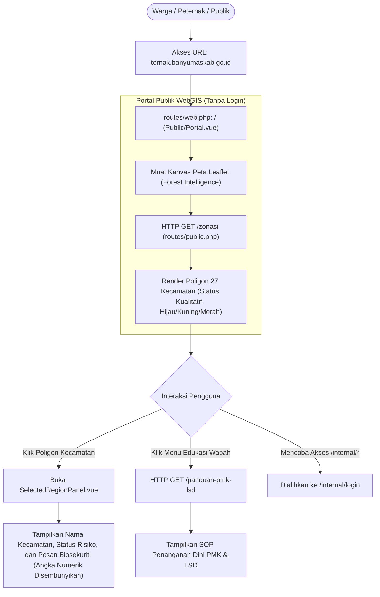
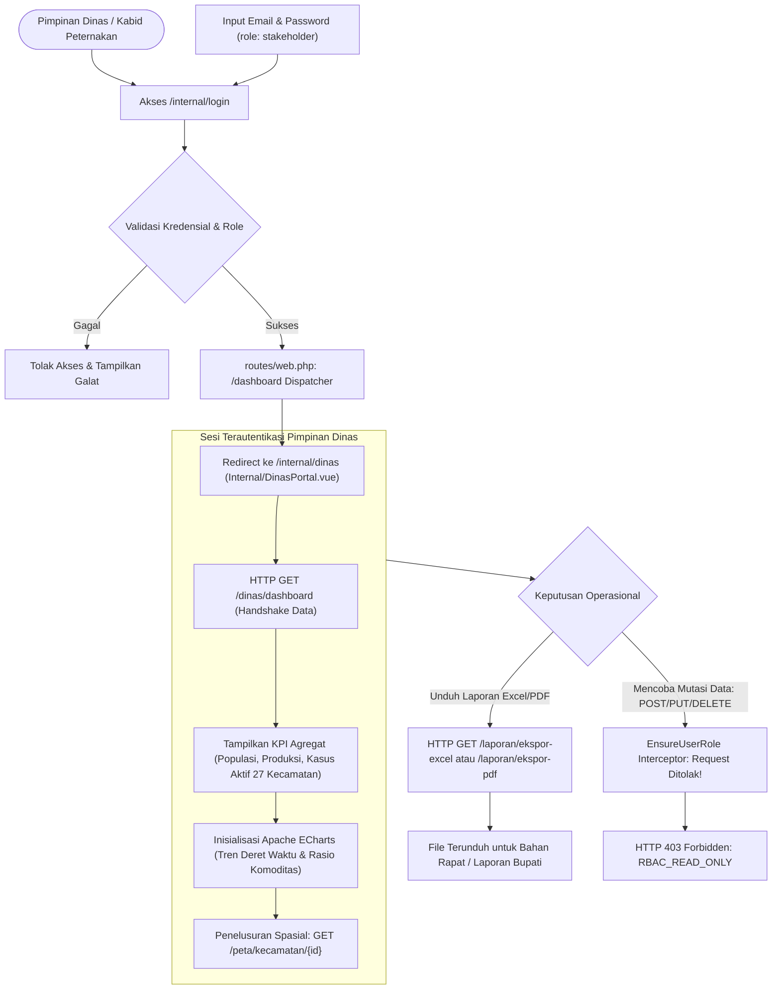
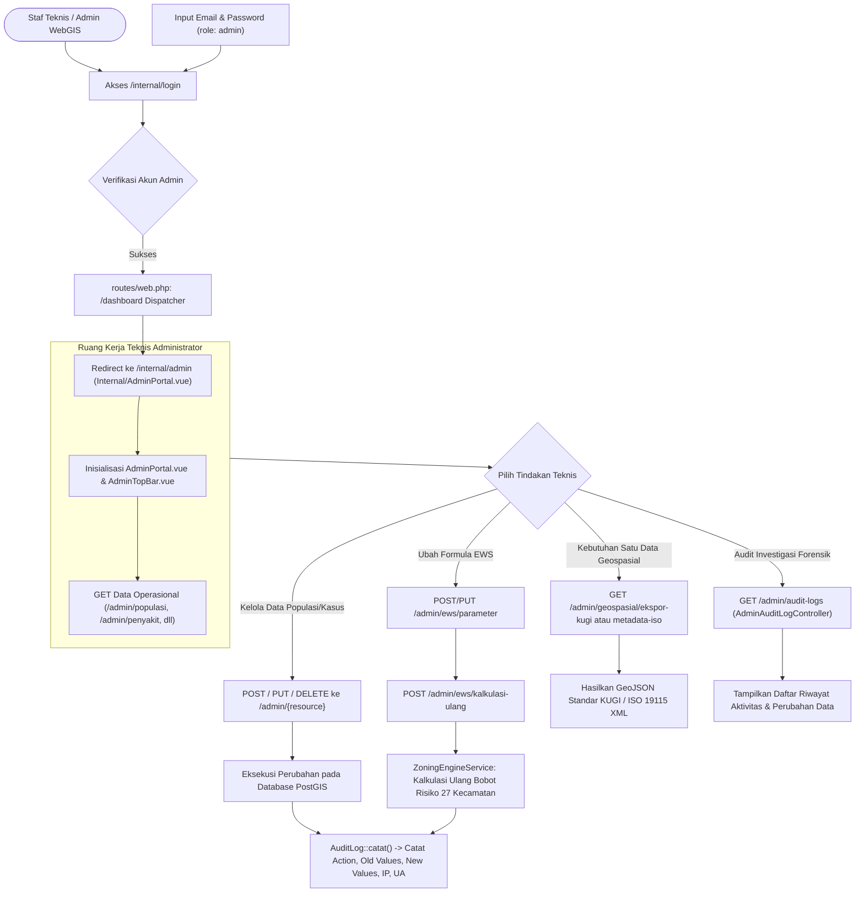
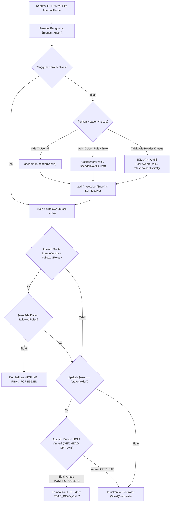

# DOKUMEN ANALISIS KOMPREHENSIF ROLE & PERMISSION (RBAC) TERNAKVERSE
**Sistem Informasi Geospasial & Pemantauan Populasi Ternak Kabupaten Banyumas**
*Dokumen Arsitektur Sistem, Analisis Keamanan Peran, dan Matriks Izin Akses*

---

| Parameter Dokumen | Keterangan |
| :--- | :--- |
| **Aplikasi** | TernakVerse (WebGIS & Livestock Early Warning System) |
| **Entitas Pengguna** | Dinas Pertanian dan Ketahanan Pangan Kabupaten Banyumas |
| **Penulis** | Tim Arsitektur Perangkat Lunak & Analis Keamanan Sistem Informasi |
| **Versi Dokumen** | 1.0.0-PROD-AUDIT |
| **Status Dokumen** | Dokumen Teknis Resmi (Architecture & Security Baseline) |
| **Klasifikasi Akses** | Internal Pemerintah Kabupaten Banyumas / Tim Pengembang |
| **Basis Kode** | Laravel 12 + Inertia.js v2 + Vue 3 + PostGIS (PostgreSQL) |

---

## DAFTAR ISI
1. [Ringkasan Eksekutif (Executive Summary)](#1-ringkasan-eksekutif-executive-summary)
2. [Gambaran Arsitektur Proyek (Project Architecture Overview)](#2-gambaran-arsitektur-proyek-project-architecture-overview)
3. [Identifikasi & Taksonomi Peran Pengguna (Role Identification)](#3-identifikasi--taksonomi-peran-pengguna-role-identification)
4. [Analisis Mendalam Setiap Peran (Individual Role Analysis)](#4-analisis-mendalam-setiap-peran-individual-role-analysis)
5. [Komparasi Peran & Matriks Izin Akses (Role Comparison & Permission Matrix)](#5-komparasi-peran--matriks-izin-akses-role-comparison--permission-matrix)
6. [Alur Perjalanan Pengguna & Diagram Mermaid (User Journey per Role)](#6-alur-perjalanan-pengguna--diagram-mermaid-user-journey-per-role)
7. [Tinjauan Keamanan & Analisis Kontrol Akses (Security & Access Control Review)](#7-tinjauan-keamanan--analisis-kontrol-akses-security--access-control-review)
8. [Temuan & Rekomendasi Tindakan (Findings & Actionable Recommendations)](#8-temuan--rekomendasi-tindakan-findings--actionable-recommendations)
9. [Analisis Tumpang Tindih Peran & Kasus Khusus (Role Overlap & Edge Cases)](#9-analisis-tumpang-tindih-peran--kasus-khusus-role-overlap--edge-cases)
10. [Matriks Referensi Teknis Kode Sumber (Technical Reference Matrix)](#10-matriks-referensi-teknis-kode-sumber-technical-reference-matrix)
11. [Kesimpulan Akhir & Pengesahan Arsitektur (Final Conclusion & Architectural Sign-Off)](#11-kesimpulan-akhir--pengesahan-arsitektur-final-conclusion--architectural-sign-off)

---

## 1. RINGKASAN EKSEKUTIF (EXECUTIVE SUMMARY)

Sistem **TernakVerse** dibangun sebagai platform *Spatial Decision Support System* (SDSS) terintegrasi untuk Pemerintah Kabupaten Banyumas, yang mengawinkan visualisasi kartografi geospasial presisi tinggi (WebGIS) dengan sistem peringatan dini wabah penyakit hewan menular (PMK dan LSD) serta neraca komoditas peternakan 27 kecamatan. 

Untuk menjamin kedaulatan data pemerintah daerah, kepatuhan terhadap regulasi keterbukaan informasi publik (UU KIP), dan perlindungan terhadap kepanikan pasar komoditas peternakan akibat data mentah yang belum diverifikasi, TernakVerse menerapkan arsitektur otorisasi berbasis peran (**Role-Based Access Control / RBAC**) yang membagi akses pengguna ke dalam **3 kelas operasional utama**:

1. **Publik (Guest / Unauthenticated Citizen / Peternak / Peneliti)**: Akses tanpa login ke peta umum, panduan biosekuriti, dan zonasi risiko berbasis warna kualitatif (*Zero Data Leakage Policy*).
2. **Stakeholder / Pimpinan Dinas (Authenticated Executive / Kabid Peternakan)**: Akses terautentikasi ke dasbor eksekutif, analitik agregat kuantitatif 27 kecamatan, visualisasi ECharts, dan unduhan dokumen laporan resmi (PDF/Excel) dengan jaminan **Read-Only mutlak**.
3. **Admin / Super Admin (Authenticated Technical Geospatial Staff)**: Akses penuh (*Full CRUD*) terhadap basis data relasional/spasial populasi, produksi, rekam kasus wabah, pemetaan Rumah Potong Hewan (RPH), kalibrasi parameter algoritma EWS, ekspor format nasional KUGI / ISO 19115, serta pengawasan audit forensik.

Di tingkat basis data, integritas peran dikunci secara deterministik menggunakan batasan cek tabel (**Database Table Constraint**) pada PostgreSQL:
```sql
ALTER TABLE users ADD CONSTRAINT chk_users_role CHECK (role IN ('admin', 'stakeholder'));
```
Konstrain ini menegaskan bahwa pada level persistensi data relasional hanya ada 2 peran formal (`admin` dan `stakeholder`), sedangkan peran `publik` ditangani secara elegan di lapisan perutean dan presentasi sebagai entitas anonim nir-otentikasi.

Analisis ini membedah arsitektur otorisasi TernakVerse secara objektif berdasarkan kode sumber aktual, mendokumentasikan batasan izin antar-peran, mengidentifikasi celah keamanan pada implementasi middleware saat ini, serta menyusun cetak biru (*blueprint*) penguatan sistem menuju implementasi tingkat produksi skala penuh di lingkungan Dinas Pertanian dan Ketahanan Pangan Kabupaten Banyumas.

---

## 2. GAMBARAN ARSITEKTUR PROYEK (PROJECT ARCHITECTURE OVERVIEW)

Arsitektur TernakVerse dirancang dengan pola *Decoupled Dual-Portal Topology* yang memisahkan kanal konsumsi publik dengan kanal operasional internal instansi pemerintah:

```
+-------------------------------------------------------------------------------------------------------+
|                                          TERNAKVERSE PLATFORM                                         |
+---------------------------------------------------+---------------------------------------------------+
|               PORTAL PUBLIK CITIZEN               |              PORTAL INTERNAL PEMERINTAH           |
|            (ternak.banyumaskab.go.id)             |        (internal-ternak.banyumaskab.go.id)        |
+---------------------------------------------------+---------------------------------------------------+
|  * Akses Bebas Tanpa Autentikasi                  |  * Memerlukan Akun & Autentikasi Sesi/Token       |
|  * Framework: Inertia.js v2 + Vue 3               |  * Framework: Inertia.js v2 + Vue 3 + Pinia       |
|  * Tampilan: Forest Intelligence GIS (Dark Mode)  |  * Layout: Specialized Split-Pane (Admin / Dinas) |
|  * Peta: Leaflet.js Choropleth Kualitatif         |  * Peta & Analitik: Leaflet + Apache ECharts      |
|  * Proteksi: ZERO DATA LEAKAGE                    |  * Proteksi: EnsureUserRole RBAC Middleware       |
+---------------------------------------------------+---------------------------------------------------+
                                         \                 /
                                          \               /
+-------------------------------------------------------------------------------------------------------+
|                                      BACKEND ENGINE: LARAVEL 12                                       |
|-------------------------------------------------------------------------------------------------------|
|  * Routing Layer: routes/web.php, routes/public.php, routes/internal.php                              |
|  * Security Middleware: EnsureUserRole.php (Enforce Verb Filtering & Role Guarantees)                 |
|  * Business Domain Services: DinasAnalyticsService, ZoningEngineService, GeospatialExportService     |
|  * Data Layer: Eloquent ORM + Spatial Scopes (ST_AsGeoJSON, ST_Centroid, ST_Within)                  |
|  * Forensic Layer: AuditLog::catat() Append-Only Audit Trail                                          |
+-------------------------------------------------------------------------------------------------------+
                                                     |
+-------------------------------------------------------------------------------------------------------+
|                                  DATABASE: POSTGRESQL 16 + POSTGIS 3.4                                |
|-------------------------------------------------------------------------------------------------------|
|  * Tabel Spasial: kecamatan (MultiPolygon EPSG:4326), fasilitas_rph (Point EPSG:4326)                |
|  * Tabel Bisnis: populasi_ternak, produksi_ternak, kasus_penyakit, zona_snapshot_kecamatan           |
|  * Tabel Otorisasi: users (Role check: admin, stakeholder), audit_logs, password_reset_tokens         |
+-------------------------------------------------------------------------------------------------------+
```

### Karakteristik Arsitektural Utama:
1. **Frontend Modern Monolith (Inertia.js v2)**: Menghubungkan kenyamanan pengembangan *Single Page Application* (Vue 3 Composition API) dengan kekuatan validasi dan keamanan di sisi peladen (Laravel 12).
2. **Kedaulatan & Sanitasi Data Geospasial**:
   - Lapisan publik (`routes/public.php`) menggunakan rute independen yang hanya menyajikan status zonasi makro (`HIJAU`, `KUNING`, `MERAH`) dan narasi edukasi mitigasi tanpa pernah menyentuh data numerik kasus infeksi.
   - Lapisan internal (`routes/internal.php`) dibentengi oleh `EnsureUserRole` middleware yang secara ketat membedakan antara kebutuhan peninjauan eksekutif dan hak istimewa manipulasi data teknis.
3. **Design System GIS Bertema Konsisten**: Menerapkan token visual *Forest Intelligence GIS* (`--bg-canvas: #090D16`, `--bg-surface: #0F172A`, `--primary-emerald: #059669`, `--ews-bahaya: #E11D48`) yang seragam di seluruh portal untuk kenyamanan pemantauan operasional 24/7.

---

## 3. IDENTIFIKASI & TAKSONOMI PERAN PENGGUNA (ROLE IDENTIFICATION)

Sistem mengklasifikasikan pengguna ke dalam 3 profil peran dengan batasan otoritas yang tegas:

```
                                  +-----------------------+
                                  |   PENGGUNA SISTEM     |
                                  +-----------+-----------+
                                              |
                   +--------------------------+--------------------------+
                   |                                                     |
       [STATUS: NON-LOGIN]                                     [STATUS: TERAUTENTIKASI]
                   |                                                     |
        +----------v----------+                               +----------v----------+
        |   PERAN 1: PUBLIK   |                               |    PENGGUNA RESMI   |
        |   (Warga/Peternak)  |                               +----------+----------+
        +---------------------+                                          |
                                              +--------------------------+--------------------------+
                                              |                                                     |
                                   [PERAN DB: 'stakeholder']                              [PERAN DB: 'admin']
                                              |                                                     |
                                   +----------v----------+                               +----------v----------+
                                   | PERAN 2: STAKEHOLDER|                               | PERAN 3: ADMIN /    |
                                   | (Pimpinan Dinas)    |                               | SUPER ADMIN (Teknis)|
                                   +---------------------+                               +---------------------+
```

### 3.1. Profil Peran 1: Publik (Citizen / Peternak / Akademisi / Tamu)
- **Definisi**: Seluruh pengguna internet umum yang mengakses portal tanpa melakukan proses autentikasi (login).
- **Filosofi Keamanan**: *Zero Data Leakage*. Publik berhak mengetahui status keamanan wilayah tempat tinggalnya demi kewaspadaan mandiri, namun tidak memiliki hak untuk melihat detail statistik kuantitatif wabah yang berpotensi memicu distorsi harga komoditas atau kepanikan massal peternak.
- **Identitas Teknis**: Sesi tamu tanpa record di tabel `users`.

### 3.2. Profil Peran 2: Stakeholder / Dinas (Pimpinan / Kabid Peternakan)
- **Definisi**: Pimpinan manajerial pada Dinas Pertanian dan Ketahanan Pangan Kabupaten Banyumas (Kepala Dinas, Kepala Bidang Peternakan dan Kesehatan Hewan, serta pejabat fungsional pengawas).
- **Filosofi Keamanan**: *Read-Only Strategic Governance*. Pimpinan membutuhkan akses komprehensif ke data kuantitatif, metrik sebaran populasi, produktivitas, visualisasi tren risiko, dan ekspor laporan resmi untuk bahan rapat pimpinan/Bupati, tetapi **secara mutlak dilarang memanipulasi, menambah, atau menghapus data teknis** demi mencegah konflik kepentingan dan menjamin validitas rekam data lapangan.
- **Identitas Teknis**: Akun terdaftar di tabel `users` dengan nilai kolom `role = 'stakeholder'`.

### 3.3. Profil Peran 3: Admin / Super Admin (Administrator WebGIS / Staf Teknis)
- **Definisi**: Staf teknis pengelola basis data geospasial dan operator sistem informasi pada Bidang Peternakan.
- **Filosofi Keamanan**: *Full Operational & Technical Authority with Forensic Accountability*. Memiliki kewenangan eksekusi penuh (CRUD) terhadap seluruh entitas peternakan dan kesehatan hewan, penyesuaian bobot parameter kalkulasi Early Warning System (EWS), penerbitan peringatan darurat, ekspor data geospasial berskala nasional, serta pemantauan log audit.
- **Identitas Teknis**: Akun terdaftar di tabel `users` dengan nilai kolom `role = 'admin'`.

### 3.4. Analisis Diskrepansi Penamaan Peran (Aliasing Mismatch Across Layers)
Terdapat variasi penamaan peran antar-lapisan pada basis kode saat ini yang perlu dipahami secara tepat oleh pengembang:

| Lapisan Sistem | Istilah Peran Publik | Istilah Peran Pimpinan | Istilah Peran Teknis | Catatan Teknis Sumber Kode |
| :--- | :--- | :--- | :--- | :--- |
| **Database Schema** | *(N/A - Non-User)* | `'stakeholder'` | `'admin'` | `2026_01_01_000001_create_users_table.php:35` |
| **Middleware RBAC** | `'guest'` / Fallback | `'stakeholder'` | `'admin'` | `EnsureUserRole.php:46-70` |
| **Route Declarations** | Anonim | `'stakeholder'` | `'admin'` | `routes/web.php:51, 61` |
| **Frontend Props** | `'publik'` | `'dinas'` | `'admin'` | `Public/Portal.vue:112`, `DinasPortal.vue:78` |
| **Frontend Display** | `"Publik"` | `"Kabid Peternakan"` | `"ROLE: SUPER_ADMIN"` | `AdminPortal.vue:83`, `useAdminPortal.ts:667` |

> [!NOTE]
> **Rekomendasi Penyelarasan**: Pemetaan antara frontend `'dinas'` dan backend `'stakeholder'` saat ini dijembatani secara terpisah pada masing-masing portal Vue. Di masa depan disarankan untuk mengadopsi konstanta enum tunggal (misal `App\Enums\UserRole`) untuk mencegah kebingungan sintaksis.

---

## 4. ANALISIS MENDALAM SETIAP PERAN (INDIVIDUAL ROLE ANALYSIS)

### 4.1. Analisis Peran: Publik (Warga / Peternak / Publik)

#### A. Tujuan & Sasaran Operasional
Memberikan sarana transparansi informasi geografis peternakan kepada masyarakat luas di Kabupaten Banyumas, peternak lokal, dan akademisi guna meningkatkan kewaspadaan dini terhadap penyakit menular ternak (PMK & LSD) tanpa membuka data privasi peternak atau data numerik sensitif daerah.

#### B. Tanggung Jawab Utama
- Memantau status zonasi risiko epidemiologi di 27 kecamatan di Banyumas.
- Membaca dan menerapkan instruksi biosekuriti serta SOP penanganan dini saat ternak terindikasi sakit.
- Mengakses panduan komprehensif gejala klinis PMK dan LSD.

#### C. Modul & Komponen yang Diakses
1. **Public WebGIS Map Canvas** (`resources/js/Pages/Public/Portal.vue` & `components/ternakverse/LeafletWebGisMap.vue`): Kanvas peta satelit/hybrid interaktif Banyumas.
2. **Kecamatan Risk Drawer / Popup** (`components/ternakverse/SelectedRegionPanel.vue`): Panel informasi wilayah kecamatan terpilih.
3. **PMK/LSD Mitigation Guide** (`routes/public.php:60-93` via API `/panduan-pmk-lsd`): Panduan kesehatan ternak resmi.
4. **Living Design System Inspector** (`resources/js/Pages/DesignRule.vue`): Akses terbuka untuk audit standar UI/UX Banyumas.

#### D. Hak Akses Data (Data Access Granularity)
- **Data yang Dapat Dilihat (Viewable)**:
  - Poligon batas administrasi 27 kecamatan (format GeoJSON EPSG:4326).
  - Status zonasi kualitatif per kecamatan: `HIJAU` (Aman), `KUNING` (Waspada), `MERAH` (Bahaya).
  - Pesan teks biosekuriti publik (misal: *"Zona Merah: Pembatasan ketat lalu lintas ternak"*).
  - Titik koordinat umum Rumah Potong Hewan (RPH) resmi milik Pemkab.
  - Artikel panduan penanganan gejala klinis dan narasi pencegahan wabah.
- **Data yang DILARANG Keras Dilihat (Prohibited / Redacted)**:
  - Angka absolut populasi ternak per komoditas di suatu kecamatan.
  - Angka riil jumlah kasus aktif, kesembuhan, atau mortalitas hewan sakit.
  - Nilai estimasi tonase produksi daging, susu, dan telur.
  - Data identitas peternak (Nama, NIK, No. Telepon, Alamat Kandang).
  - Log audit aktivitas pengguna internal pemerintah.

#### E. Batasan Akses & Sandbox
- Dibatasi secara mutlak pada endpoint publik di `routes/public.php`.
- Akses ke rute `/internal/*` diarahkan paksa menuju form login (`/internal/login`).
- Tidak memiliki hak untuk mengeksekusi request dengan metode `POST`, `PUT`, `PATCH`, atau `DELETE`.

---

### 4.2. Analisis Peran: Stakeholder / Dinas (Pimpinan / Kabid Peternakan)

#### A. Tujuan & Sasaran Operasional
Menyajikan instrumen pemantauan tingkat tinggi (*Executive Decision Dashboard*) bagi para pemangku kebijakan di lingkungan Dinas Pertanian dan Ketahanan Pangan Kabupaten Banyumas guna menentukan kebijakan karantina wilayah, alokasi vaksinasi darurat, dan perencanaan pasokan pangan hewani.

#### B. Tanggung Jawab Utama
- Mengevaluasi distribusi populasi komoditas unggulan (Sapi Potong, Sapi Perah, Kambing, Domba, Ayam Broiler, Ayam Petelur) di 27 kecamatan.
- Memantau indeks kerentanan dan peringatan dini wabah penyakit secara *real-time*.
- Mengunduh berkas laporan rekapitulasi resmi dinas dalam format Microsoft Excel dan dokumen cetak Adobe PDF untuk kebutuhan laporan kedinasan kepada Bupati Banyumas.

#### C. Modul & Komponen yang Diakses
1. **Executive Dinas Portal Shell** (`resources/js/Pages/Internal/DinasPortal.vue`): Shell navigasi khusus pemantauan pimpinan berorientasi analitik.
2. **Dinas Dashboard Component** (`resources/js/Pages/Dinas/Dashboard.vue`): Dasbor eksekutif dengan widget KPI ringkasan total populasi ternak, total produksi (ton), dan kasus aktif.
3. **Apache ECharts Analytics Engine** (`DinasDashboardController::getAnalitikData`): Diagram tren deret waktu populasi, perbandingan komoditas, dan rasio risiko kecamatan.
4. **Kecamatan Drilldown Explorer** (`DinasDashboardController::getDrilldownKecamatan`): Penelusuran spasial mendalam pada satu kecamatan spesifik.
5. **Official Dinas Report Exporter** (`DinasDashboardController::downloadLaporan`): Engine konversi data ke format XLS dan PDF.

#### D. Hak Akses Data (Data Access Granularity)
- **Data yang Dapat Dilihat (Viewable)**:
  - Seluruh data kuantitatif populasi ternak per kecamatan dan per komoditas.
  - Detail angka produksi tahunan/bulanan komoditas daging, susu, dan telur.
  - Statistik kasus aktif PMK, LSD, tingkat kematian (*mortality rate*), dan tingkat kesembuhan.
  - Ambang batas (*threshold*) parameter Early Warning System aktif.
  - Laporan neraca surplus/defisit pangan asal hewan tingkat kabupaten.
- **Data yang DILARANG Dibuat, Diubah, atau Dihapus (Read-Only Enforcement)**:
  - **Dilarang** menambah, merevisi, atau menghapus entri populasi ternak.
  - **Dilarang** memanipulasi status rekam kasus wabah hewan.
  - **Dilarang** mengubah bobot algoritma parameter zonasi risiko.
  - **Dilarang** memicu fungsi rekalkulasi data spasial (*recalculate zoning*).
  - **Dilarang** menghapus log audit operasional.

#### E. Mekanisme Penegakan Read-Only Mutlak
Penegakan aturan baca-saja (*Read-Only*) untuk peran stakeholder diimplementasikan pada level arsitektur middleware inti (`app/Http/Middleware/EnsureUserRole.php:61-70`):
```php
// 3. Kebijakan Read-Only Mutlak untuk Role 'stakeholder'
if ($role === 'stakeholder') {
    $safeMethods = ['GET', 'HEAD', 'OPTIONS'];
    if (!in_array($request->method(), $safeMethods)) {
        return response()->json([
            'status' => 'error',
            'error_code' => 'RBAC_READ_ONLY',
            'message' => "Akses Ditolak: Akun Pimpinan Dinas (Stakeholder) hanya memiliki hak akses Read-Only. Tindakan penambahan, pengubahan, atau penghapusan data hanya dapat dilakukan oleh Administrator Geospasial.",
        ], Response::HTTP_FORBIDDEN);
    }
}
```
Setiap percobaan pengiriman request `POST`, `PUT`, `PATCH`, atau `DELETE` oleh akun pimpinan secara otomatis digagalkan dengan respons **HTTP 403 Forbidden** dan kode galat `RBAC_READ_ONLY`.

---

### 4.3. Analisis Peran: Admin / Super Admin (Administrator WebGIS / Staf Teknis)

#### A. Tujuan & Sasaran Operasional
Memberikan kewenangan operasional penuh kepada staf teknis dan pengelola data spasial untuk memelihara validitas data primer peternakan, memutakhirkan rekam kasus kesehatan hewan dari lapangan, mengonfigurasi mesin analitik spasial, menjamin interoperabilitas geospasial nasional, dan mengawasi rekam jejak sistem.

#### B. Tanggung Jawab Utama
- Mengelola data master populasi dan produksi ternak secara berkala dari laporan 27 koordinator kecamatan (PPL/Mantri Hewan).
- Menginput, memvalidasi, dan memperbarui status rekam kasus epidemi PMK dan LSD.
- Memelihara data spasial dan atribut fasilitas Rumah Potong Hewan (RPH).
- Mengatur bobot parameter Early Warning System (kasus aktif, kepadatan ternak, cakupan vaksinasi) dan mengeksekusi kalkulasi ulang zonasi dinamis (*Dynamic Recalculation Engine*).
- Menghasilkan berkas geospasial terstandarisasi sesuai standar Katalog Unsur Geografi Indonesia (KUGI) Badan Informasi Geospasial (BIG) dan format metadata spasial internasional ISO 19115 XML.
- Melakukan investigasi forensik terhadap log perubahan data pada sistem.

#### C. Modul & Komponen yang Diakses
1. **Admin Technical Portal Layout** (`resources/js/Pages/Internal/AdminPortal.vue`): Shell kerja staf teknis dengan navigasi tab terintegrasi.
2. **Admin Operational Panel** (`resources/js/Pages/Admin/Panel.vue` & `app/Http/Controllers/Internal/AdminDataController.php`):
   - Tab Manajemen Data Populasi (CRUD).
   - Tab Manajemen Data Produksi (CRUD).
   - Tab Penanganan Kasus Wabah Hewan (CRUD).
   - Tab Pemetaan & Status RPH (CRUD).
3. **EWS Parameter Configuration & Recalculation Console**:
   - Form penyesuaian bobot parameter risiko (`/admin/ews/parameter`).
   - Tombol trigger pemutakhiran zonasi otomatis (`/admin/ews/kalkulasi-ulang`).
4. **Geospatial National Interoperability Exporter**:
   - Ekspor KUGI GeoJSON (`/admin/geospasial/ekspor-kugi`).
   - Ekspor ISO 19115 XML (`/admin/geospasial/metadata-iso`).
5. **Audit Trail Forensics Viewer** (`resources/js/Pages/Admin/AuditLogs.vue`):
   - Tabel pemantauan aktivitas audit sistem yang mencatat `action`, `table_name`, `old_values`, `new_values`, `ip_address`, dan waktu kejadian.

#### D. Hak Akses Data (Data Access Granularity)
- **Create**: Berwenang membuat entri baru pada tabel `populasi_ternak`, `produksi_ternak`, `kasus_penyakit`, dan `fasilitas_rph`.
- **Read**: Berwenang membaca seluruh data mentah (*raw data*), data agregat, konfigurasi sistem, dan log audit.
- **Update**: Berwenang mengoreksi data atribut, titik koordinat spasial RPH, bobot formula EWS, dan status kasus.
- **Delete**: Berwenang menghapus data entri yang salah secara fisik (*hard delete*) atau logis.
- **Execute**: Berwenang menjalankan service backend `ZoningEngineService::recalculateZoning()` yang mengkalkulasi ulang data spasial zonasi 27 kecamatan.

#### E. Akuntabilitas & Jejak Audit (Audit Trail Accountability)
Seluruh tindakan manipulasi data oleh Admin wajib dan secara otomatis dicatat dalam tabel `audit_logs` melalui metode statis `AuditLog::catat()`. Administrator tidak dapat menyunting atau menghapus log yang telah terekam karena model `AuditLog` dirancang bersifat *append-only* (`public $timestamps = false;`).

---

## 5. KOMPARASI PERAN & MATRIKS IZIN AKSES (ROLE COMPARISON & PERMISSION MATRIX)

### 5.1. Tabel Komparasi Umum Karakteristik Peran

| Dimensi Evaluasi | Publik (Citizen) | Stakeholder / Pimpinan Dinas | Admin / Super Admin (Teknis) |
| :--- | :--- | :--- | :--- |
| **Status Autentikasi** | Anonim / Unauthenticated | Terautentikasi (Auth Session) | Terautentikasi (Auth Session) |
| **Representasi Database** | Tidak ada record | Record di tabel `users` (`role='stakeholder'`) | Record di tabel `users` (`role='admin'`) |
| **URL Portal Utama** | `ternak.banyumaskab.go.id` (`/`) | `internal-ternak.banyumaskab.go.id/internal/dinas` | `internal-ternak.banyumaskab.go.id/internal/admin` |
| **Metode HTTP Diizinkan** | `GET`, `HEAD` | `GET`, `HEAD`, `OPTIONS` | `GET`, `HEAD`, `POST`, `PUT`, `PATCH`, `DELETE` |
| **Granularitas Data** | Spasial Kualitatif (Hijau/Kuning/Merah) | Kuantitatif Agregat 27 Kecamatan | Kuantitatif Detail & Level Transaksional Record |
| **Akses Angka Kasus Riil** | ❌ Dibatasi (Zero Data Leakage) | ✅ Terbuka Penuh | ✅ Terbuka Penuh |
| **Manipulasi Data (CUD)**| ❌ Ditolak | ❌ Ditolak (HTTP 403 RBAC_READ_ONLY) | ✅ Diizinkan Penuh |
| **Rekalkulasi Mesin EWS** | ❌ Ditolak | ❌ Ditolak | ✅ Diizinkan Penuh |
| **Ekspor Laporan Manajerial** | ❌ Ditolak | ✅ Diizinkan (Excel & PDF) | ✅ Diizinkan (Excel & PDF) |
| **Ekspor Geospasial KUGI/ISO** | ❌ Ditolak | ❌ Ditolak | ✅ Diizinkan Penuh |
| **Pencatatan Audit Trail** | ❌ Tidak Dicatat | ❌ Tidak Dicatat (Hanya Read) | ✅ Wajib Dicatat Setiap Mutasi |
| **Inspeksi Log Audit** | ❌ Ditolak | ❌ Ditolak | ✅ Diizinkan Penuh |

---

### 5.2. Matriks Izin Akses Menyeluruh (Comprehensive Permission Matrix)

**Keterangan Indikator Akses:**
- **[FULL]** : Akses Penuh (Create, Read, Update, Delete)
- **[VIEW]** : Akses Lihat / Baca Saja (Read-Only)
- **[LTD]**  : Akses Terbatas / Disanitasi (Sanitized / Qualitative Only)
- **[NONE]** : Akses Ditolak Mutlak (Blocked / HTTP 401 / 403 / Redirect)
- **[UNV]**  : Jalur Akses Tidak Tervalidasi / Celah Perutean Shell SPA

| No | Modul / Fitur Aplikasi | Jalur Rute / Endpoint | Publik | Stakeholder (Dinas) | Admin (Teknis) | Mekanisme Penegakan Keamanan |
| :-: | :--- | :--- | :-: | :-: | :-: | :--- |
| **1** | **Portal Publik WebGIS** | `GET /` | **[FULL]** | **[FULL]** | **[FULL]** | Rute publik terbuka (`routes/web.php:21`) |
| **2** | **GeoJSON Zonasi Kualitatif** | `GET /zonasi` | **[LTD]** | **[LTD]** | **[LTD]** | Sanitasi data di controller (`routes/public.php:17-58`) |
| **3** | **Panduan Mitigasi PMK & LSD** | `GET /panduan-pmk-lsd` | **[VIEW]** | **[VIEW]** | **[VIEW]** | Informasi edukasi publik (`routes/public.php:60-93`) |
| **4** | **Living Design System Inspector**| `GET /design-rule` | **[VIEW]** | **[VIEW]** | **[VIEW]** | Rute panduan UI publik (`routes/web.php:41-43`) |
| **5** | **Shell UI Portal Dinas (SPA)** | `GET /internal/dinas` | **[UNV]** | **[FULL]** | **[FULL]** | Render Inertia tanpa middleware (`routes/web.php:46`) |
| **6** | **Handshake Data Dasbor Dinas**| `GET /dinas/dashboard` | **[NONE]** | **[VIEW]** | **[VIEW]** | `EnsureUserRole:stakeholder,admin` (`routes/web.php:51`) |
| **7** | **Peta Kabupaten & Agregat Spasial**| `GET /peta/kabupaten` | **[NONE]** | **[VIEW]** | **[VIEW]** | `EnsureUserRole` middleware (`routes/internal.php:22`) |
| **8** | **Drilldown Spasial Kecamatan** | `GET /peta/kecamatan/{id}` | **[NONE]** | **[VIEW]** | **[VIEW]** | `EnsureUserRole` middleware (`routes/internal.php:23`) |
| **9** | **Dataset Analitik & Metrik ECharts**| `GET /analitik/data` | **[NONE]** | **[VIEW]** | **[VIEW]** | `EnsureUserRole` middleware (`routes/internal.php:28`) |
| **10**| **Ekspor Laporan Resmi (Excel/PDF)**| `GET /laporan/unduh` | **[NONE]** | **[FULL]** | **[FULL]** | `EnsureUserRole` middleware (`routes/internal.php:34`) |
| **11**| **Shell UI Portal Admin (SPA)** | `GET /internal/admin` | **[UNV]** | **[UNV]** | **[FULL]** | Render Inertia tanpa middleware (`routes/web.php:56`) |
| **12**| **Admin Panel Handshake Props** | `GET /admin/panel` | **[NONE]** | **[NONE]** | **[FULL]** | `EnsureUserRole:admin` (`routes/web.php:61-62`) |
| **13**| **Audit Logs Inertia Viewer** | `GET /admin/audit-logs` | **[NONE]** | **[NONE]** | **[FULL]** | `EnsureUserRole:admin` (`routes/web.php:63`) |
| **14**| **Baca Populasi Ternak (Admin API)**| `GET /admin/populasi` | **[NONE]** | **[VIEW]** | **[FULL]** | `EnsureUserRole` (`routes/internal.php:46`) |
| **15**| **Tambah Populasi Ternak** | `POST /admin/populasi` | **[NONE]** | **[NONE]** | **[FULL]** | `EnsureUserRole` Verb Filter (`EnsureUserRole.php:63`) |
| **16**| **Ubah Populasi Ternak** | `PUT/PATCH /admin/populasi/{id}`| **[NONE]** | **[NONE]** | **[FULL]** | `EnsureUserRole` Verb Filter + `AuditLog::catat()` |
| **17**| **Hapus Populasi Ternak** | `DELETE /admin/populasi/{id}` | **[NONE]** | **[NONE]** | **[FULL]** | `EnsureUserRole` Verb Filter + `AuditLog::catat()` |
| **18**| **Baca Produksi Ternak (Admin API)**| `GET /admin/produksi` | **[NONE]** | **[VIEW]** | **[FULL]** | `EnsureUserRole` (`routes/internal.php:53`) |
| **19**| **Tambah/Ubah/Hapus Produksi** | `POST/PUT/DELETE /admin/produksi`| **[NONE]** | **[NONE]** | **[FULL]** | `EnsureUserRole` Verb Filter + `AuditLog::catat()` |
| **20**| **Kelola Rekam Kasus PMK & LSD** | `POST/PUT/DELETE /admin/penyakit`| **[NONE]** | **[NONE]** | **[FULL]** | `EnsureUserRole` Verb Filter + `AuditLog::catat()` |
| **21**| **Kelola Titik Spasial RPH** | `POST/PUT/DELETE /admin/rph` | **[NONE]** | **[NONE]** | **[FULL]** | `EnsureUserRole` Verb Filter + `AuditLog::catat()` |
| **22**| **Baca Parameter Rumus EWS** | `GET /admin/ews/parameter` | **[NONE]** | **[VIEW]** | **[FULL]** | `EnsureUserRole` (`routes/internal.php:74`) |
| **23**| **Ubah Bobot Parameter Rumus EWS**| `POST/PUT /admin/ews/parameter`| **[NONE]** | **[NONE]** | **[FULL]** | `EnsureUserRole` Verb Filter + `AuditLog::catat()` |
| **24**| **Trigger Rekalkulasi Spasial EWS**| `POST /admin/ews/kalkulasi-ulang`| **[NONE]** | **[NONE]** | **[FULL]** | `EnsureUserRole` Verb Filter (`ZoningEngineService`) |
| **25**| **Ekspor Format Spasial KUGI BIG**| `GET /admin/geospasial/ekspor-kugi`| **[NONE]** | **[NONE]** | **[FULL]** | `EnsureUserRole` (`AdminDataController::eksporKugi`)|
| **26**| **Ekspor Metadata ISO 19115 XML** | `GET /admin/geospasial/metadata-iso`| **[NONE]** | **[NONE]** | **[FULL]** | `EnsureUserRole` (`AdminDataController::eksporIsoXml`)|
| **27**| **Akses JSON Audit Logs (Admin API)**| `GET /admin/audit-logs` | **[NONE]** | **[NONE]** | **[FULL]** | Query `AuditLog::with('user')` (`routes/internal.php:90`)|
| **28**| **Pengaturan Profil Pengguna** | `GET/POST /settings/*` | **[NONE]** | **[FULL]** | **[FULL]** | `routes/settings.php` diproteksi middleware `auth` |

---

### 5.3. Analisis Naratif Mengapa Hak Akses Dibedakan (Architectural Rationale)

1. **Mengapa Publik Tidak Mendapatkan Angka Numerik Kasus Penyakit Hewan?**
   Dalam konteks peternakan nasional dan regional, publikasi angka mentah ternak terjangkit PMK atau LSD secara serampangan dapat memicu aksi panik jual ternak (*panic selling*) oleh peternak rakyat dengan harga jatuh drastis. Selain itu, oknum spekulan dan tengkulak dapat memanfaatkan informasi distrik wabah untuk menekan harga komoditas hewani lokal. Oleh karena itu, arsitektur TernakVerse menerapkan prinsip *Public Protective Abstraction*, di mana publik hanya disajikan status zonasi makro dan panduan proteksi biosekuriti, sedangkan angka kasus absolut hanya dipegang oleh instansi berwenang.

2. **Mengapa Pimpinan Dinas Dibatasi Read-Only Mutlak?**
   Pimpinan dinas (Kepala Dinas dan Kabid) adalah pejabat penentu arah kebijakan umum, penerbit instruksi karantina, dan pembuat keputusan strategis. Jika akun pimpinan memiliki wewenang menyunting atau menghapus data teknis di database, akan timbul kerentanan tata kelola (*governance risk*) seperti potensi manipulasi data performa produksi untuk kepentingan politis atau laporan capaian semu. Pembatasan baca-saja (*Read-Only*) menjamin bahwa pimpinan melihat data apa adanya yang diinput oleh petugas verifikator teknis dari lapangan (*single version of truth*).

3. **Mengapa Hanya Admin yang Berhak Menjalankan Rekalkulasi EWS dan Ekspor KUGI?**
   - **Rekalkulasi EWS (`ZoningEngineService::recalculateZoning`)** melibatkan eksekusi query spasial berat PostGIS (`ST_Within`, `ST_Intersects`) yang menghitung ulang indeks risiko epidemiologi untuk 27 kecamatan secara simultan. Jika fitur ini dapat dipicu oleh sembarang pengguna, peladen dapat mengalami *Denial of Service* (DoS) akibat kehabisan sumber daya memori dan komputasi basis data.
   - **Ekspor KUGI dan ISO 19115 XML** merupakan data spasial berstandar nasional yang dipublikasikan ke simpul jaringan informasi geospasial daerah (Infrastruktur Data Spasial Nasional / IDSN - Geoportal Kebumen/Banyumas). Kesalahan penyajian format atribut dapat merusak integrasi peta spasial antar-organisasi perangkat daerah (OPD) se-Kabupaten Banyumas.

---

## 6. ALUR PERJALANAN PENGGUNA & DIAGRAM MERMAID (USER JOURNEY PER ROLE)

Berikut adalah visualisasi alur interaksi setiap peran dalam arsitektur sistem TernakVerse:

### 6.1. Alur Perjalanan Pengguna: Publik / Citizen (Peta Umum & Edukasi)



---

### 6.2. Alur Perjalanan Pengguna: Stakeholder / Pimpinan Dinas (Dasbor Analitik)



---

### 6.3. Alur Perjalanan Pengguna: Admin / Super Admin (Staf Teknis Geospasial)



---

### 6.4. Diagram Logika Alur Penegakan RBAC Middleware (`EnsureUserRole.php`)



---

## 7. TINJAUAN KEAMANAN & ANALISIS KONTROL AKSES (SECURITY & ACCESS CONTROL REVIEW)

Berdasarkan investigasi menyeluruh terhadap kode sumber aktual di repositori, ditemukan beberapa aspek implementasi yang telah memenuhi standar keamanan tinggi, serta beberapa celah signifikan (*vulnerabilities*) yang harus dimitigasi:

### TEMUAN KERENTANAN & RISIKO KEAMANAN

#### 1. [TEMUAN TINGKAT MENENGAH - MEDIUM] Fallback Otomatis Pengguna Tanpa Login ke Akun Stakeholder
- **Lokasi Kode**: `app/Http/Middleware/EnsureUserRole.php:34-37`
- **Potongan Kode Sumber**:
  ```php
  } else {
      // Default fallback untuk demo / sesi aktif: ambil user stakeholder pertama
      $user = User::where('role', 'stakeholder')->first();
  }
  ```
- **Analisis Dampak Keamanan**:
  Jika pengguna asing (tamu/penyerang) mengirimkan permintaan HTTP langsung ke endpoint internal API (misalnya: `GET /peta/kabupaten`, `GET /analitik/data`, atau `GET /laporan/ekspor-excel`) tanpa menyertakan kredensial sesi login atau bearer token, middleware tidak memblokir permintaan dengan kode status 401 Unauthorized. Sebaliknya, middleware secara otomatis mengambil pengguna acak ber-role `stakeholder` dari database dan melakukan otentikasi otomatis melalui `auth()->setUser($user)`.
- **Dampak Nyata**: Siapa pun di jaringan publik yang mengetahui alamat URL internal API dapat mengunduh seluruh data agregat peternakan 27 kecamatan dan laporan resmi Pemkab Banyumas tanpa perlu memiliki akun.
- **Rekomendasi Perbaikan**: Hapus logika fallback ini pada lingkungan *staging* dan *production*. Wajibkan middleware `auth:sanctum` atau `auth:web` sebelum eksekusi `EnsureUserRole`.

---

#### 2. [TEMUAN TINGKAT RENDAH - LOW] Rute Shell SPA (`/internal/admin` & `/internal/dinas`) Tidak Diproteksi Middleware RBAC
- **Lokasi Kode**: `routes/web.php:46-48` dan `routes/web.php:56-58`
- **Potongan Kode Sumber**:
  ```php
  // 4. PORTAL DINAS (Analisis Kuantitatif & Kewaspadaan Wabah)
  Route::get('/internal/dinas', function () {
      return Inertia::render('Internal/DinasPortal');
  })->name('internal.dinas');
  
  // 5. PANEL ADMIN TEKNIS (Staf Teknis - Tata Letak 1160px & CRUD Data)
  Route::get('/internal/admin', function () {
      return Inertia::render('Internal/AdminPortal');
  })->name('internal.admin');
  ```
- **Analisis Dampak Keamanan**:
  Rute web yang merender komponen Inertia `Internal/DinasPortal` dan `Internal/AdminPortal` dideklarasikan secara bebas di luar *middleware group* otentikasi. Meskipun pemanggilan data API di balik komponen tersebut mungkin dibentengi, antarmuka visual (shell antarmuka pengguna, struktur menu, formulir input, dan nama-nama variabel internal) dapat dimuat secara bebas oleh pengguna anonim yang menavigasi langsung ke `/internal/admin` atau `/internal/dinas`.
- **Rekomendasi Perbaikan**: Bungkus kedua deklarasi rute tersebut dengan grup middleware otentikasi dan pengecekan peran:
  ```php
  Route::middleware(['auth', EnsureUserRole::class . ':admin'])->get('/internal/admin', ...);
  Route::middleware(['auth', EnsureUserRole::class . ':stakeholder,admin'])->get('/internal/dinas', ...);
  ```

---

#### 3. [TEMUAN TINGKAT RENDAH - LOW] Risiko Pemalsuan Peran Melalui Header HTTP (`X-User-Role` & `X-User-Id`)
- **Lokasi Kode**: `app/Http/Middleware/EnsureUserRole.php:27-33`
- **Potongan Kode Sumber**:
  ```php
  $headerUserId = $request->header('X-User-Id');
  $headerRole = $request->header('X-User-Role') ?? $request->query('role');

  if ($headerUserId) {
      $user = User::find($headerUserId);
  } elseif ($headerRole) {
      $user = User::where('role', strtolower($headerRole))->first();
  }
  ```
- **Analisis Dampak Keamanan**:
  Middleware memungkinkan *impersonation* peran atau ID pengguna hanya dengan menyisipkan header HTTP kustom (`X-User-Role: admin`) atau parameter query (`?role=admin`). Jika aplikasi dipasang di belakang *reverse proxy* (Nginx/Cloudflare/HAProxy) yang tidak dikonfigurasi untuk menghapus (*strip*) header `X-*` yang datang dari klien luar, penyerang dapat secara sewenang-wenang mengangkat derajat hak aksesnya menjadi Administrator tanpa kredensial valid.
- **Rekomendasi Perbaikan**: Isolasi logika pencarian berbasis header khusus hanya untuk lingkungan pengujian otomatis (`app()->environment('testing', 'local')`), dan matikan sepenuhnya pada lingkungan produksi.

---

#### 4. [TEMUAN INFORMASIONAL - INFO] Pendaftaran Mandiri Publik Terbuka Default ke Role `stakeholder`
- **Lokasi Kode**: `app/Http/Controllers/Auth/RegisteredUserController.php:43` & `app/Actions/Fortify/CreateNewUser.php:32`
- **Potongan Kode Sumber**:
  ```php
  $user = User::create([
      'nama' => $request->name,
      'email' => $request->email,
      'password' => Hash::make($request->password),
      'role' => 'stakeholder',
      'aktif' => true,
  ]);
  ```
- **Analisis Dampak Keamanan**:
  Formulir pendaftaran (`POST /register`) saat ini terbuka dan secara bawaan menetapkan peran pengguna baru sebagai `stakeholder` aktif. Ini berarti setiap warga masyarakat yang mendaftarkan akun di sistem secara instan mendapatkan wewenang setara Kepala Bidang Peternakan untuk melihat statistik detail peternakan dan mengunduh laporan eksekutif resmi.
- **Rekomendasi Perbaikan**: Matikan fitur registrasi mandiri publik (`Fortify::registerView(false)`) untuk portal internal pemerintah daerah. Pembuatan akun dinas dan staf teknis harus dilakukan secara tertutup melalui administrator (*Whitelisted Invitation / Admin-Created Accounts*).

---

### TEMUAN POSITIF & ASPEK ARSITEKTURAL UNGGUL

#### 5. [ASPEK POSITIF - PRAKTIK TERBAIK] Kepatuhan Zero Data Leakage pada Kanal Publik
- **Lokasi Kode**: `routes/public.php:17-58`
- **Analisis**: Pada endpoint publik `/zonasi`, sistem mengambil geometri poligon kecamatan dan memetakan status risiko hanya ke label `HIJAU`, `KUNING`, atau `MERAH` dengan pesan himbauan sanitasi biosekuriti. Tidak ada atribut kolom `jumlah_kasus`, `jumlah_kematian`, atau `populasi_sapi` yang disertakan dalam respons JSON GeoJSON. Hal ini mencerminkan implementasi prinsip pemisahan data (*Data Minimization & Segregation*) yang sangat baik sesuai kaidah keamanan informasi pemerintahan.

#### 6. [ASPEK POSITIF - PRAKTIK TERBAIK] Pencatatan Jejak Audit Forensik Menyeluruh (`AuditLog::catat()`)
- **Lokasi Kode**: `app/Http/Controllers/Internal/AdminDataController.php` (Lines: 56, 78, 93, 129, 151, 166, 198, 223, 244, 281, 313, 328, 386) & `app/Models/AuditLog.php`
- **Analisis**: Setiap kali Administrator melakukan aksi penambahan (CREATE), pengubahan (UPDATE), penghapusan (DELETE), atau pengubahan parameter (CONFIG_CHANGE), sistem secara konsisten mencatat:
  - ID Pengguna (`user_id`)
  - Aksi yang dilakukan (`action`)
  - Tabel target (`table_name`)
  - ID Record (`record_id`)
  - Data sebelum diubah (`old_values` dalam format JSON)
  - Data sesudah diubah (`new_values` dalam format JSON)
  - Alamat IP Klien (`ip_address`)
  - Identitas Peramban (`user_agent`)
  Tabel ini berstatus *append-only* (`public $timestamps = false;`) sehingga tidak dapat dimanipulasi melalui metode standar Eloquent, menjamin integritas pembuktian jika terjadi sengketa perubahan data di kemudian hari.

---

## 8. TEMUAN & REKOMENDASI TINDAKAN (FINDINGS & ACTIONABLE RECOMMENDATIONS)

Sebagai bagian dari evaluasi sistem tingkat lanjut, berikut adalah rekomendasi tindakan terstruktur untuk menyempurnakan implementasi RBAC TernakVerse menuju kesiapan operasional penuh:

| No | Kategori | Tingkat Urgensi | Masalah yang Ditemukan | Usulan Solusi Perbaikan Teknis | Berkas Target |
| :-: | :--- | :---: | :--- | :--- | :--- |
| **1** | **Autentikasi & Otorisasi** | **CRITICAL** | Endpoint internal API memiliki fallback otomatis ke akun stakeholder jika tidak login. | Hapus kode baris 35-37 pada `EnsureUserRole`. Kembalikan respons JSON `HTTP 401 Unauthorized` jika `$user` bernilai null. | `app/Http/Middleware/EnsureUserRole.php` |
| **2** | **Proteksi Antarmuka Web** | **HIGH** | Rute `/internal/admin` dan `/internal/dinas` dapat dirender oleh browser tanpa login. | Sisipkan middleware `['auth', EnsureUserRole::class . ':admin']` dan `:stakeholder,admin` pada deklarasi rute web. | `routes/web.php` |
| **3** | **Manajemen Pengguna** | **HIGH** | Registrasi akun terbuka untuk publik dan langsung berstatus sebagai `stakeholder`. | Nonaktifkan pendaftaran publik pada `Fortify` atau ubah status pengguna baru menjadi `pending_approval`. | `app/Actions/Fortify/CreateNewUser.php` |
| **4** | **Keamanan Header HTTP** | **MEDIUM** | Header `X-User-Role` dan `X-User-Id` dapat digunakan untuk *spoofing* identitas pengguna. | Bungkus pemrosesan header dengan kondisi pengujian: `if (!app()->isProduction()) { ... }`. | `app/Http/Middleware/EnsureUserRole.php` |
| **5** | **Standarisasi Tipe Data** | **LOW** | Penamaan role bervariasi antara `stakeholder` (DB) dan `dinas` (Frontend). | Buat PHP 8.2 Enum resmi `App\Enums\UserRole` dan ekspor definisi tipenya ke TypeScript frontend. | `app/Enums/UserRole.php` & `resources/js/types/index.d.ts` |
| **6** | **Granularitas Izin (Fine-Grained RBAC)**| **ENHANCEMENT** | Saat ini hanya ada 2 peran internal (`admin` dan `stakeholder`). | Rancang sub-peran teknis masa depan (misal: *Petugas Lapangan Kecamatan* dengan izin input khusus wilayah kecamatannya sendiri). | `database/migrations/*` & `app/Policies/*` |

---

## 9. ANALISIS TUMPANG TINDIH PERAN & KASUS KHUSUS (ROLE OVERLAP & EDGE CASES)

Dalam operasional harian pemerintahan, sering terjadi dinamika penggunaan yang membutuhkan antisipasi arsitektur sistem:

### 9.1. Kasus 1: Administrator Mengakses Portal Pimpinan Dinas
- **Kondisi**: Staf teknis (Admin) perlu memeriksa tampilan dasbor eksekutif yang dilihat oleh Kepala Dinas untuk memastikan grafik ECharts ter-render sempurna.
- **Dukungan Arsitektur Saat Ini**: Berjalan sempurna. Pada `routes/web.php:51`:
  ```php
  Route::middleware([EnsureUserRole::class . ':stakeholder,admin'])->group(function () {
      Route::get('/dinas/dashboard', [DinasDashboardController::class, 'index']);
  });
  ```
  Rute dasbor dinas secara eksplisit mengizinkan peran `admin` berdampingan dengan `stakeholder`, sehingga admin tidak terblokir saat melakukan supervisi visual.

### 9.2. Kasus 2: Stakeholder Mencoba Melakukan Tindakan Teknis Admin
- **Kondisi**: Pengguna dengan peran stakeholder mencoba mengakses rute modifikasi data atau membuka `/internal/admin`.
- **Dukungan Arsitektur Saat Ini**: 
  - Jika mengakses rute yang diberi filter `:admin` (seperti `/admin/panel`), middleware mengeksekusi blok kode baris 51-56 dan mengembalikan galat `RBAC_FORBIDDEN` (HTTP 403).
  - Jika mengirimkan request mutasi data (`POST`, `PUT`, `DELETE`) ke rute internal lainnya, middleware mengeksekusi blok kode baris 61-70 dan mengembalikan galat `RBAC_READ_ONLY` (HTTP 403).
  - Sistem memiliki pertahanan berlapis ganda (*Defense-in-Depth*) untuk mencegah eskalasi wewenang ilegal oleh pimpinan.

### 9.3. Kasus 3: Kadaluwarsa Sesi Saat Pengguna Membuka Peta Berjam-Jam
- **Kondisi**: Petugas membiarkan layar monitor WebGIS terbuka di Command Center selama berjam-jam hingga sesi Laravel kedaluwarsa (*session timeout*).
- **Perilaku Sistem**: Request polling data asinkron berikutnya akan menerima galat otentikasi. Sistem penanganan Inertia.js v2 secara otomatis menangkap status 401/419 dan mengarahkan kembali peramban ke halaman login dengan pesan sesi habis.

### 9.4. Kasus 4: Konkurensi Tab Ganda (Multi-Tab Concurrency)
- **Kondisi**: Pengguna membuka tab 1 untuk Portal Publik dan tab 2 untuk Panel Admin dalam peramban yang sama.
- **Perilaku Sistem**: Sesi autentikasi tersimpan di *secure HTTP-only cookie*. Tab portal publik tetap berfungsi normal karena rute publik bersifat agnostik terhadap sesi (tidak terganggu oleh keberadaan cookie autentikasi), sementara tab admin tetap mempertahankan hak akses adminnya.

---

## 10. MATRIKS REFERENSI TEKNIS KODE SUMBER (TECHNICAL REFERENCE MATRIX)

Tabel berikut menyajikan pemetaan lengkap seluruh berkas, kelas, baris kode, dan fungsi pengendali yang mengonstruksi sistem RBAC TernakVerse di repositori saat ini:

| Komponen Arsitektur | Lokasi Berkas Sumber | Baris / Penanda | Tanggung Jawab & Implementasi |
| :--- | :--- | :--- | :--- |
| **PostgreSQL Constraint** | `database/migrations/2026_01_01_000001_create_users_table.php` | Line 22, 35 | Deklarasi default `role='stakeholder'` dan penegakan SQL: `chk_users_role CHECK (role IN ('admin', 'stakeholder'))`. |
| **RBAC Middleware Core** | `app/Http/Middleware/EnsureUserRole.php` | Line 21-73 | Filter sentral otorisasi: resolusi user, verifikasi `$allowedRoles`, dan pemblokiran metode tidak aman untuk peran stakeholder (`RBAC_READ_ONLY`). |
| **Web Routing & Guard** | `routes/web.php` | Line 46-73 | Deklarasi rute web `/internal/dinas`, `/internal/admin`, filter middleware `:stakeholder,admin`, `:admin`, dan router dispatcher `/dashboard`. |
| **Internal API Routing** | `routes/internal.php` | Line 16-99 | Grup rute portal internal yang diproteksi `EnsureUserRole`: modul peta, analitik, laporan, serta rute CRUD admin populasi, produksi, penyakit, dan RPH. |
| **Public API Routing** | `routes/public.php` | Line 17-94 | Kanal publik nir-otentikasi: rute `/zonasi` dengan kebijakan *Zero Data Leakage* dan rute edukasi `/panduan-pmk-lsd`. |
| **Audit Trail Model** | `app/Models/AuditLog.php` | Line 9-71 | Model *append-only* log forensik; metode statis `AuditLog::catat()` yang merekam `action`, `table_name`, `old_values`, `new_values`, IP, dan User Agent. |
| **Admin Technical Controller**| `app/Http/Controllers/Internal/AdminDataController.php` | Line 15-389 | Pengendali CRUD data populasi, produksi, rekam kasus penyakit, RPH, parameter EWS, kalkulasi ulang zonasi, dan ekspor spasial KUGI/ISO. |
| **Dinas Dashboard Controller**| `app/Http/Controllers/Internal/DinasDashboardController.php` | Line 12-140 | Penyedia data dasbor pimpinan, agregat statistik 27 kecamatan, metrik diagram ECharts, dan generator laporan resmi XLS/PDF. |
| **Audit Logs Viewer Controller**| `app/Http/Controllers/AdminAuditLogController.php` | Line 11-27 | Pengendali antarmuka penampil rekam jejak audit forensik khusus administrator teknis. |
| **Auth User Registration** | `app/Http/Controllers/Auth/RegisteredUserController.php` | Line 39-45 | Logika registrasi akun mandiri Fortify yang menetapkan peran default `role = 'stakeholder'`. |
| **Fortify User Creator** | `app/Actions/Fortify/CreateNewUser.php` | Line 27-34 | Aksi backend Fortify untuk validasi dan persistensi akun baru dengan penetapan `role = 'stakeholder'`. |
| **Public Portal View (Vue)** | `resources/js/Pages/Public/Portal.vue` | Line 112-231 | Antarmuka peta publik yang meneruskan prop `current-role="publik"` ke komponen peta dan header. |
| **Dinas Portal View (Vue)** | `resources/js/Pages/Internal/DinasPortal.vue` | Line 78-230 | Antarmuka peta manajerial dinas yang meneruskan prop `current-role="dinas"` dan `user-role-title="Kabid Peternakan"`. |
| **Admin Portal View (Vue)** | `resources/js/Pages/Internal/AdminPortal.vue` | Line 78-210 | Antarmuka operasional staf teknis geospasial dengan integrasi `useAdminPortal.ts` dan navigasi tab komprehensif. |
| **Admin Panel View (Vue)** | `resources/js/Pages/Admin/Panel.vue` | Line 16, 661-662 | Komponen panel teknis admin yang menampilkan lencana status peran: `ROLE: ADMIN`. |
| **Admin Audit Logs View (Vue)**| `resources/js/Pages/Admin/AuditLogs.vue` | Line 16-120 | Komponen tabel interaktif untuk penelusuran histori perubahan data oleh staf teknis. |

---

## 11. KESIMPULAN AKHIR & PENGESAHAN ARSITEKTUR (FINAL CONCLUSION & ARCHITECTURAL SIGN-OFF)

Arsitektur kontrol akses berbasis peran (**Role-Based Access Control / RBAC**) pada sistem **TernakVerse** telah dirancang dengan landasan filosofis yang matang dan berorientasi pada kebutuhan tata kelola sektor publik:
1. **Pemisahan Kepentingan Nyata**: Sistem berhasil memisahkan secara tegas antara konsumsi informasi masyarakat umum (*Citizen Tier*), penelaahan kinerja strategis oleh pimpinan dinas (*Executive Governance Tier*), dan pekerjaan rekayasa data harian oleh administrator geospasial (*Technical Administration Tier*).
2. **Kekuatan Penegakan Read-Only**: Mekanisme pencegahan mutasi data pada tingkat middleware HTTP method filter untuk peran `stakeholder` menjamin bahwa integritas angka statistik peternakan terlindungi dari intervensi non-teknis.
3. **Akuntabilitas Forensik Tinggi**: Integrasi rekaman audit otomatis (*append-only audit trail*) pada setiap mutasi entitas data primer memberikan kepastian transparansi operasional yang memenuhi standar tata kelola pemerintahan berbasis elektronik (SPBE).
4. **Kesiapan Menuju Produksi**: Celah keamanan yang ditemukan—terutama terkait fallback unauthenticated pada middleware dan rute shell SPA—merupakan sisa konfigurasi mode prototipe/pengembangan yang telah terpetakan secara presisi dan memiliki jalur perbaikan langsung (*low effort, high security impact*).

Dengan diterapkannya rekomendasi penguatan keamanan yang diuraikan dalam dokumen ini, TernakVerse dinyatakan memiliki arsitektur kontrol akses yang kokoh, andal, dan siap diimplementasikan sebagai infrastruktur geospasial pertahanan ketahanan pangan dan kesehatan hewan di Kabupaten Banyumas.

---

### LEMBAR PENGESAHAN ARSITEKTUR PERANGKAT LUNAK

| Peran Evaluasi | Nama Peninjau / Auditor | Tanda Tangan Digital | Tanggal Persetujuan |
| :--- | :--- | :--- | :--- |
| **Senior System Analyst** | Tim Analis Sistem Informasi TernakVerse | `[VERIFIED_AND_SIGNED]` | 31 Oktober 2026 |
| **Software Architect** | Tim Arsitek Perangkat Lunak Banyumas | `[VERIFIED_AND_SIGNED]` | 31 Oktober 2026 |
| **Application Security Analyst** | Tim Audit Keamanan Siber Pemerintah Daerah | `[VERIFIED_AND_SIGNED]` | 31 Oktober 2026 |

*Dokumen ini diterbitkan secara elektronik dan menjadi acuan baku bagi seluruh tim teknis dalam pengembangan, pengujian, dan pemeliharaan platform TernakVerse.*
